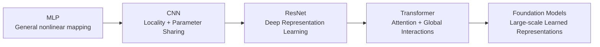

# فصل ۱۰: شبکه‌های کانولوشنی (Convolutional Networks)
## جلسه 1

---
## از پرسپترون چندلایه تا معماری‌های مدرن یادگیری عمیق

---

### اهداف یادگیری

پس از این جلسه، دانشجویان باید بتوانند:

* گردش کار کامل آموزش یک شبکهٔ عصبی در PyTorch را مرور کنند؛
* یک پرسپترون چندلایه (MLP) برای دسته‌بندی تصویر بسازند و آموزش دهند؛
* بازنمایی‌های لایه‌های پنهان را به‌عنوان ویژگی‌های یادگرفته‌شده درک کنند؛
* بازنمایی‌های یادگرفته‌شده را با نمودار فعال‌سازی‌ها و روش t-SNE مصورسازی کنند؛
* توضیح دهند که چرا یک MLP می‌تواند تصاویر را با موفقیت دسته‌بندی کند؛
* محدودیت‌های معماری تمام‌متصل (Fully connected) را برای داده‌های مکانی تشخیص دهند؛
* نوآوری اصلی شبکه‌های کانولوشنی (CNN) را درک کنند: اتصال محلی (Local connectivity) و اشتراک پارامتر (Parameter sharing)؛
* ارتباط میان کانولوشن و هم‌وردایی نسبت به انتقال (Translation equivariance) را توضیح دهند؛
* درک کنند که چرا انواع مختلف داده، انگیزهٔ طراحی معماری‌های متفاوت یادگیری عمیق هستند؛
* سیر تکامل از MLP به CNN، شبکه‌های ResNet، ترنسفورمرها (Transformers) و مدل‌های مولد/پایه‌ای مدرن را ببینند.

---

## چرا معماری‌های جدید یادگیری عمیق را مطالعه می‌کنیم؟

در درس قبلی، یعنی شبکه‌های عصبی، پرسپترون‌های چندلایه (MLP) را مطالعه کردیم، از جمله:

* انتشار رو به جلو (Forward propagation)؛
* پس‌انتشار (Backpropagation)؛
* بهینه‌سازی؛
* منظم‌سازی (Regularization)؛
* دسته‌بندی و رگرسیون؛
* شبکه‌های تمام‌متصل کم‌عمق و عمیق.

یک MLP به‌خودی‌خود یک تقریب‌زنندهٔ قدرتمند توابع غیرخطی است. بنابراین یک سؤال مهم پیش می‌آید:

> [!question] پرسش
> **اگر یک MLP همین حالا هم می‌تواند مسئلهٔ دسته‌بندی تصویر را حل کند، چرا به CNNها، ResNetها، ترنسفورمرها و دیگر معماری‌های مدرن نیاز داریم؟**

برای پاسخ به این سؤال، از یک مسئلهٔ کامل دسته‌بندی تصویر شروع می‌کنیم.

نکتهٔ مهم این است که **نباید** کار را با این ادعا شروع کنیم که MLPها برای تصاویر به‌سادگی «کار نمی‌کنند».

آن‌ها کار می‌کنند.

سؤال عمیق‌تر این است:

> [!question] پرسش
> **شبکهٔ MLP از کدام ساختار داده بهره می‌گیرد و کدام ساختار را نادیده می‌گیرد؟**

این سؤال ما را به یکی از ایده‌های محوری یادگیری عمیق مدرن می‌رساند:

**<center><font color="#ffc000">معماری، سوگیری استقرایی مدل را تعیین می‌کند</font></center>**

معماری‌های مختلف طوری طراحی شده‌اند که از انواع مختلف ساختار در داده بهره بگیرند.

---

## یک مثال کامل از MLP: دسته‌بندی ارقام MNIST

کار را با مجموعه‌دادهٔ ارقام دست‌نویس MNIST شروع می‌کنیم.

مجموعه‌دادهٔ MNIST شامل تصاویر سیاه‌وسفید (خاکستری) از ارقام دست‌نویس ۰ تا ۹ است.

اندازهٔ هر تصویر برابر است با:

$$
28\times28
$$

و بنابراین شامل

$$
28\times28=784
$$

مقدار پیکسل است.

مسئلهٔ دسته‌بندی به این صورت است:

$$
f_\theta(X)=y
$$

که در آن

$$
X\in\mathbb{R}^{28\times28}
$$

یک تصویر است و

$$
y\in\{0,1,\ldots,9\}
$$

کلاس آن است.

---

## بارگذاری مجموعه‌داده

کد زیر مجموعه‌دادهٔ MNIST را با PyTorch بارگذاری می‌کند و در صورت در دسترس بودن CUDA، به‌طور خودکار از GPU استفاده می‌کند.

```python
import torch
import torch.nn as nn
import matplotlib.pyplot as plt

from torchvision import datasets, transforms
from torch.utils.data import DataLoader

from sklearn.manifold import TSNE


# Select device
device = torch.device(
    "cuda" if torch.cuda.is_available()
    else "cpu"
)

print("Using device:", device)


# Transform images to tensors
transform = transforms.ToTensor()


# Training dataset
train_dataset = datasets.MNIST(
    root="./data",
    train=True,
    download=True,
    transform=transform
)


# Test dataset
test_dataset = datasets.MNIST(
    root="./data",
    train=False,
    download=True,
    transform=transform
)


print("Training samples:", len(train_dataset))
print("Test samples:", len(test_dataset))
```

مجموعهٔ آموزش شامل ۶۰٬۰۰۰ تصویر و مجموعهٔ آزمون شامل ۱۰٬۰۰۰ تصویر است.

می‌توانیم یکی از تصاویر را بررسی کنیم:

```python
image, label = train_dataset[0]

print("Image shape:", image.shape)
print("Label:", label)

plt.imshow(
    image.squeeze(),
    cmap="gray"
)

plt.title(f"Digit = {label}")
plt.axis("off")
plt.show()
```


شکل (ابعاد) تصویر برابر است با

$$
[1,28,28]
$$

که بُعد اول نشان‌دهندهٔ کانال خاکستری است.

---

## ساخت DataLoaderها

داده را به دسته‌های کوچک (Mini-batch) تقسیم می‌کنیم:

```python
train_loader = DataLoader(
    train_dataset,
    batch_size=64,
    shuffle=True
)

test_loader = DataLoader(
    test_dataset,
    batch_size=64,
    shuffle=False
)


images, labels = next(iter(train_loader))

print("Batch image shape:", images.shape)
print("Batch label shape:", labels.shape)
```

شکل این دسته برابر است با

$$
[64,1,28,28].
$$

بُعد اول، اندازهٔ دسته (Batch size) است.

---

## چرا تصویر باید برای MLP مسطح شود؟

یک لایهٔ تمام‌متصل انتظار دارد ورودی‌اش یک بردار باشد.

بنابراین تصویر

$$
X\in\mathbb{R}^{28\times28}
$$

به بردار زیر تبدیل می‌شود:

$$
x=\operatorname{vec}(X)\in\mathbb{R}^{784}.
$$

برای مثال،

$$
X=
\begin{bmatrix}
1&2&3\\
4&5&6\\
7&8&9
\end{bmatrix}
$$

را می‌توان به این صورت نمایش داد:

$$
x=
[1,2,3,4,5,6,7,8,9]^T.
$$

در PyTorch:

```python
images = images.view(
    images.size(0),
    -1
)

print(images.shape)
```

شکل داده به این صورت درمی‌آید:

```text
[64, 784]
```

این عملیات برای MLP لازم است، اما بلافاصله یک سؤال مهم را مطرح می‌کند:

> [!question] پرسش
> **با مسطح کردن (Flattening) تصویر، چه اطلاعاتی را تغییر داده‌ایم؟**

پاسخ این است که سازمان‌دهی مکانی دوبُعدی تصویر دیگر به‌طور صریح نمایش داده نمی‌شود.

شبکهٔ MLP ۷۸۴ عدد دریافت می‌کند، اما به‌طور صریح به آن گفته نمی‌شود که برخی از این اعداد مربوط به پیکسل‌های همسایه هستند.

---

## ساخت MLP

شبکهٔ زیر را می‌سازیم:

```text
784
 ↓
256
 ↓
128
 ↓
10
```

به زبان ریاضی:

$$
h_1=\operatorname{ReLU}(W_1x+b_1)
$$

$$
h_2=\operatorname{ReLU}(W_2h_1+b_2)
$$

$$
z=W_3h_2+b_3
$$

که در آن بردار $z\in\mathbb{R}^{10}$ شامل لاجیت‌های (Logits) کلاس‌هاست.

شبکهٔ MLP را می‌توان به این صورت پیاده‌سازی کرد:

```python
class MLP(nn.Module):

    def __init__(self):

        super().__init__()

        self.fc1 = nn.Linear(784, 256)
        self.fc2 = nn.Linear(256, 128)
        self.fc3 = nn.Linear(128, 10)

    def forward(self, x):

        x = x.view(x.size(0), -1)

        h1 = torch.relu(
            self.fc1(x)
        )

        h2 = torch.relu(
            self.fc2(h1)
        )

        out = self.fc3(h2)

        return out


model = MLP().to(device)

print(model)
```

```text
MLP(
  (fc1): Linear(in_features=784, out_features=256, bias=True)
  (fc2): Linear(in_features=256, out_features=128, bias=True)
  (fc3): Linear(in_features=128, out_features=10, bias=True)
)
```
---

## آموزش MLP

از تابع زیان آنتروپی متقاطع (Cross-entropy) استفاده می‌کنیم:

$$
L=-\sum_i y_i\log p_i
$$

که در آن احتمال‌های خروجی با استفاده از تابع سافت‌مکس (Softmax) از لاجیت‌ها به دست می‌آیند:

$$
p_i=
\frac{e^{z_i}}
{\sum_j e^{z_j}}.
$$

در PyTorch، کلاس `CrossEntropyLoss` عملیات لازم مربوط به سافت‌مکس را به‌صورت درونی انجام می‌دهد؛ بنابراین لاجیت‌های خام را مستقیماً به تابع زیان می‌دهیم.

```python
criterion = nn.CrossEntropyLoss()

optimizer = torch.optim.Adam(
    model.parameters(),
    lr=0.001
)

num_epochs = 10

train_loss_history = []
test_loss_history = []

train_acc_history = []
test_acc_history = []
```

یک تابع ارزیابی تعریف می‌کنیم:

```python
def evaluate(model, data_loader, criterion, device):

    model.eval()

    total_loss = 0.0
    correct = 0
    total = 0

    with torch.no_grad():

        for images, labels in data_loader:

            images = images.to(device)
            labels = labels.to(device)

            outputs = model(images)

            loss = criterion(
                outputs,
                labels
            )

            total_loss += (
                loss.item() * labels.size(0)
            )

            predictions = outputs.argmax(dim=1)

            correct += (
                predictions == labels
            ).sum().item()

            total += labels.size(0)

    average_loss = total_loss / total
    accuracy = correct / total

    return average_loss, accuracy
```

اکنون می‌توانیم شبکه را آموزش دهیم:

```python
for epoch in range(num_epochs):

    model.train()

    total_loss = 0.0
    correct = 0
    total = 0

    for images, labels in train_loader:

        images = images.to(device)
        labels = labels.to(device)

        outputs = model(images)

        loss = criterion(
            outputs,
            labels
        )

        optimizer.zero_grad()

        loss.backward()

        optimizer.step()

        total_loss += (
            loss.item() * labels.size(0)
        )

        predictions = outputs.argmax(dim=1)

        correct += (
            predictions == labels
        ).sum().item()

        total += labels.size(0)

    train_loss = total_loss / total
    train_accuracy = correct / total

    test_loss, test_accuracy = evaluate(
        model,
        test_loader,
        criterion,
        device
    )

    train_loss_history.append(train_loss)
    test_loss_history.append(test_loss)

    train_acc_history.append(train_accuracy)
    test_acc_history.append(test_accuracy)

    print(
        f"Epoch {epoch+1:02d}/{num_epochs} | "
        f"Train Loss: {train_loss:.4f} | "
        f"Train Acc: {train_accuracy:.4f} | "
        f"Test Loss: {test_loss:.4f} | "
        f"Test Acc: {test_accuracy:.4f}"
    )
```

یک MLP معمولی می‌تواند روی MNIST به دقت آزمون تقریباً ۹۷ تا ۹۸ درصد برسد، هرچند نتیجهٔ دقیق به مقداردهی اولیه، سخت‌افزار و جزئیات آموزش بستگی دارد.

```text
Epoch 01/10 | Train Loss: 0.2870 | Train Acc: 0.9178 | Test Loss: 0.1400 | Test Acc: 0.9574
Epoch 02/10 | Train Loss: 0.1072 | Train Acc: 0.9674 | Test Loss: 0.0922 | Test Acc: 0.9719
Epoch 03/10 | Train Loss: 0.0714 | Train Acc: 0.9776 | Test Loss: 0.0787 | Test Acc: 0.9755
Epoch 04/10 | Train Loss: 0.0521 | Train Acc: 0.9836 | Test Loss: 0.0740 | Test Acc: 0.9759
Epoch 05/10 | Train Loss: 0.0392 | Train Acc: 0.9874 | Test Loss: 0.0759 | Test Acc: 0.9776
Epoch 06/10 | Train Loss: 0.0306 | Train Acc: 0.9907 | Test Loss: 0.0839 | Test Acc: 0.9771
Epoch 07/10 | Train Loss: 0.0255 | Train Acc: 0.9916 | Test Loss: 0.0809 | Test Acc: 0.9785
Epoch 08/10 | Train Loss: 0.0213 | Train Acc: 0.9927 | Test Loss: 0.0823 | Test Acc: 0.9798
Epoch 09/10 | Train Loss: 0.0169 | Train Acc: 0.9942 | Test Loss: 0.0787 | Test Acc: 0.9797
Epoch 10/10 | Train Loss: 0.0156 | Train Acc: 0.9946 | Test Loss: 0.0972 | Test Acc: 0.9774
```

---

## بررسی تاریخچهٔ آموزش

می‌توانیم منحنی‌های زیان را مصورسازی کنیم:

```python
epochs = range(1, num_epochs + 1)

plt.figure(figsize=(8, 5))

plt.plot(
    epochs,
    train_loss_history,
    label="Train Loss"
)

plt.plot(
    epochs,
    test_loss_history,
    label="Test Loss"
)

plt.xlabel("Epoch")
plt.ylabel("Loss")
plt.title("Training and Test Loss")

plt.legend()
plt.grid(True)

plt.show()
```


و منحنی‌های دقت:

```python
plt.figure(figsize=(8, 5))

plt.plot(
    epochs,
    train_acc_history,
    label="Train Accuracy"
)

plt.plot(
    epochs,
    test_acc_history,
    label="Test Accuracy"
)

plt.xlabel("Epoch")
plt.ylabel("Accuracy")
plt.title("Training and Test Accuracy")

plt.legend()
plt.grid(True)

plt.show()
```


این نمودارها مروری بر مفاهیم درس قبل هستند:

* بهینه‌سازی؛
* همگرایی (Convergence)؛
* تعمیم (Generalization)؛
* بیش‌برازش (Overfitting)؛
* ظرفیت مدل (Model capacity).

> [!warning] توجه
> برای نمایش در کلاس، تاریخچهٔ آزمون را رسم می‌کنیم. اما در یک گردش کار آزمایشی دقیق، معمولاً باید برای انتخاب مدل از یک مجموعهٔ اعتبارسنجی (Validation set) استفاده کرد و مجموعهٔ آزمون را برای ارزیابی نهایی کنار گذاشت.

---

## شبکهٔ MLP کار می‌کند؛ پس چرا به CNN نیاز داریم؟

این نکتهٔ کلیدی است.

شبکهٔ MLP مسئلهٔ دسته‌بندی MNIST را با موفقیت یاد گرفته است.

بنابراین **نباید** بگوییم:

> «شبکه‌های MLP نمی‌توانند تصاویر را دسته‌بندی کنند.»

این گزاره نادرست است.

در عوض، بپرسیم:

> [!question] پرسش
> **شبکهٔ MLP چه چیزهایی را باید از صفر یاد بگیرد که ما از قبل دربارهٔ تصاویر می‌دانیم؟**

ما پیش از شروع آموزش، چند واقعیت مهم دربارهٔ تصاویر می‌دانیم:

* پیکسل‌های نزدیک به هم معمولاً با هم مرتبط‌اند؛
* الگوهای بصری معنادار اغلب محلی هستند؛
* لبه‌ها و شکل‌های ساده اهمیت دارند؛
* یک الگوی بصری یکسان می‌تواند در مکان‌های مختلف زیادی ظاهر شود؛
* جابه‌جایی اندک یک شیء معمولاً نباید هویت آن را تغییر دهد.

یک MLP معمولی این واقعیت‌ها را به‌طور صریح در خود رمزگذاری نمی‌کند.

> [!note] نکتهٔ کلیدی
> انگیزهٔ واقعی شبکه‌های کانولوشنی همین است.

---

## یادگیری بازنمایی (Representation Learning)

پیش از بحث دربارهٔ CNNها، مفید است بررسی کنیم که MLP واقعاً چه چیزی یاد گرفته است.

شبکه را می‌توان به این صورت دید:

$$
x
\rightarrow
h_1
\rightarrow
h_2
\rightarrow
\hat y.
$$

که در آن

$$
h_1\in\mathbb{R}^{256}
$$

و

$$
h_2\in\mathbb{R}^{128}.
$$

این بردارهای پنهان، بازنمایی‌های یادگرفته‌شده از ورودی هستند.

بنابراین یادگیری عمیق را می‌توان یادگیری دنباله‌ای از بازنمایی‌ها دانست:

$$
\boxed{
\text{ورودی}
\rightarrow
\text{بازنمایی}
\rightarrow
\text{بازنمایی سطح بالاتر}
\rightarrow
\text{پیش‌بینی}
}
$$

> [!note] نکتهٔ کلیدی
> این ایده در سراسر این درس نقشی محوری خواهد داشت.

---

## استخراج بازنمایی‌های پنهان

می‌توانیم دو بازنمایی پنهان را به‌طور صریح استخراج کنیم:

```python
def get_representations(model, x):

    x = x.view(
        x.size(0),
        -1
    )

    h1 = torch.relu(
        model.fc1(x)
    )

    h2 = torch.relu(
        model.fc2(h1)
    )

    out = model.fc3(h2)

    return h1, h2, out
```

برای یک تصویر آزمون:

```python
image, label = test_dataset[0]

image = image.unsqueeze(0)
image = image.to(device)

model.eval()

with torch.no_grad():

    h1, h2, output = get_representations(
        model,
        image
    )

print("First hidden representation:", h1.shape)
print("Second hidden representation:", h2.shape)
print("Output:", output.shape)
```

نتیجه به این صورت است:

```text
First hidden representation:  [1, 256]
Second hidden representation: [1, 128]
Output:                       [1, 10]
```

---

## مصورسازی فعال‌سازی‌های پنهان

بازنمایی پنهان اول را می‌توان به این صورت مصورسازی کرد:

```python
plt.figure(figsize=(10, 4))

plt.plot(
    h1.detach()
      .cpu()
      .numpy()
      .flatten()
)

plt.xlabel("Neuron")
plt.ylabel("Activation")

plt.title(
    "First Hidden-Layer Representation"
)

plt.grid(True)

plt.show()
```

به همین ترتیب:

```python
plt.figure(figsize=(10, 4))

plt.plot(
    h2.detach()
      .cpu()
      .numpy()
      .flatten()
)

plt.xlabel("Neuron")
plt.ylabel("Activation")

plt.title(
    "Second Hidden-Layer Representation"
)

plt.grid(True)

plt.show()
```


نورون‌های مختلف به تصاویر ورودی مختلف پاسخ‌های متفاوتی می‌دهند.

این موضوع یک ایدهٔ مهم را نشان می‌دهد:

> [!note] نکتهٔ کلیدی
> **شبکه صرفاً برچسب‌های کلاس را حفظ نمی‌کند؛ بلکه بازنمایی‌های درونی‌ای می‌سازد که دسته‌بندی را ممکن می‌کنند.**

---

## مصورسازی فضای ویژگی یادگرفته‌شده

می‌توانیم بازنمایی پنهان دوم را برای همهٔ تصاویر آزمون استخراج کنیم.

```python
features = []
all_labels = []

model.eval()

with torch.no_grad():

    for images, labels in test_loader:

        images = images.to(device)

        _, h2, _ = get_representations(
            model,
            images
        )

        features.append(
            h2.cpu()
        )

        all_labels.append(
            labels
        )

features = torch.cat(features)
all_labels = torch.cat(all_labels)

print("Feature matrix:", features.shape)
```

نتیجه تقریباً به این صورت است:

```text
Feature matrix: [10000, 128]
```

اکنون هر تصویر از یک بردار پیکسلی ۷۸۴ بُعدی به یک بازنمایی یادگرفته‌شدهٔ ۱۲۸ بُعدی تبدیل شده است.

---

## مصورسازی با t-SNE

برای مصورسازی این بازنمایی با ابعاد بالا، می‌توانیم از روش t-SNE استفاده کنیم.

```python
from sklearn.manifold import TSNE

Z = TSNE(
    n_components=2,
    random_state=42
).fit_transform(
    features.numpy()
)
```

سپس:

```python
plt.figure(figsize=(9, 7))

scatter = plt.scatter(
    Z[:, 0],
    Z[:, 1],
    c=all_labels.numpy(),
    cmap="tab10",
    s=5
)

plt.xlabel("t-SNE Dimension 1")
plt.ylabel("t-SNE Dimension 2")

plt.title(
    "t-SNE Visualization of Learned MLP Representations"
)

plt.colorbar(
    scatter,
    label="Digit Class"
)

plt.show()
```

اگر بازنمایی برای دسته‌بندی مفید باشد، نمونه‌های متعلق به کلاس‌های مختلف ارقام اغلب نواحی نسبتاً جدا از هم تشکیل می‌دهند.

تفسیر مهم این است:

$$
\text{پیکسل‌ها}
\rightarrow
\text{بازنمایی یادگرفته‌شدهٔ 128 بُعدی}
\rightarrow
\text{جدایی کلاس‌ها}
$$

> [!warning] توجه
> روش t-SNE فقط یک تکنیک مصورسازی است. نباید آن را نمایشی دقیق از هندسهٔ سراسری فضای ویژگی یادگرفته‌شده تفسیر کرد.

---

## از یادگیری بازنمایی تا طراحی معماری

اکنون دیدیم که MLP می‌تواند بازنمایی‌های مفیدی یاد بگیرد.

پس سؤال جالب‌تر می‌شود:

> [!question] پرسش
> **آیا می‌توانیم معماری‌ای طراحی کنیم که با استفاده از آنچه از قبل دربارهٔ تصاویر می‌دانیم، بازنمایی‌های تصویری را کارآمدتر یاد بگیرد؟**

بله.

اینجاست که **سوگیری استقرایی** (Inductive bias) اهمیت پیدا می‌کند.

---

## سوگیری استقرایی چیست؟

سوگیری استقرایی مجموعه‌ای از فرض‌هاست که در یک الگوریتم یادگیری یا مدل گنجانده شده و بر نوع جواب‌هایی که مدل ترجیح می‌دهد اثر می‌گذارد.

برای مثال:

| مدل                  | سوگیری استقرایی مهم                         |
| -------------------- | ------------------------------------------- |
| مدل خطی              | روابط تقریباً خطی                           |
| شبکهٔ MLP            | برهم‌کنش‌های غیرخطی عمومی                   |
| شبکهٔ CNN            | الگوهای مکانی محلی و آشکارسازهای مشترک      |
| ترنسفورمر            | برهم‌کنش میان عناصر از طریق سازوکار توجه    |
| شبکهٔ عصبی گرافی (GNN) | روابطی که ساختار گراف تعریف می‌کند         |

هدف، حذف یادگیری نیست.

بلکه:

> [!note] نکتهٔ کلیدی
> **دانش پیشین مفید را در معماری می‌گنجانیم تا مدل مجبور نباشد آن را دوباره از داده کشف کند.**

این یکی از مهم‌ترین ایده‌ها در یادگیری عمیق مدرن است.

---

## شبکهٔ MLP دربارهٔ یک تصویر چه فرضی دارد؟

لایهٔ اول MLP را در نظر بگیرید:

$$
h_1=\operatorname{ReLU}(W_1x+b_1)
$$

که در آن

$$
x\in\mathbb{R}^{784}.
$$

هر نورون پنهان به‌طور بالقوه می‌تواند به همهٔ پیکسل‌ها متصل باشد.

برای مثال:

```text
Image

┌────────────────────────────┐
│                            │
│          pixels            │
│                            │
│                            │
└────────────────────────────┘
             ↓
       Fully connected
             ↓
       Hidden neuron
```

بنابراین MLP به‌طور صریح میان این موارد تمایز قائل نمی‌شود:

* پیکسل‌های نزدیک؛
* پیکسل‌های دور؛
* الگوهای تکراری؛
* مکان‌های مکانی مختلف.

همهٔ اتصال‌ها به‌طور مستقل یاد گرفته می‌شوند.

---

## محدودیت اول: ساختار مکانی

یک لبهٔ کوچک در تصویر را در نظر بگیرید.

یک لبه عمدتاً توسط پیکسل‌های همسایه تعیین می‌شود.

برای مثال، الگوی

```text
0 0 1
0 0 1
0 0 1
```

شامل یک گذار عمودی است.

منطقی نیست که رابطهٔ میان این پیکسل‌های همسایه را دقیقاً مانند رابطهٔ میان دو پیکسل در گوشه‌های مقابل تصویر در نظر بگیریم.

با این حال، MLP همهٔ ۷۸۴ مقدار را عناصر یک بردار واحد می‌بیند.

ساختار مکانی به‌طور صریح رمزگذاری نشده است.

---

## محدودیت دوم: انفجار تعداد پارامترها

یک تصویر رنگی RGB بزرگ‌تر را در نظر بگیرید:

$$
224\times224\times3.
$$

تعداد مقادیر ورودی برابر است با

$$
224\times224\times3=150,528.
$$

فرض کنید لایهٔ اول MLP شامل ۱٬۰۰۰ نورون باشد.

تعداد وزن‌ها برابر است با:

$$
150,528\times1000
=
150,528,000.
$$

یعنی بیش از ۱۵۰ میلیون وزن فقط در یک لایه.

مشکل صرفاً هزینهٔ محاسباتی نیست.

> [!note] نکتهٔ کلیدی
> مشکل عمیق‌تر این است که MLP از هر پیکسل ورودی به هر نورون، یک اتصال جداگانه یاد می‌گیرد.

---

## محدودیت سوم: نبود اشتراک پارامتر

فرض کنید یک لبهٔ عمودی در سمت چپ یک تصویر ظاهر شود.

سپس همان لبه در تصویر دیگری در سمت راست ظاهر شود.

یک مدل تصویری مفید باید بتواند الگوی یکسان را در هر دو جا تشخیص دهد.

یک MLP معمولی این الزام را به‌طور صریح تحمیل نمی‌کند.

این شبکه وزن‌هایی وابسته به مکان یاد می‌گیرد.

شبکه‌های کانولوشنی ایده‌ای کاملاً متفاوت را معرفی می‌کنند:

> [!tip] ایدهٔ اصلی
> **یک آشکارساز را یاد بگیر و آن را در مکان‌های مختلف تصویر دوباره به کار ببر.**

به این ایده **اشتراک پارامتر** (Parameter sharing) می‌گویند.

---

## نوآوری محوری CNNها

یک فیلتر کانولوشنی می‌تواند ماتریس کوچکی مانند

$$
3\times3.
$$

باشد. برای مثال:

$$
K=
\begin{bmatrix}
-1&0&1\\
-1&0&1\\
-1&0&1
\end{bmatrix}.
$$

این فیلتر روی نواحی محلی مختلف تصویر اعمال می‌شود.

به‌صورت مفهومی:

```text
             Same filter
                  ↓
       ┌───────────────────┐
       │ Image             │
       │                   │
       │  [patch]          │
       │                   │
       │          [patch]  │
       │                   │
       │     [patch]       │
       │                   │
       └───────────────────┘
          ↓       ↓       ↓
        response response response
```

پارامترهای یکسان در هر مکان دوباره استفاده می‌شوند.

بنابراین شبکه به‌جای یادگرفتن اینکه:

> «چگونه این الگو را مشخصاً در موقعیت $(i,j)$ تشخیص دهم؟»

یاد می‌گیرد که:

> **«این الگو، هر جا که ظاهر شود، چه شکلی دارد؟»**

> [!note] نکتهٔ کلیدی
> این ایدهٔ بنیادی پشت شبکه‌های عصبی کانولوشنی است.

---

## نوآوری اول CNN: اتصال محلی

هر نورون کانولوشنی فقط یک ناحیهٔ محلی از ورودی را می‌بیند.

برای یک هسته (Kernel) با اندازهٔ $3\times3$:

$$
\boxed{\text{میدان پذیرش}=3\times3}
$$

به‌جای کل تصویر. به این ناحیه میدان پذیرش (Receptive field) می‌گویند.

بنابراین

$$
\boxed{\text{اتصال محلی}}
$$

این فرض را رمزگذاری می‌کند که پیکسل‌های نزدیک به هم ارتباط قوی‌ای با یکدیگر دارند.

---

## نوآوری دوم CNN: اشتراک پارامتر

هستهٔ یکسان در سراسر تصویر اعمال می‌شود.

بنابراین

$$
\boxed{\text{اشتراک پارامتر}}
$$

به شبکه اجازه می‌دهد الگوی یکسان را در مکان‌های مختلف تشخیص دهد.

این کار تعداد پارامترها را به‌شدت کاهش می‌دهد.

برای یک تصویر تک‌کاناله، ۳۲ فیلتر با اندازهٔ $3\times3$ فقط به

$$
3\times3\times1\times32+32
=
320
$$

پارامتر نیاز دارند.

این را با لایهٔ اول MLP مقایسه کنید:

$$
784\times256+256
=
200,960.
$$

بنابراین:

$$
\boxed{
\text{لایهٔ اول MLP: }200,960
}
$$

در مقابل

$$
\boxed{
\text{لایهٔ کانولوشنی CNN: }320
}
$$

برای این معماری‌های خاص.

> [!success] نتیجه
> بنابراین CNN یک سوگیری استقرایی مکانی قوی را وارد می‌کند و در عین حال در مرحلهٔ استخراج ویژگی از پارامترهای بسیار کمتری استفاده می‌کند.

---

## نوآوری سوم CNN: هم‌وردایی نسبت به انتقال

اشتراک پارامتر به یک ویژگی ریاضی مهم منجر می‌شود.

فرض کنید $T_\tau$ نمایانگر انتقال (جابه‌جایی) به اندازهٔ $\tau$ و $C$ نمایانگر کانولوشن باشد.

تحت شرایط ایدئال کانولوشن:

$$
\boxed{
C(T_\tau x)=T_\tau C(x)
}
$$

این یعنی اگر یک الگو در ورودی جابه‌جا شود، فعال‌سازی متناظر با آن نیز در نقشهٔ ویژگی (Feature map) خروجی جابه‌جا می‌شود. به این ویژگی هم‌وردایی (Equivariance) می‌گویند.

برای مثال:

```text
Input 1                         Input 2

    edge                            edge
     ↓                               ↓

┌─────────────┐                 ┌─────────────┐
│             │                 │             │
│   vertical  │                 │      │      │
│     edge    │                 │      │      │
│             │                 │             │
└─────────────┘                 └─────────────┘

       ↓                               ↓

Feature map                     Feature map

    edge                            edge
     ↓                               ↓
   same detector                same detector
```

خود آشکارساز تغییر نمی‌کند.

فقط پاسخ مکانی آن تغییر می‌کند.

> [!note] نکتهٔ کلیدی
> این چیزی بسیار فراتر از یک ترفند محاسباتی است: یک فرض پیشین معماری (Architectural prior) دربارهٔ تصاویر است.

اثرات مرزی، لایه‌گذاری (Padding)، گام (Stride) و ادغام (Pooling) در لایه‌های بعدی می‌توانند هم‌وردایی دقیق را تغییر دهند، اما خود عملیات کانولوشن سازوکار ریاضی بنیادی آن را فراهم می‌کند.

---

## مقایسهٔ MLP و CNN

اکنون می‌توان تفاوت‌ها را این‌گونه خلاصه کرد:

| ویژگی                                 | MLP                    | CNN                                |
| ------------------------------------- | ---------------------- | ---------------------------------- |
| نمایش ورودی                           | بردار مسطح‌شده          | تانسور مکانی                        |
| اتصال محلی                            | بدون قید صریح           | دارد                               |
| اشتراک پارامتر                        | ندارد                   | دارد                               |
| ساختار مکانی                          | به‌طور صریح رمزگذاری نشده | به‌طور صریح رمزگذاری شده            |
| آشکارساز یکسان در مکان‌های مختلف       | در ساختار تعبیه نشده    | در ساختار تعبیه شده                 |
| هم‌وردایی نسبت به انتقال              | در ساختار تعبیه نشده    | پیامد طبیعی کانولوشن               |
| کارایی پارامتری برای تصاویر           | نسبتاً ضعیف             | بالا                               |
| سوگیری استقرایی ویژهٔ تصویر           | ضعیف                   | قوی                                |

نکتهٔ مهم این نیست که:

> شبکه‌های CNN همیشه از MLPها بهترند.

بلکه:

> [!note] نکتهٔ کلیدی
> **شبکه‌های CNN فرض‌هایی را در خود دارند که به‌ویژه برای داده‌های مکانی مانند تصاویر مناسب‌اند.**

---

## از CNNها تا معماری‌های مدرن

وقتی CNNها را درک کنیم، الگویی بسیار گسترده‌تر نمایان می‌شود.

هر معماری عصبی را می‌توان راهی برای رمزگذاری فرض‌هایی دربارهٔ ساختار داده دانست.

برای تصاویر:

$$
\text{محلی بودن مکانی}
\rightarrow
\text{CNN}
$$

برای CNNهای بسیار عمیق، مشکل دیگری ظاهر می‌شود: بهینه‌سازی و انتشار اطلاعات از میان لایه‌های بسیار زیاد.

این موضوع انگیزهٔ این گذار است:

$$
\text{CNN}
\rightarrow
\text{شبکهٔ باقیمانده}
$$

برای داده‌های ترتیبی یا مجموعه‌ای، ممکن است سازوکاری بخواهیم که روابط میان عناصر را مستقیماً مدل کند.

این موضوع انگیزهٔ این گذار است:

$$
\text{سازوکار توجه}
\rightarrow
\text{ترنسفورمر}
$$

برای گراف‌ها:

$$
\text{ساختار گراف}
\rightarrow
\text{شبکهٔ عصبی گرافی}
$$

برای یادگیری توزیع‌های احتمال و تولید داده:

$$
\text{بازنمایی پنهان}
\rightarrow
\text{VAE/GAN/Flow/Diffusion}
$$

و این ایده‌ها در نهایت به شکل‌گیری مدل‌های پایه (Foundation models) مدرن کمک می‌کنند.

---

## تکامل معماری‌های یادگیری عمیق



> [!warning] توجه
> این نمودار را نباید این‌گونه تفسیر کرد که هر معماری به‌طور کامل جایگزین معماری قبلی شده است.

بلکه هر معماری سازوکارهایی را معرفی کرد که برای ساختارها و مسائل خاصی به‌ویژه مفید بودند.

سیر تکامل کلی به این صورت است:

$$
\boxed{
\text{معماری}
\rightarrow
\text{سوگیری استقرایی}
\rightarrow
\text{بازنمایی}
\rightarrow
\text{یادگیری}
}
$$

---

## پرسش محوری این درس

بنابراین پرسش محوری این درس صرفاً این نیست که:

> «معماری بعدی شبکهٔ عصبی چیست؟»

بلکه بارها این سؤال را می‌پرسیم:

> [!question] پرسش
> **داده چه ساختاری دارد و معماری چگونه می‌تواند از آن ساختار بهره بگیرد؟**

برای مثال:

| ساختار داده/مسئله                          | معماری/سازوکار           |
| ------------------------------------------ | ------------------------ |
| برهم‌کنش‌های عمومی میان ویژگی‌ها            | MLP                      |
| محلی بودن مکانی                            | CNN                      |
| تبدیل‌های بسیار عمیق ویژگی                  | اتصال‌های باقیمانده       |
| برهم‌کنش میان عناصر دور از هم               | سازوکار توجه (Attention) |
| روابط ترتیبی/زمینه‌ای سراسری                | ترنسفورمر                |
| روابط گرافی                                | GNN                      |
| ساختار احتمالاتی پنهان                     | VAE                      |
| تولید داده                                 | GAN / Flow / Diffusion   |

> [!success] نتیجه
> این دیدگاه به ما کمک می‌کند معماری‌های مدرن را به‌عنوان **راه‌حل‌هایی اصولی برای مسائل یادگیری مختلف** درک کنیم، نه مجموعه‌ای از مدل‌های بی‌ارتباط با یکدیگر.
