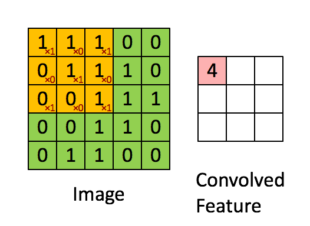
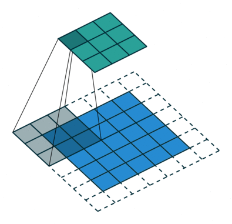
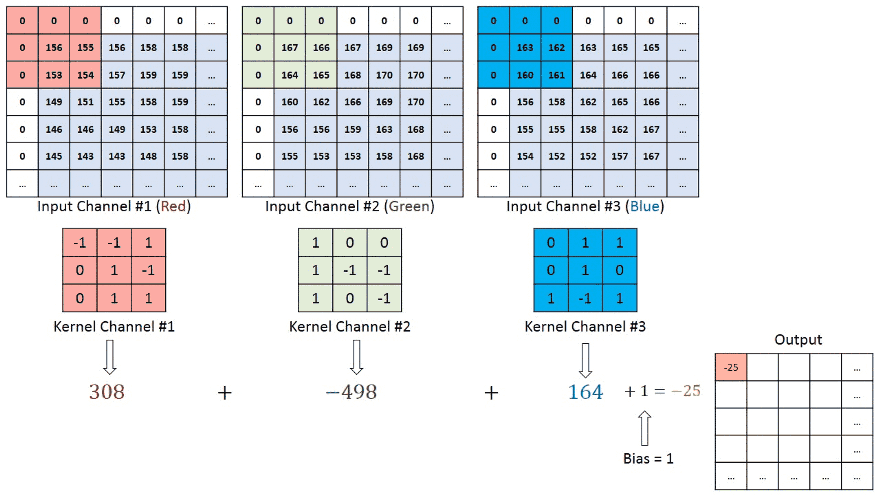

# فصل ۱۰: شبکه‌های کانولوشنی ( ادامه...)
## جلسه 4
---
## شبکه‌های کانولوشنی دوبعدی (2D Convolutional Networks)

## لایهٔ کانولوشنی دوبعدی

یک **لایهٔ کانولوشنی دوبعدی** (2D Convolutional Layer) یک **هسته** (Kernel) کوچک دوبعدی را روی نواحی محلی تصویر ورودی اعمال می‌کند و در هر موقعیت مکانی یک مجموع وزن‌دار محاسبه می‌کند.

یک تصویر ورودی را در نظر بگیرید:

$$
x \in \mathbb{R}^{H\times W},
$$

و یک هسته:

$$
\omega \in \mathbb{R}^{K_h\times K_w}.
$$

خروجی در موقعیت $(i,j)$ برابر است با:

$$
\boxed{
z_{i,j}
=
\sum_{u=1}^{K_h}
\sum_{v=1}^{K_w}
\omega_{u,v}
\,x_{\,i+u-c_h,\;j+v-c_w}
}
$$

که در آن $c_h$ و $c_w$ جابه‌جایی مرکز هسته را نشان می‌دهند.

با افزودن بایاس $\beta$ و تابع فعال‌سازی $a[\cdot]$، لایهٔ کانولوشنی این مقدار را محاسبه می‌کند:

$$
\boxed{
h_{i,j}
=
a\!\left[
\beta+
\sum_{u=1}^{K_h}
\sum_{v=1}^{K_w}
\omega_{u,v}
\,x_{\,i+u-c_h,\;j+v-c_w}
\right].
}
$$

---


### مثال

تصویر ورودی زیر را در نظر بگیرید:

$$
x=
\begin{bmatrix}
1 & 2 & 3 & 0\\
4 & 5 & 6 & 1\\
7 & 8 & 9 & 2\\
0 & 1 & 2 & 3
\end{bmatrix}
$$

و هستهٔ $2\times2$ زیر:

$$
\omega=
\begin{bmatrix}
1 & 0\\
0 & -1
\end{bmatrix}.
$$

با یک کانولوشن معتبر (Valid convolution) و **گام** (Stride) برابر با $1$، هسته روی تصویر حرکت داده می‌شود و در هر موقعیت یک مجموع وزن‌دار محاسبه می‌شود.

برای موقعیت بالا-چپ،

$$
\begin{bmatrix}
1 & 2\\
4 & 5
\end{bmatrix},
$$

خروجی برابر است با:

$$
z_{1,1}
=
1(1)+0(2)+0(4)+(-1)(5)
=
-4.
$$

برای موقعیت بعدی،

$$
\begin{bmatrix}
2 & 3\\
5 & 6
\end{bmatrix},
$$

به دست می‌آوریم:

$$
z_{1,2}
=
1(2)+0(3)+0(5)+(-1)(6)
=
-4.
$$

به همین ترتیب،

$$
z_{1,3}
=
1(3)+0(0)+0(6)+(-1)(1)
=
2.
$$

با ادامهٔ این کار روی کل تصویر، به نتیجهٔ زیر می‌رسیم:

$$
z=
\begin{bmatrix}
-4 & -4 & 2\\
-4 & -4 & 4\\
6 & 6 & 6
\end{bmatrix}.
$$

---

#### چند کانال

برای یک تصویر رنگی با $C_{\text{in}}$ **کانال** (Channel) ورودی، هر هسته برای هر کانال یک مجموعهٔ وزن جداگانه دارد:

$$
\omega
\in
\mathbb{R}^{K_h\times K_w\times C_{\text{in}}}.
$$

خروجی در موقعیت $(i,j)$ به این صورت درمی‌آید:

$$
\boxed{
z_{i,j}
=
\sum_{c=1}^{C_{\text{in}}}
\sum_{u=1}^{K_h}
\sum_{v=1}^{K_w}
\omega_{u,v,c}
\,x_{\,i+u-c_h,\;j+v-c_w,\;c}.
}
$$

با استفاده از $C_{\text{out}}$ هستهٔ مختلف، تعداد $C_{\text{out}}$ **نقشهٔ ویژگی** (Feature map) خروجی تولید می‌شود.


 

---

#### اندازهٔ خروجی

برای ورودی با ارتفاع $H$ و عرض $W$، اندازهٔ هستهٔ $K_h\times K_w$، **لایه‌گذاری** (Padding) $P_h,P_w$ و گام $S_h,S_w$ داریم:

$$
\boxed{
H_{\text{out}}
=
\left\lfloor
\frac{H+2P_h-K_h}{S_h}
\right\rfloor+1,
}
$$

$$
\boxed{
W_{\text{out}}
=
\left\lfloor
\frac{W+2P_w-K_w}{S_w}
\right\rfloor+1.
}
$$

> [!note] نکتهٔ کلیدی
> بنابراین یک لایهٔ کانولوشنی دوبعدی تصویر را به‌صورت **محلی** پردازش می‌کند و در عین حال **وزن‌های یک هستهٔ یکسان** را در همهٔ موقعیت‌های مکانی به اشتراک می‌گذارد.




---
### تعریف یک لایهٔ کانولوشنی در PyTorch

در کتابخانهٔ PyTorch، لایهٔ کانولوشنی دوبعدی با کلاس `nn.Conv2d` پیاده‌سازی می‌شود.

مثال زیر یک لایهٔ کانولوشنی با این مشخصات تعریف می‌کند:

* تعداد $3$ کانال ورودی (تصویر RGB)
* تعداد $16$ کانال خروجی
* اندازهٔ هستهٔ $3\times3$
* گام $1$
* لایه‌گذاری $1$

```python
import torch
import torch.nn as nn

conv = nn.Conv2d(
    in_channels=3,
    out_channels=16,
    kernel_size=3,
    stride=1,
    padding=1
)

print(conv)
```

```text
Conv2d(3, 16, kernel_size=(3, 3), stride=(1, 1), padding=(1, 1))
```

یک تنسور ورودی با شکل

```python
x = torch.randn(8, 3, 32, 32)
```

نشان‌دهندهٔ موارد زیر است:

* اندازهٔ دسته (Batch size) = ۸
* تعداد ۳ کانال
* ارتفاع تصویر = ۳۲
* عرض تصویر = ۳۲

این لایه را می‌توان به این صورت اعمال کرد:

```python
y = conv(x)

print(y.shape)
```

خروجی:

```text
torch.Size([8, 16, 32, 32])
```

ابعاد مکانی تغییر نمی‌کنند، زیرا

$$
H_{out}
=
\left\lfloor
\frac{H+2P-K}{S}
\right\rfloor +1
=
\left\lfloor
\frac{32+2(1)-3}{1}
\right\rfloor +1
=
32,
$$

و به همین ترتیب

$$
W_{out}=32.
$$

تعداد پارامترهای قابل آموزش برابر است با:

$$
(3\times3\times3)\times16+16
=
448.
$$

جملهٔ اول مربوط به وزن‌های کانولوشنی و جملهٔ دوم مربوط به پارامترهای بایاس است.

---

### نمونه‌برداری کاهشی

**نمونه‌برداری کاهشی** (Downsampling) اندازهٔ مکانی یک نمایش دوبعدی را کاهش می‌دهد و در عین حال اطلاعات مهم را حفظ می‌کند. اگر یک نقشهٔ ویژگی اندازهٔ $H\times W$ داشته باشد، نمونه‌برداری کاهشی نمایشی کوچک‌تر، مثلاً با اندازهٔ $H/2\times W/2$، تولید می‌کند.

روش‌های رایج عبارت‌اند از:

#### الف) زیرنمونه‌برداری (Sub-sampling)

زیرنمونه‌برداری با انتخاب مقادیر در فواصل منظم، وضوح مکانی را کاهش می‌دهد. با گام $S$، فقط هر $S$-امین موقعیت مکانی نگه داشته می‌شود.

برای مثال، با $S=2$:

$$
z_{i,j}=x_{2i,2j}.
$$

زیرنمونه‌برداری ساده است و هزینهٔ محاسباتی کمی دارد، اما چون هیچ تجمیعی انجام نمی‌دهد، ممکن است اطلاعات مهم را دور بریزد.


#### ب) ادغام بیشینه (Max Pooling)

**ادغام بیشینه** نقشهٔ ویژگی را به نواحی محلی تقسیم می‌کند و از هر ناحیه مقدار بیشینه را انتخاب می‌کند:

$$
z_{i,j}
=
\max_{(u,v)\in\mathcal{R}_{i,j}} x_{u,v}.
$$

این روش قوی‌ترین فعال‌سازی را در هر ناحیهٔ محلی حفظ می‌کند و معمولاً برای کاهش ابعاد مکانی به کار می‌رود.


#### ج) ادغام میانگین (Mean Pooling)

**ادغام میانگین** هر ناحیهٔ محلی را با مقدار میانگین آن جایگزین می‌کند:

$$
z_{i,j}
=
\frac{1}{|\mathcal{R}_{i,j}|}
\sum_{(u,v)\in\mathcal{R}_{i,j}}x_{u,v}.
$$

این روش با تجمیع اطلاعات کل ناحیهٔ محلی، نمایش هموارتری به دست می‌دهد.


---
### مثال PyTorch برای روش‌های نمونه‌برداری کاهشی

```python
import torch
import torch.nn as nn
import torch.nn.functional as F

# --------------------------------------------------
# Input: one 2D feature map
# Shape = [batch, channels, height, width]
# --------------------------------------------------

x = torch.tensor([
    [
        [
            [1.,  2.,  3.,  4.],
            [5.,  6.,  7.,  8.],
            [9., 10., 11., 12.],
            [13.,14., 15., 16.]
        ]
    ]
])

print("Input shape:", x.shape)
```

شکل خروجی:

```text
[1, 1, 4, 4]
```

#### ۱. زیرنمونه‌برداری

با ضریب ۲، از هر دو سطر یکی و از هر دو ستون یکی را نگه می‌داریم.

```python
x_sub = x[:, :, ::2, ::2]

print("Sub-sampling:")
print(x_sub[0, 0])
print("Shape:", x_sub.shape)
```

نتیجه:

```text
Sub-sampling:
tensor([[ 1.,  3.],
        [ 9., 11.]])
Shape: torch.Size([1, 1, 2, 2])
```

اندازهٔ مکانی به این صورت تغییر می‌کند:

$$
4\times4 \rightarrow 2\times2.
$$

#### ۲. ادغام بیشینه

برای یک پنجرهٔ ادغام $2\times2$ با گام ۲:

```python
max_pool = nn.MaxPool2d(
    kernel_size=2,
    stride=2
)

x_max = max_pool(x)

print("Max pooling:")
print(x_max[0, 0])
print("Shape:", x_max.shape)
```

نتیجه:

```text
Max pooling:
tensor([[ 6.,  8.],
        [14., 16.]])
Shape: torch.Size([1, 1, 2, 2])
```

هر مقدار خروجی، بیشینهٔ یک ناحیهٔ محلی $2\times2$ است.

#### ۳. ادغام میانگین

ادغام میانگین را می‌توان با `AvgPool2d` پیاده‌سازی کرد:

```python
mean_pool = nn.AvgPool2d(
    kernel_size=2,
    stride=2
)

x_mean = mean_pool(x)

print("Mean pooling:")
print(x_mean[0, 0])
print("Shape:", x_mean.shape)
```

نتیجه:

```text
Mean pooling:
tensor([[ 3.5000,  5.5000],
        [11.5000, 13.5000]])
Shape: torch.Size([1, 1, 2, 2])
```

هر مقدار خروجی، میانگین یک ناحیهٔ محلی $2\times2$ است.

هر سه روش، نمایش را از

$$
1\times1\times4\times4
$$

به

$$
1\times1\times2\times2.
$$

کاهش می‌دهند.

---


## نمونه‌برداری افزایشی

**نمونه‌برداری افزایشی** (Upsampling) وضوح مکانی یک نقشهٔ ویژگی را افزایش می‌دهد. اگر نمایش ورودی اندازهٔ $H\times W$ داشته باشد، عملیات نمونه‌برداری افزایشی نمایشی بزرگ‌تر، مثلاً با اندازهٔ $2H\times2W$، تولید می‌کند.

روش‌های رایج نمونه‌برداری افزایشی عبارت‌اند از:

#### الف) نمونه‌برداری افزایشی نزدیک‌ترین همسایه (تکثیر)

روش **نزدیک‌ترین همسایه** (Nearest-Neighbor Upsampling) وضوح مکانی را با تکرار مقادیر ورودی افزایش می‌دهد. با ضریب مقیاس $2$، هر مقدار ورودی در یک ناحیهٔ $2\times2$ از خروجی کپی می‌شود.

از نظر ریاضی:

$$
z_{2i+r,\;2j+s}
=
x_{i,j},
\qquad
r,s\in\{0,1\}.
$$

این روش از نظر محاسباتی کارآمد است، اما ممکن است خروجی‌هایی «پله‌ای» و بلوکی تولید کند.


#### ب) برگرداندن ادغام بیشینه (Max Unpooling)

عملیات **برگرداندن ادغام بیشینه** با ادغام بیشینه مرتبط است. این عملیات وضوح مکانی را با قرار دادن مقادیر ادغام‌شده در همان موقعیت‌های اصلیِ بیشینه‌شان بازمی‌گرداند؛ برای این کار از اندیس‌های ادغامی که هنگام ادغام بیشینه ثبت شده‌اند استفاده می‌کند.

فرض کنید $p_{i,j}$ یک مقدار ادغام‌شده و $m_{i,j}$ اندیس ادغام متناظر با آن باشد. نمایش برگردانده‌شده با این انتساب ساخته می‌شود:

$$
z_{m_{i,j}}
=
p_{i,j},
$$

و همهٔ موقعیت‌های باقی‌مانده برابر صفر قرار داده می‌شوند.

این روش به اندیس‌های ادغامی نیاز دارد که در مرحلهٔ ادغام متناظر تولید شده‌اند.


#### ج) درون‌یابی دوخطی (Bilinear Interpolation)

**درون‌یابی دوخطی** وضوح مکانی را با تخمین مقادیر در موقعیت‌های مکانی غیرصحیح، با استفاده از چهار پیکسل همسایهٔ نزدیک، افزایش می‌دهد.

فرض کنید یک موقعیت خروجی متناظر با مختصات پیوستهٔ ورودی

$$
(u,v),
$$

باشد و قرار دهید

$$
i=\lfloor u \rfloor,
\qquad
j=\lfloor v \rfloor.
$$

تعریف می‌کنیم

$$
\alpha=u-i,
\qquad
\beta=v-j,
$$

که در آن

$$
0\le \alpha,\beta <1.
$$

مقدار درون‌یابی‌شده به این صورت محاسبه می‌شود:

$$
\boxed{
\begin{aligned}
z(u,v)
&=
(1-\alpha)(1-\beta)x_{i,j}
\\
&\quad+
\alpha(1-\beta)x_{i+1,j}
\\
&\quad+
(1-\alpha)\beta x_{i,j+1}
\\
&\quad+
\alpha\beta x_{i+1,j+1}.
\end{aligned}
}
$$

به‌طور معادل،

$$
\boxed{
z(u,v)
=
\sum_{m=0}^{1}
\sum_{n=0}^{1}
w_{mn}\,
x_{i+m,j+n},
}
$$

که وزن‌ها عبارت‌اند از:

$$
w_{00}=(1-\alpha)(1-\beta),
$$

$$
w_{10}=\alpha(1-\beta),
$$

$$
w_{01}=(1-\alpha)\beta,
$$

$$
w_{11}=\alpha\beta.
$$

وزن‌های درون‌یابی در این شرایط صدق می‌کنند:

$$
w_{mn}\ge 0,
$$

و

$$
\sum_{m=0}^{1}\sum_{n=0}^{1}w_{mn}=1.
$$

در نتیجه، درون‌یابی دوخطی با ترکیب اطلاعات چهار پیکسل همسایه بر اساس فاصلهٔ نسبی آن‌ها از نقطهٔ درون‌یابی، تخمینی هموار تولید می‌کند.


#### د) کانولوشن ترانهاده (Transposed Convolution)

**کانولوشن ترانهاده** یک عملیات قابل یادگیری است که وضوح مکانی نقشهٔ ویژگی را افزایش می‌دهد. برخلاف روش‌های مبتنی بر درون‌یابی، این روش تبدیلِ نمونه‌برداری افزایشی را از طریق وزن‌های کانولوشنیِ قابل آموزش **یاد می‌گیرد**.

برای نقشهٔ ویژگی ورودی

$$
x\in\mathbb{R}^{H\times W},
$$

کانولوشن ترانهاده یک هستهٔ قابل یادگیری را اعمال می‌کند و خروجی‌ای با ابعاد مکانی بزرگ‌تر تولید می‌کند.

اندازهٔ خروجی آن با اندازهٔ هستهٔ $K$، گام $S$، لایه‌گذاری $P$ و لایه‌گذاری خروجی (Output padding) $P_{\text{out}}$ تعیین می‌شود:

$$
\boxed{
H_{\text{out}}
=
(H-1)S-2P+K+P_{\text{out}}
}
$$

و به همین ترتیب،

$$
\boxed{
W_{\text{out}}
=
(W-1)S-2P+K+P_{\text{out}}.
}
$$

وقتی گام بزرگ‌تر از یک باشد، این عملیات می‌تواند وضوح مکانی را افزایش دهد. وزن‌های هسته در طول آموزش یاد گرفته می‌شوند و به شبکه اجازه می‌دهند یاد بگیرد که ویژگی‌های کم‌وضوح چگونه باید به نمایش‌های پروضوح تبدیل شوند.

کانولوشن ترانهاده معمولاً در **شبکه‌های رمزگشا (Decoder)، مدل‌های مولد و معماری‌های بازسازی تصویر** به کار می‌رود.

> [!warning] مهم
> کانولوشن ترانهاده **وارون ریاضی** کانولوشن نیست. بهتر است آن را **ترانهادهٔ عملگر خطی‌ای** بدانیم که یک لایهٔ کانولوشنی نمایش می‌دهد.


### مثال PyTorch برای روش‌های نمونه‌برداری افزایشی

```python
import torch
import torch.nn as nn
import torch.nn.functional as F

# --------------------------------------------------
# Input Feature Map
# Shape = [batch, channels, height, width]
# --------------------------------------------------

x = torch.tensor([
    [
        [
            [1., 2.],
            [3., 4.]
        ]
    ]
])

print("Input")
print(x[0,0])
print("Shape:", x.shape)
```

خروجی:

```text
Input
tensor([[1., 2.],
        [3., 4.]])
Shape: torch.Size([1, 1, 2, 2])
```

---

### ۱. نمونه‌برداری افزایشی نزدیک‌ترین همسایه (تکثیر)

```python
nearest = nn.Upsample(
    scale_factor=2,
    mode='nearest'
)

x_nearest = nearest(x)

print("\nNearest Neighbor Upsampling")
print(x_nearest[0,0])
print("Shape:", x_nearest.shape)
```

خروجی:

```text
Nearest Neighbor Upsampling
tensor([[1., 1., 2., 2.],
        [1., 1., 2., 2.],
        [3., 3., 4., 4.],
        [3., 3., 4., 4.]])
Shape: torch.Size([1, 1, 4, 4])
```

هر مقدار در یک بلوک $2\times2$ تکثیر می‌شود.

---

### ۲. برگرداندن ادغام بیشینه

این روش به اندیس‌های ادغامی نیاز دارد که در یک عملیات ادغام بیشینهٔ قبلی تولید شده‌اند.

```python
pool = nn.MaxPool2d(
    kernel_size=2,
    stride=2,
    return_indices=True
)

unpool = nn.MaxUnpool2d(
    kernel_size=2,
    stride=2
)

pooled, indices = pool(x)

x_unpool = unpool(
    pooled,
    indices,
    output_size=x.shape
)

print("\nMax Unpooling")
print(x_unpool[0,0])
print("Shape:", x_unpool.shape)
```

خروجی:

```text
Max Unpooling
tensor([[0., 0.],
        [0., 4.]])
Shape: torch.Size([1, 1, 2, 2])
```

فقط مقدار بیشینه به موقعیت اصلی خود بازگردانده می‌شود.

---

### ۳. درون‌یابی دوخطی

```python
x_bilinear = F.interpolate(
    x,
    scale_factor=2,
    mode='bilinear',
    align_corners=False
)

print("\nBilinear Interpolation")
print(x_bilinear[0,0])
print("Shape:", x_bilinear.shape)
```

خروجی:

```text
Bilinear Interpolation
tensor([[1.0000, 1.2500, 1.7500, 2.0000],
        [1.5000, 1.7500, 2.2500, 2.5000],
        [2.5000, 2.7500, 3.2500, 3.5000],
        [3.0000, 3.2500, 3.7500, 4.0000]])
Shape: torch.Size([1, 1, 4, 4])
```

مقادیر جدید به‌صورت میانگین وزن‌دار پیکسل‌های همسایه محاسبه می‌شوند.

---

### ۴. کانولوشن ترانهاده

```python
transposed_conv = nn.ConvTranspose2d(
    in_channels=1,
    out_channels=1,
    kernel_size=2,
    stride=2,
    bias=False
)

# Initialize weights to 1 for illustration
transposed_conv.weight.data.fill_(1.0)

x_transposed = transposed_conv(x)

print("\nTransposed Convolution")
print(x_transposed[0,0])
print("Shape:", x_transposed.shape)
```

خروجی:

```text
Transposed Convolution
tensor([[1., 1., 2., 2.],
        [1., 1., 2., 2.],
        [3., 3., 4., 4.],
        [3., 3., 4., 4.]], grad_fn=<SelectBackward0>)
Shape: torch.Size([1, 1, 4, 4])
```


---

### تغییر تعداد کانال‌ها

یک **کانولوشن $1\times1$** (1×1 Convolution) می‌تواند تعداد کانال‌های یک نقشهٔ ویژگی را تغییر دهد و در عین حال ابعاد مکانی آن را حفظ کند.

نقشهٔ ویژگی ورودی زیر را در نظر بگیرید:

$$
x\in\mathbb{R}^{H\times W\times C_{\text{in}}}.
$$

یک کانولوشن $1\times1$ از $C_{\text{out}}$ هسته استفاده می‌کند که اندازهٔ هر کدام برابر است با:

$$
1\times1\times C_{\text{in}}.
$$

در هر موقعیت مکانی $(i,j)$، این عملیات مقدار زیر را محاسبه می‌کند:

$$
z_{i,j,k}
=
\beta_k+
\sum_{c=1}^{C_{\text{in}}}
\omega_{k,c}x_{i,j,c},
\qquad
k=1,\ldots,C_{\text{out}}.
$$

بنابراین این عملیات یک **تبدیل خطی قابل یادگیری در راستای بُعد کانال** را به‌طور مستقل در هر موقعیت مکانی انجام می‌دهد.

ابعاد مکانی بدون تغییر می‌مانند:

$$
H\times W\times C_{\text{in}}
\quad\longrightarrow\quad
H\times W\times C_{\text{out}}.
$$

در صورت استفاده از بایاس، تعداد پارامترهای قابل آموزش برابر است با:

$$
\boxed{
C_{\text{in}}C_{\text{out}}+C_{\text{out}}
}
$$

> [!tip] کاربرد
> بنابراین کانولوشن $1\times1$ برای **افزایش یا کاهش تعداد کانال‌ها** بدون تغییر وضوح مکانی مفید است. این عملیات در معماری‌های مدرن شبکه‌های کانولوشنی (CNN) برای تبدیل ویژگی‌ها و کاهش ابعاد به‌طور گسترده به کار می‌رود.


### مثال PyTorch: تغییر تعداد کانال‌ها

در مثال زیر، یک ورودی با ۳ کانال به یک نقشهٔ ویژگی با ۱۶ کانال تبدیل می‌شود:

```python id="tx2x2e"
import torch
import torch.nn as nn

# Input tensor:
# Batch size = 8
# Channels = 3
# Height = 32
# Width = 32

x = torch.randn(8, 3, 32, 32)

# 1×1 convolution

conv1x1 = nn.Conv2d(
    in_channels=3,
    out_channels=16,
    kernel_size=1
)

y = conv1x1(x)

print("Input shape :", x.shape)
print("Output shape:", y.shape)
```

خروجی:

```text id="x1gxz2"
Input shape : torch.Size([8, 3, 32, 32])
Output shape: torch.Size([8, 16, 32, 32])
```

توجه کنید که ابعاد مکانی بدون تغییر می‌مانند:

$$
32\times32
\rightarrow
32\times32,
$$

در حالی که تعداد کانال‌ها از

$$
3
\rightarrow
16.
$$

تغییر می‌کند.

تعداد پارامترهای قابل آموزش برابر است با:

$$
(1\times1\times3)\times16 + 16
=
64.
$$

---

کانولوشن $1\times1$ را می‌توان برای کاهش تعداد کانال‌ها نیز به کار برد:

```python id="8wzz4p"
compress = nn.Conv2d(
    in_channels=64,
    out_channels=16,
    kernel_size=1
)

x = torch.randn(8, 64, 32, 32)

y = compress(x)

print("Input shape :", x.shape)
print("Output shape:", y.shape)
```

خروجی:

```text id="c38k1j"
Input shape : torch.Size([8, 64, 32, 32])
Output shape: torch.Size([8, 16, 32, 32])
```

این عملیات در معماری‌های مدرن CNN به‌طور مکرر برای کنترل اندازهٔ مدل، کاهش هزینهٔ محاسباتی و ترکیب اطلاعات میان کانال‌ها بدون تغییر وضوح مکانی استفاده می‌شود.

## مثال: یک شبکهٔ کانولوشنی برای مجموعه‌دادهٔ MNIST
#### معماری شبکهٔ کانولوشنی

این شبکه عمداً ساده طراحی شده است:

$$
28\times28
\rightarrow
\text{Conv}(1\rightarrow16)
\rightarrow
\text{MaxPool}
\rightarrow
\text{Conv}(16\rightarrow32)
\rightarrow
\text{MaxPool}
\rightarrow
\text{FC}
\rightarrow
10.
$$
#### کد کامل

```python
import torch
import torch.nn as nn
import torch.optim as optim

from torchvision import datasets, transforms
from torch.utils.data import DataLoader

import matplotlib.pyplot as plt
import numpy as np

from sklearn.metrics import confusion_matrix


# ============================================================
# Device
# ============================================================

device = torch.device(
    "cuda" if torch.cuda.is_available() else "cpu"
)

print("Device:", device)


# ============================================================
# Hyperparameters
# ============================================================

BATCH_SIZE = 128
LEARNING_RATE = 1e-3
EPOCHS = 15


# ============================================================
# Dataset
# ============================================================

transform = transforms.ToTensor()

train_dataset = datasets.MNIST(
    root="./data",
    train=True,
    download=True,
    transform=transform
)

test_dataset = datasets.MNIST(
    root="./data",
    train=False,
    download=True,
    transform=transform
)

train_loader = DataLoader(
    train_dataset,
    batch_size=BATCH_SIZE,
    shuffle=True
)

test_loader = DataLoader(
    test_dataset,
    batch_size=BATCH_SIZE,
    shuffle=False
)


# ============================================================
# CNN
# ============================================================

class CNN(nn.Module):

    def __init__(self):

        super().__init__()

        self.features = nn.Sequential(

            nn.Conv2d(
                1,
                16,
                kernel_size=3,
                padding=1
            ),
            nn.ReLU(),

            nn.MaxPool2d(2),

            nn.Conv2d(
                16,
                32,
                kernel_size=3,
                padding=1
            ),
            nn.ReLU(),

            nn.MaxPool2d(2)
        )

        self.classifier = nn.Sequential(

            nn.Linear(
                32 * 7 * 7,
                128
            ),

            nn.ReLU(),

            nn.Linear(
                128,
                10
            )
        )

    def forward(self, x):

        x = self.features(x)

        x = torch.flatten(
            x,
            start_dim=1
        )

        x = self.classifier(x)

        return x


model = CNN().to(device)


# ============================================================
# Loss and Optimizer
# ============================================================

criterion = nn.CrossEntropyLoss()

optimizer = optim.Adam(
    model.parameters(),
    lr=LEARNING_RATE
)


# ============================================================
# Train / Evaluate Functions
# ============================================================

def train_one_epoch():

    model.train()

    running_loss = 0.0

    for images, labels in train_loader:

        images = images.to(device)
        labels = labels.to(device)

        optimizer.zero_grad()

        outputs = model(images)

        loss = criterion(
            outputs,
            labels
        )

        loss.backward()

        optimizer.step()

        running_loss += (
            loss.item()
            * images.size(0)
        )

    return running_loss / len(train_loader.dataset)


@torch.no_grad()
def evaluate(loader):

    model.eval()

    running_loss = 0.0

    correct = 0

    for images, labels in loader:

        images = images.to(device)
        labels = labels.to(device)

        outputs = model(images)

        loss = criterion(
            outputs,
            labels
        )

        running_loss += (
            loss.item()
            * images.size(0)
        )

        predictions = outputs.argmax(1)

        correct += (
            predictions == labels
        ).sum().item()

    loss = running_loss / len(loader.dataset)

    accuracy = (
        correct
        / len(loader.dataset)
    )

    return loss, accuracy


# ============================================================
# Training
# ============================================================

train_losses = []
test_losses = []

train_accs = []
test_accs = []

for epoch in range(EPOCHS):

    train_loss = train_one_epoch()

    train_eval_loss, train_acc = evaluate(
        train_loader
    )

    test_loss, test_acc = evaluate(
        test_loader
    )

    train_losses.append(train_eval_loss)
    test_losses.append(test_loss)

    train_accs.append(train_acc)
    test_accs.append(test_acc)

    print(
        f"Epoch {epoch+1:02d} | "
        f"Train Loss={train_eval_loss:.4f} | "
        f"Test Loss={test_loss:.4f} | "
        f"Train Acc={train_acc:.4f} | "
        f"Test Acc={test_acc:.4f}"
    )

```

```
Epoch 01 | Train Loss=0.0843 | Test Loss=0.0775 | Train Acc=0.9753 | Test Acc=0.9758
Epoch 02 | Train Loss=0.0560 | Test Loss=0.0539 | Train Acc=0.9822 | Test Acc=0.9818
Epoch 03 | Train Loss=0.0418 | Test Loss=0.0440 | Train Acc=0.9870 | Test Acc=0.9849
Epoch 04 | Train Loss=0.0387 | Test Loss=0.0428 | Train Acc=0.9879 | Test Acc=0.9861
Epoch 05 | Train Loss=0.0207 | Test Loss=0.0296 | Train Acc=0.9939 | Test Acc=0.9897
Epoch 06 | Train Loss=0.0183 | Test Loss=0.0299 | Train Acc=0.9945 | Test Acc=0.9896
Epoch 07 | Train Loss=0.0162 | Test Loss=0.0291 | Train Acc=0.9953 | Test Acc=0.9905
Epoch 08 | Train Loss=0.0131 | Test Loss=0.0314 | Train Acc=0.9964 | Test Acc=0.9899
Epoch 09 | Train Loss=0.0119 | Test Loss=0.0341 | Train Acc=0.9960 | Test Acc=0.9897
Epoch 10 | Train Loss=0.0104 | Test Loss=0.0326 | Train Acc=0.9967 | Test Acc=0.9903
Epoch 11 | Train Loss=0.0069 | Test Loss=0.0285 | Train Acc=0.9981 | Test Acc=0.9913
Epoch 12 | Train Loss=0.0081 | Test Loss=0.0340 | Train Acc=0.9973 | Test Acc=0.9903
Epoch 13 | Train Loss=0.0109 | Test Loss=0.0459 | Train Acc=0.9965 | Test Acc=0.9874
Epoch 14 | Train Loss=0.0071 | Test Loss=0.0349 | Train Acc=0.9975 | Test Acc=0.9896
Epoch 15 | Train Loss=0.0049 | Test Loss=0.0377 | Train Acc=0.9985 | Test Acc=0.9905
```

```python
# ============================================================
# Loss Plot
# ============================================================

plt.figure(figsize=(7,5))

plt.plot(
    train_losses,
    label="Train Loss"
)

plt.plot(
    test_losses,
    label="Test Loss"
)

plt.xlabel("Epoch")
plt.ylabel("Loss")

plt.title(
    "Training vs Test Loss"
)

plt.legend()
plt.grid(True)

plt.show()

```


```python

# ============================================================
# Accuracy Plot
# ============================================================

plt.figure(figsize=(7,5))

plt.plot(
    train_accs,
    label="Train Accuracy"
)

plt.plot(
    test_accs,
    label="Test Accuracy"
)

plt.xlabel("Epoch")
plt.ylabel("Accuracy")

plt.title(
    "Training vs Test Accuracy"
)

plt.legend()
plt.grid(True)

plt.show()

```


```python
# ============================================================
# Recall Matrix Heatmap (Publication Style)
# ============================================================
cm = confusion_matrix( all_labels, all_preds )

recall_matrix = cm.astype(float)
recall_matrix /= (
    recall_matrix.sum(
        axis=1,
        keepdims=True
    )
)

fig, ax = plt.subplots(
    figsize=(8, 7)
)

im = ax.imshow(
    recall_matrix,
    cmap="viridis",
    vmin=0,
    vmax=1
)

# --------------------------------------------------
# Colorbar
# --------------------------------------------------

cbar = plt.colorbar(
    im,
    ax=ax
)

cbar.set_label(
    "Recall",
    rotation=270,
    labelpad=15
)

# --------------------------------------------------
# Axis labels
# --------------------------------------------------

classes = np.arange(10)

ax.set_xticks(classes)
ax.set_yticks(classes)

ax.set_xlabel(
    "Predicted Class",
    fontsize=12
)

ax.set_ylabel(
    "True Class",
    fontsize=12
)

ax.set_title(
    "Recall Matrix",
    fontsize=14
)

# --------------------------------------------------
# Write recall values inside cells
# --------------------------------------------------

for i in range(recall_matrix.shape[0]):

    for j in range(recall_matrix.shape[1]):

        value = recall_matrix[i, j]

        ax.text(
            j,
            i,
            f"{value:.2f}",
            ha="center",
            va="center",
            color="white" if value < 0.5 else "black",
            fontsize=9
        )

# --------------------------------------------------
# Publication-style formatting
# --------------------------------------------------

ax.set_aspect("equal")

fig.tight_layout()

plt.show()
```


