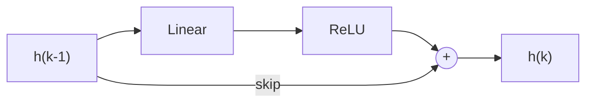
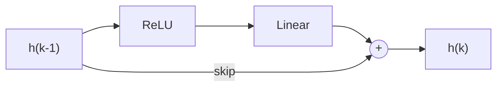
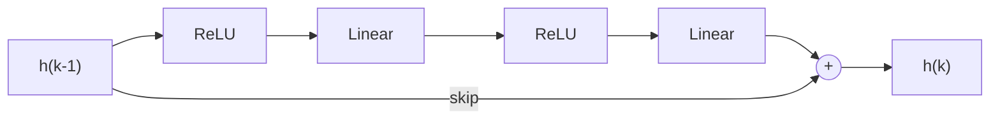
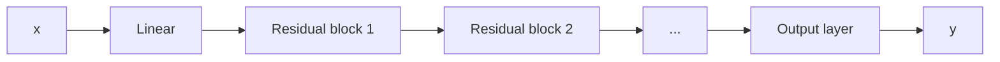
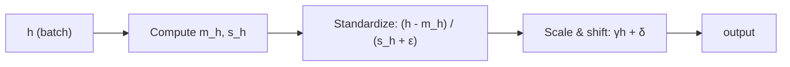
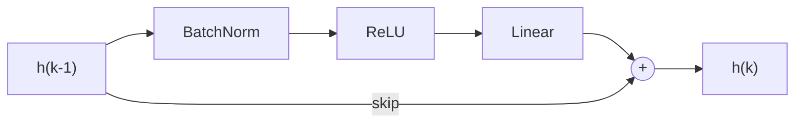
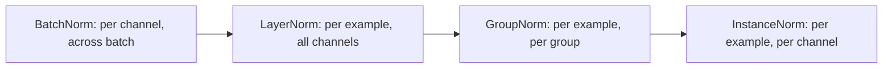

# فصل ۱۱: شبکه‌های باقیمانده ( ادامه...)
## جلسه 6
---
## بخش دوم: ترتیب عملیات در بلوک‌های باقیمانده

یک بلوک باقیمانده این را محاسبه می‌کند:

$$  
\mathbf{h}_k = \mathbf{h}_{k-1} + \mathbf{f}_k[\mathbf{h}_{k-1}]  
$$

تا اینجا $$\mathbf{f}_k[\cdot]$$ را «یک لایهٔ شبکه» در نظر گرفتیم، مثل یک لایهٔ کانولوشنی یا تمام‌متصل. این از نظر فنی درست است، اما **ترتیب عملیات درون** $\mathbf{f}_k$ اهمیت زیادی دارد. در این بخش بررسی می‌کنیم که تبدیل خطی و تابع فعال‌سازی را درون بلوک چگونه بچینیم.

مانند فصل‌های قبل:

- نماد $\boldsymbol{\Omega}$ ماتریس وزن (یا یک کانولوشن) و $\boldsymbol{\beta}$ بایاس است؛ پس عبارت $$\boldsymbol{\beta} + \boldsymbol{\Omega}\mathbf{h}$$ همان **تبدیل خطی** است.
- نماد $$\mathbf{a}[\cdot]$$ **تابع فعال‌سازی** است که اینجا ReLU است: $$\text{ReLU}[z] = \max(0, z)$$
### قاعدهٔ اول: بلوک باید یک تابع غیرخطی داشته باشد

اگر $\mathbf{f}_k$ کاملاً خطی بود، مثلاً
$$\mathbf{f}_k[\mathbf{h}] = \boldsymbol{\Omega}_k \mathbf{h},$$
آنگاه:

$$  
\mathbf{h}_k = \mathbf{h}_{k-1} + \boldsymbol{\Omega}_k \mathbf{h}_{k-1} = (\mathbf{I} + \boldsymbol{\Omega}_k)\mathbf{h}_{k-1}  
.$$

این فقط یک نگاشت خطی دیگر است. دنباله‌ای از چنین بلوک‌هایی، هر قدر هم عمیق باشد، باز هم **خطی** خواهد بود.

> [!note] نکتهٔ کلیدی  
> هر بلوک باقیمانده **باید** یک تابع فعال‌سازی مثل ReLU داشته باشد. در غیر این صورت کل شبکه به یک تبدیل خطی واحد تبدیل می‌شود.

سؤال اصلی این است که ReLU را **کجا** قرار دهیم.

---

### گزینهٔ الف: ترتیب «معمول» (خطی ← ReLU)

در شبکه‌هایی که تا اینجا ساختیم، هر لایه **ابتدا** تبدیل خطی و **در پایان** تابع فعال‌سازی را اعمال می‌کند:

$$  
\mathbf{f}_k[\mathbf{h}] = \mathbf{a}\big[\boldsymbol{\beta}_k + \boldsymbol{\Omega}_k \mathbf{h}\big]  
$$



#### مشکل

خروجی ReLU **هرگز منفی نیست**؛ پس با این ترتیب:

$$  
\mathbf{f}_k[\mathbf{h}] \geq \mathbf{0} \quad \text{(element-wise)}  
$$

و در نتیجه:

$$  
\mathbf{h}_k = \mathbf{h}_{k-1} + \underbrace{\mathbf{f}_k[\mathbf{h}_{k-1}]}_{\geq, 0} ;;\geq;; \mathbf{h}_{k-1}  
$$

> [!warning] پیامد  
> هر بلوک باقیمانده **فقط می‌تواند** مقادیر عبوری را **افزایش دهد** و هرگز کاهش نمی‌دهد. با عمیق‌تر شدن شبکه، مقادیر پنهان فقط می‌توانند بزرگ‌تر شوند. این یک محدودیت شدید و غیرضروری روی چیزی است که شبکه می‌تواند یاد بگیرد.

> [!example] مثال عددی کوچک  
> فرض کنید $$\mathbf{h}_{k-1} = [2, -1]^T$$ باشد.  
> هر وزنی که انتخاب کنیم، خروجی ReLU چیزی مثل $$[0.5, 0]^T$$ یا $$[0, 3]^T$$ است و هرگز منفی نیست.  
> پس مقدار جدید $$[2.5, -1]^T$$ یا $$[2, 2]^T$$ می‌شود. بلوک می‌تواند مقادیر را **بالا** ببرد، اما **هرگز** نمی‌تواند عدد ۲ را به ۱ تبدیل کند.

---

### گزینهٔ ب: ترتیب پیش‌فعال‌سازی (ReLU ← خطی)

راه‌حل این است که **ترتیب را عوض کنیم**: ابتدا تابع فعال‌سازی و **سپس** تبدیل خطی را اعمال کنیم:

$$  
\mathbf{f}_k[\mathbf{h}] = \boldsymbol{\beta}_k + \boldsymbol{\Omega}_k \mathbf{a}[\mathbf{h}]  
$$



حالا خروجی بلوک از یک تبدیل **خطی** می‌آید، پس می‌تواند **مثبت یا منفی** باشد. هر بلوک می‌تواند مقادیر را بالا **یا** پایین ببرد؛ این دقیقاً همان انعطافی است که برای یادگیری یک «اصلاح کوچک» روی ورودی لازم داریم.

> [!example] همان مثال با ترتیب جدید  
> فرض کنید $$\mathbf{h}_{k-1} = [2, -1]^T$$ باشد؛ پس $$\mathbf{a}[\mathbf{h}_{k-1}] = [2, 0]^T$$ است.  
> با انتخاب $$\boldsymbol{\Omega}_k = \begin{bmatrix} -0.5 & 0 \ 0 & 0 \end{bmatrix}$$ و $$\boldsymbol{\beta}_k = \mathbf{0}$$ داریم $$\mathbf{f}_k = [-1, 0]^T$$  
> پس $$\mathbf{h}_k = [1, -1]^T$$ می‌شود. مقدار اول **کاهش یافت**؛ کاری که در گزینهٔ الف ممکن نبود.

به این چینش معمولاً بلوک باقیماندهٔ **پیش‌فعال‌سازی** (Pre-activation) می‌گویند، چون تابع فعال‌سازی _پیش از_ وزن‌ها قرار می‌گیرد.

---

### گزینهٔ ج: چند لایه درون یک بلوک

لازم نیست یک بلوک باقیمانده فقط یک لایه باشد. اغلب **دو یا چند** مرحله پردازش دارد، برای مثال:

$$  
\mathbf{f}_k[\mathbf{h}] = \boldsymbol{\beta}_{k2} + \boldsymbol{\Omega}_{k2} \mathbf{a}\Big[\boldsymbol{\beta}_{k1} + \boldsymbol{\Omega}_{k1} \mathbf{a}[\mathbf{h}]\Big]  
$$



> [!tip] قاعدهٔ سرانگشتی  
> هر اتفاقی که درون بلوک بیفتد، بلوک باید **با یک تبدیل خطی تمام شود** تا خروجی آن پیش از جمع شدن با اتصال پرشی بتواند هر علامتی داشته باشد.

---

### قاعدهٔ دوم: شبکه را با بلوک باقیمانده شروع نکنید

بلوک‌های پیش‌فعال‌سازی یک نکتهٔ ظریف دارند: هر بلوک **با ReLU شروع می‌شود**. اگر ورودی شبکه $\mathbf{x}$ مستقیماً وارد اولین بلوک باقیمانده شود:

$$  
\mathbf{h}_1 = \mathbf{x} + \boldsymbol{\beta}_1 + \boldsymbol{\Omega}_1 \mathbf{a}[\mathbf{x}]  
$$

- همهٔ درایه‌های **منفی** $\mathbf{x}$ توسط ReLU صفر می‌شوند، پس بلوک اصلاً نمی‌تواند از آن اطلاعات استفاده کند.
- اگر **همهٔ** درایه‌های $\mathbf{x}$ منفی باشند، آنگاه $$\mathbf{a}[\mathbf{x}] = \mathbf{0}$$ و بلوک فقط یک مقدار ثابت $\boldsymbol{\beta}_1$ اضافه می‌کند؛ یعنی هیچ کار مفیدی انجام نمی‌دهد.

این موضوع در عمل مهم است: ورودی‌ها معمولاً **به میانگین صفر نرمال** می‌شوند، پس تقریباً نیمی از مقادیر ورودی منفی هستند.

> [!note] راه‌حل  
> شبکه را با یک **تبدیل خطی** ساده (مثلاً یک کانولوشن) **پیش از** اولین بلوک باقیمانده شروع کنید. این لایه ورودی را به نمایشی تبدیل می‌کند که بلوک‌های باقیمانده بتوانند با آن کار کنند.

پس یک شبکهٔ باقیماندهٔ معمول به این شکل است:

$$  
\begin{aligned}  
\mathbf{h}_1 &= \boldsymbol{\beta}_0 + \boldsymbol{\Omega}_0 \mathbf{x} && \text{(initial linear layer)} \\  
\mathbf{h}_2 &= \mathbf{h}_1 + \boldsymbol{\beta}_1 + \boldsymbol{\Omega}_1 \mathbf{a}[\mathbf{h}_1] && \text{(residual block 1)} \\  
\mathbf{h}_3 &= \mathbf{h}_2 + \boldsymbol{\beta}_2 + \boldsymbol{\Omega}_2 \mathbf{a}[\mathbf{h}_2] && \text{(residual block 2)} \\ 
&\vdots \\  
\mathbf{y} &= \boldsymbol{\beta}_K + \boldsymbol{\Omega}_K \mathbf{a}[\mathbf{h}_K] && \text{(output layer)}  
\end{aligned}  
$$



---

### مقایسهٔ ترتیب‌ها

||خطی ← ReLU (گزینهٔ الف)|ReLU ← خطی (گزینهٔ ب و ج)|
|---|---|---|
|علامت خروجی بلوک $\mathbf{f}_k$|همیشه نامنفی|مثبت یا منفی|
|اثر روی $\mathbf{h}$|فقط می‌تواند مقادیر را افزایش دهد|می‌تواند افزایش یا کاهش دهد|
|پایان بلوک|تابع فعال‌سازی|تبدیل خطی|
|مناسب برای بلوک باقیمانده؟|خیر|بله|

> [!tip] نکتهٔ اصلی  
> تابع ReLU را **در ابتدای** هر بلوک باقیمانده و یک تبدیل خطی را **در پایان** آن قرار دهید تا هر بلوک بتواند اصلاحی با هر علامتی اضافه کند. شبکه را با یک لایهٔ خطی شروع کنید تا ReLU اولین بلوک بخش منفی ورودی را دور نریزد.


---

## گرادیان‌های انفجاری در شبکه‌های باقیمانده

### یادآوری: اهمیت مقداردهی اولیه

در فصل‌های قبل دیدیم که **مقداردهی اولیه** (Initialization) نقش حیاتی دارد. اگر وزن‌های اولیه درست انتخاب نشوند، مقادیر در **گذر رو به جلو** (Forward pass) می‌توانند از لایه‌ای به لایهٔ بعد به‌صورت نمایی بزرگ یا کوچک شوند. به همین ترتیب، گرادیان‌ها در **گذر رو به عقب** (Backward pass) ممکن است **منفجر** (Explode) یا **محو** (Vanish) شوند.

راه‌حل این بود که مقداردهی اولیه طوری انجام شود که **واریانس از لایه‌ای به لایهٔ دیگر ثابت بماند**؛ هم برای فعال‌سازی‌ها (رو به جلو) و هم برای گرادیان‌ها (رو به عقب).

> [!note] مقداردهی اولیهٔ He (برای ReLU)
> 
> - بایاس‌ها: $$\boldsymbol{\beta} = \mathbf{0}$$
> - وزن‌ها: از توزیع نرمال با میانگین صفر و واریانس زیر انتخاب می‌شوند:  
>     $$  
>     \sigma^2_{\Omega} = \frac{2}{D_h}  
>     $$  
>     که در آن $D_h$ تعداد واحدهای پنهان در لایهٔ قبلی است.
> 
> با این انتخاب، هر لایه (تبدیل خطی + ReLU) **واریانس را تقریباً ثابت نگه می‌دارد**.

---

### خبر خوب: مشکل محو شدن نداریم

در شبکهٔ باقیمانده، خروجی هر بلوک با مسیری **جمع** می‌شود که مستقیماً به خروجی شبکه می‌رسد. پس هر لایه یک مسیر مستقیم برای اثرگذاری روی خروجی دارد و گرادیان هم یک مسیر مستقیم برای بازگشت دارد. بنابراین با عمیق‌تر شدن شبکه **نگران محو شدن** مقادیر یا گرادیان‌ها **نیستیم**.

### خبر بد: مقادیر منفجر می‌شوند

حتی اگر از مقداردهی اولیهٔ He **درون** هر بلوک باقیمانده استفاده کنیم، مقادیر در گذر رو به جلو با پیشروی در شبکه **به‌صورت نمایی بزرگ می‌شوند**.

#### چرا؟ جمع کردن دو منبع تغییرپذیری

یک بلوک باقیمانده را در نظر بگیرید:

$$  
\mathbf{h}_k = \underbrace{\mathbf{h}_{k-1}}_{\text{skip branch}} + \underbrace{\mathbf{f}_k[\mathbf{h}_{k-1}]}_{\text{residual branch}}  
$$

- مقداردهی اولیهٔ He باعث می‌شود شاخهٔ باقیمانده واریانس را حفظ کند: $$\text{Var}\big(\mathbf{f}_k[\mathbf{h}_{k-1}]\big) \approx \text{Var}(\mathbf{h}_{k-1})$$
- در لحظهٔ مقداردهی اولیه، دو شاخه تقریباً **ناهمبسته** هستند.
- برای متغیرهای ناهمبسته، **واریانس‌ها با هم جمع می‌شوند**: $$\text{Var}(A + B) = \text{Var}(A) + \text{Var}(B)$$

پس:

$$  
\text{Var}(\mathbf{h}_k) \approx \text{Var}(\mathbf{h}_{k-1}) + \text{Var}(\mathbf{h}_{k-1}) = 2\text{Var}(\mathbf{h}_{k-1})  
$$

> [!warning] واریانس در هر بلوک دو برابر می‌شود  
> پس از $K$ بلوک باقیمانده:  
> $$  
> \text{Var}(\mathbf{h}_K) \approx 2^K \text{Var}(\mathbf{h}_0)  
> $$  
> به‌ازای ۵۰ بلوک، این ضریب برابر $$2^{50} \approx 10^{15}$$ است. مقادیر خیلی زود از دقت اعداد ممیز شناور (Floating-point) فراتر می‌روند.

همین استدلال برای **گرادیان‌ها** در گذر رو به عقب هم برقرار است، پس آن‌ها هم **منفجر** می‌شوند.

> [!example] شهود  
> هر بلوک سیگنال فعلی را می‌گیرد و یک سیگنال «تصادفی» مستقل با همان اندازه به آن اضافه می‌کند. مثل این است که یک سیگنال نویزی را بارها با یک نسخهٔ هم‌اندازهٔ دیگر جمع کنیم: پراکندگی کل مدام دو برابر می‌شود.

> [!note] نکتهٔ کلیدی  
> شبکه‌های باقیمانده مشکل گرادیان‌های **محوشونده** و **خردشده** را حل می‌کنند، اما به‌تنهایی هنوز از **ناپایداری گذر رو به جلو** و **گرادیان‌های انفجاری** رنج می‌برند؛ حتی با مقداردهی اولیهٔ He.

---

### یک راه‌حل ساده: مقیاس‌دهی 

چون هر بلوک واریانس را دو برابر می‌کند، می‌توانیم خروجی ترکیب‌شدهٔ بلوک را کوچک کنیم:

$$  
\mathbf{h}_k = \frac{1}{\sqrt{2}}\Big(\mathbf{h}_{k-1} + \mathbf{f}_k[\mathbf{h}_{k-1}]\Big)  
$$

ضرب یک متغیر در $c$ واریانس آن را در $c^2$ ضرب می‌کند، پس:

$$  
\text{Var}(\mathbf{h}_k) \approx \frac{1}{2}\Big(\sigma^2 + \sigma^2\Big) = \sigma^2  
$$

حالا واریانس **ثابت** می‌ماند. این روش کار می‌کند، اما در عمل راه‌حل رایج‌تر **نرمال‌سازی دسته‌ای** است.

---

## نرمال‌سازی دسته‌ای (Batch Normalization)

### ایدهٔ اصلی

**نرمال‌سازی دسته‌ای** (که به اختصار **BatchNorm** نامیده می‌شود) هر فعال‌سازی $h$ را **جابه‌جا و مقیاس‌دهی** می‌کند تا **میانگین** و **واریانس** آن روی دستهٔ فعلی برابر مقادیری شوند که شبکه در طول آموزش **یاد می‌گیرد**.

به‌جای اینکه فقط به مقداردهی اولیه برای کنترل اندازهٔ مقادیر تکیه کنیم، در طول آموزش **مقادیر را مستقیماً نرمال می‌کنیم**.

> [!note] نمادگذاری
> 
> - نماد $\mathcal{B}$: دستهٔ (Batch) فعلی از نمونه‌های آموزشی، با اندازهٔ $|\mathcal{B}|$
> - نماد $h_i$: مقدار **یک واحد پنهان مشخص** برای نمونهٔ شمارهٔ $i$ در دسته.
> - همهٔ کمیت‌های زیر **اسکالر** هستند و برای هر واحد پنهان جداگانه محاسبه می‌شوند.

---

### گام اول: محاسبهٔ آماره‌های دسته

برای یک واحد پنهان، **میانگین تجربی** $m_h$ و **انحراف معیار** $s_h$ را روی دسته محاسبه می‌کنیم:

$$  
m_h = \frac{1}{|\mathcal{B}|}\sum_{i \in \mathcal{B}} h_i  
\qquad\qquad  
s_h = \sqrt{\frac{1}{|\mathcal{B}|}\sum_{i \in \mathcal{B}} \big(h_i - m_h\big)^2}  
$$

### گام دوم: استانداردسازی

مقادیر را جابه‌جا و مقیاس‌دهی می‌کنیم تا دسته **میانگین صفر** و **واریانس یک** داشته باشد:

$$  
h_i \leftarrow \frac{h_i - m_h}{s_h + \epsilon}, \qquad \forall i \in \mathcal{B}.  
$$

در اینجا $\epsilon$ یک **عدد کوچک** است که وقتی همهٔ مقادیر دسته برابرند یعنی $$s_h = 0$$ از تقسیم بر صفر جلوگیری می‌کند.

### گام سوم: مقیاس‌دهی و جابه‌جایی با پارامترهای یادگرفتنی

در پایان، مقدار را در $\gamma$ ضرب و با $\delta$ جمع می‌کنیم:

$$  
h_i \leftarrow \gamma h_i + \delta  
$$

پس از این گام، فعال‌سازی‌ها روی دسته میانگین $\delta$ و انحراف معیار $\gamma$ دارند. هر دو پارامتر درست مثل وزن‌ها و بایاس‌ها در طول آموزش **یاد گرفته می‌شوند**.

> [!question] چرا پس از نرمال‌سازی، دو پارامتر گاما و دلتا را اضافه می‌کنیم؟  
> اگر همهٔ واحدهای پنهان را مجبور کنیم دقیقاً میانگین صفر و واریانس یک داشته باشند، ممکن است توان نمایش شبکه محدود شود. با $\gamma$ و $\delta$، شبکه برای هر واحد، بهترین میانگین و مقیاس را **خودش انتخاب می‌کند**. حتی اگر مفید باشد، می‌تواند اثر نرمال‌سازی را کاملاً خنثی کند.




---

### یک مثال عددی

فرض کنید یک دستهٔ ۴تایی برای یک واحد پنهان این مقادیر را تولید کرده است:

$$  
h = [2, 4, 6, 8]  
$$

**گام اول:** آماره‌ها

$$  
m_h = \frac{2+4+6+8}{4} = 5  
\qquad  
s_h = \sqrt{\frac{9 + 1 + 1 + 9}{4}} = \sqrt{5} \approx 2.24  
$$

**گام دوم:** استانداردسازی (با صرف‌نظر از اپسیلون)

$$  
h \approx [-1.34, -0.45, 0.45, 1.34]  
$$

اکنون میانگین صفر و انحراف معیار یک است.

**گام سوم:** مقیاس‌دهی و جابه‌جایی، مثلاً با $$\gamma = 2$$ و $$\delta = 1$$

$$  
h \approx [-1.68, 0.11, 1.89, 3.68]  
$$

اکنون میانگین ۱ و انحراف معیار ۲ است.

---

### در زمان آزمون چه اتفاقی می‌افتد؟

در زمان آزمون (Test time) معمولاً **یک نمونه در هر بار** پردازش می‌شود، پس دسته‌ای وجود ندارد که $m_h$ و $s_h$ را از آن حساب کنیم.

> [!note] راه‌حل  
> مقادیر $m_h$ و $s_h$ را روی **کل مجموعهٔ آموزشی** (به‌جای یک دسته) محاسبه کرده و در شبکهٔ نهایی **ثابت** می‌کنیم. در زمان آزمون، همهٔ ورودی‌ها با همین آماره‌های ثابت نرمال می‌شوند.
> 
> در عمل، کتابخانه‌هایی مانند PyTorch این آماره‌ها را در طول آموزش با یک **میانگین متحرک** (Running average) از آماره‌های دسته‌ها تخمین می‌زنند.

---

### جایگاه نرمال‌سازی دسته‌ای در بلوک باقیمانده

در شبکهٔ باقیمانده، نرمال‌سازی دسته‌ای معمولاً **در ابتدای شاخهٔ باقیمانده** و پیش از ReLU قرار می‌گیرد:

$$  
\mathbf{f}_k[\mathbf{h}] = \boldsymbol{\beta}_k + \boldsymbol{\Omega}_k \mathbf{a}\Big[\text{BN}\big[\mathbf{h}\big]\Big]  
$$



این ساختار همان ترتیب پیش‌فعال‌سازی بخش قبل را حفظ می‌کند (ReLU پیش از تبدیل خطی، و پایان بلوک با تبدیل خطی). شاخهٔ میان‌بر (Skip) بدون تغییر باقی می‌ماند.

> [!success] اثر بر انفجار واریانس  
> در لحظهٔ مقداردهی اولیه (با $$\gamma = 1$$ و $$\delta = 0$$)، نرمال‌سازی دسته‌ای ورودی هر شاخهٔ باقیمانده را به **واریانس واحد** برمی‌گرداند؛ بنابراین هر بلوک به‌جای دو برابر کردن واریانس، تقریباً **یک واحد** به آن اضافه می‌کند:  
> $$  
> \text{Var}(\mathbf{h}_k) \approx \text{Var}(\mathbf{h}_{k-1}) + 1  
> $$  
> حالا واریانس با عمق به‌صورت **خطی** رشد می‌کند (پس از $k$ بلوک تقریباً برابر $k$) و نه به‌صورت **نمایی** (یعنی $2^k$). در ادامه این موضوع و سایر هزینه‌ها و مزایای نرمال‌سازی دسته‌ای را بررسی می‌کنیم.

--- 
## هزینه‌ها و مزایای نرمال‌سازی دسته‌ای

نرمال‌سازی دسته‌ای فقط یک ترفند برای کنترل واریانس نیست؛ اثرات دیگری هم روی آموزش شبکه دارد. بعضی از این اثرات **هزینه** هستند و بعضی **مزیت**. ابتدا هزینه‌ها را می‌بینیم و سپس سه مزیت اصلی را بررسی می‌کنیم.

### هزینه‌ها: افزونگی در پارامترها

#### 1. پایداری نسبت به مقیاس وزن‌ها

نرمال‌سازی دسته‌ای باعث می‌شود شبکه نسبت به **تغییر مقیاس** وزن‌ها و بایاس‌هایی که یک فعال‌سازی را می‌سازند، **ناوردا** (Invariant) شود.

فرض کنید همهٔ وزن‌ها و بایاس‌های ورودی یک واحد پنهان را **دو برابر** کنیم. در این صورت:

- فعال‌سازی‌ها دو برابر می‌شوند: $$h_i \rightarrow 2h_i$$
- میانگین دسته دو برابر می‌شود: $$m_h \rightarrow 2m_h$$
- انحراف معیار دسته هم دو برابر می‌شود: $$s_h \rightarrow 2s_h$$

پس در گام استانداردسازی (با صرف‌نظر از اپسیلون):

$$
\frac{2h_i - 2m_h}{2s_h} = \frac{h_i - m_h}{s_h}
$$

خروجی **هیچ تغییری نمی‌کند**؛ نرمال‌سازی اثر دو برابر شدن را کاملاً خنثی کرده است. این اتفاق برای هر واحد پنهان جداگانه رخ می‌دهد.

> [!warning] پیامد
> خانوادهٔ بزرگی از وزن‌ها و بایاس‌ها وجود دارد که همگی **دقیقاً همان خروجی** را تولید می‌کنند. یعنی در پارامترهای وزن **افزونگی** (Redundancy) ایجاد شده است.

#### پارامترهای اضافه

از طرف دیگر، نرمال‌سازی دسته‌ای برای هر واحد پنهان (یا هر کانال) **دو پارامتر جدید** $\gamma$ و $\delta$ اضافه می‌کند و مدل کمی بزرگ‌تر می‌شود.

> [!note] نکتهٔ کلیدی
> نرمال‌سازی دسته‌ای از یک طرف در وزن‌ها **افزونگی ایجاد می‌کند** و از طرف دیگر برای جبران آن **پارامترهای اضافه** می‌آورد. این کار آشکارا ناکارآمد است، اما مزایای مهمی دارد که ارزش این هزینه را دارند.

---

### مزیت اول: انتشار رو به جلوی پایدار (Stable forward propagation)

اگر پارامترها را با $$\delta = 0$$ و $$\gamma = 1$$ مقداردهی اولیه کنیم، خروجی هر فعال‌سازی **واریانس واحد** خواهد داشت.

- در یک **شبکهٔ معمولی**، این تضمین می‌کند که واریانس در لحظهٔ مقداردهی اولیه در طول گذر رو به جلو **پایدار** بماند.
- در یک **شبکهٔ باقیمانده**، واریانس همچنان باید افزایش یابد، چون هر بلوک یک منبع تغییرپذیری جدید به ورودی اضافه می‌کند. اما این افزایش حالا **خطی** است، نه نمایی.

#### رشد خطی واریانس

هر بلوک (که با نرمال‌سازی دسته‌ای شروع می‌شود) تقریباً **یک واحد** واریانس به واریانس موجود اضافه می‌کند:

$$
\text{Var}(\mathbf{h}_k) \approx \text{Var}(\mathbf{h}_{k-1}) + 1 \quad \Longrightarrow \quad \text{Var}(\mathbf{h}_k) \approx k
$$

یعنی بلوک شمارهٔ $k$ یک واحد واریانس به واریانس موجود (که حدوداً برابر $k$ است) اضافه می‌کند.

| روش                               | واریانس پس از ۵۰ بلوک              |
| --------------------------------- | ---------------------------------- |
| بدون نرمال‌سازی (فقط مقداردهی He) | تقریباً $$2^{50} \approx 10^{15}$$ |
| با ضریب یک بر رادیکال دو          | تقریباً ثابت                       |
| با نرمال‌سازی دسته‌ای             | تقریباً $50$                       |

#### یک اثر جانبی جالب: عمق مؤثر کمتر در شروع آموزش

چون واریانس سیگنال اصلی به‌تدریج بزرگ‌تر می‌شود ولی هر بلوک فقط یک واحد اضافه می‌کند، **سهم نسبی** بلوک‌های بعدی کوچک‌تر است:

$$
\text{relative change at block } k \approx \frac{1}{k}
$$

- بلوک ۱ واریانس را از ۱ به ۲ می‌رساند: تغییر نسبی **۱۰۰٪**
- بلوک ۵۰ واریانس را از ۵۰ به ۵۱ می‌رساند: تغییر نسبی **۲٪**

> [!example] شهود
> تصور کنید چند نفر به ترتیب روی یک نقاشی کار می‌کنند و هر نفر فقط یک لایهٔ رنگ نازک با ضخامت ثابت اضافه می‌کند. نفر اول بوم سفید را کاملاً عوض می‌کند، اما نفر پنجاهم روی پنجاه لایهٔ قبلی فقط تغییر کوچکی ایجاد می‌کند.

> [!success] نتیجه
> در شروع آموزش، لایه‌های بعدی تقریباً **تابع همانی** را محاسبه می‌کنند؛ پس شبکه در عمل **کم‌عمق‌تر** رفتار می‌کند و آموزش آسان‌تر شروع می‌شود. با پیشرفت آموزش، شبکه می‌تواند پارامتر $\gamma$ را در لایه‌های بعدی **بزرگ‌تر کند** و به این ترتیب **عمق مؤثر خودش را کنترل کند**.

---

### مزیت دوم: نرخ‌های یادگیری بالاتر (Higher learning rates)

هم مطالعات تجربی و هم تحلیل‌های نظری نشان می‌دهند که نرمال‌سازی دسته‌ای باعث می‌شود سطح زیان و گرادیان آن **هموارتر** تغییر کنند. به بیان دیگر، نرمال‌سازی دسته‌ای مشکل **گرادیان‌های خردشده** را کاهش می‌دهد.

چرا این مهم است؟

- وقتی سطح زیان **قابل پیش‌بینی‌تر** باشد، گرادیان در نقطهٔ فعلی راهنمای خوبی برای فاصلهٔ بیشتری است.
- پس می‌توانیم **قدم‌های بزرگ‌تری** برداریم، یعنی از **نرخ یادگیری بالاتر** استفاده کنیم، بدون اینکه آموزش ناپایدار شود.

$$
\boldsymbol{\phi} \leftarrow \boldsymbol{\phi} - \alpha \frac{\partial L}{\partial \boldsymbol{\phi}} \qquad \text{(larger } \alpha \text{ becomes safe)}
$$

> [!example] شهود
> به مثال کوه‌پیمایی در مه برگردیم. اگر زمین هموار باشد، با اطمینان می‌توانید قدم‌های بلند بردارید. اگر زمین ناهموار و شکسته باشد، باید قدم‌های کوتاه و محتاطانه بردارید.

> [!note] چرا نرخ یادگیری بالاتر مفید است؟
> در فصل‌های قبل (بخش مربوط به گرادیان کاهشی تصادفی) دیدیم که نرخ یادگیری بالاتر علاوه بر سرعت بیشتر، معمولاً **عملکرد روی دادهٔ آزمون** را هم بهبود می‌دهد؛ زیرا آموزش را به سمت نواحی هموارتر سطح زیان هدایت می‌کند.

---

### مزیت سوم: منظم‌سازی (Regularization)

در فصل منظم‌سازی دیدیم که **افزودن نویز** به فرایند آموزش می‌تواند **تعمیم‌پذیری** را بهبود دهد. نرمال‌سازی دسته‌ای به‌طور طبیعی چنین نویزی تزریق می‌کند.

#### نویز از کجا می‌آید؟

مقدار نرمال‌شدهٔ یک نمونه به $m_h$ و $s_h$ بستگی دارد، و این آماره‌ها به **سایر نمونه‌های دسته** وابسته‌اند. در هر تکرار آموزش، هر نمونه در کنار نمونه‌های متفاوتی در یک دسته قرار می‌گیرد؛ پس مقدار نرمال‌شدهٔ آن در هر تکرار **کمی متفاوت** است.

> [!example] مثال عددی
> فرض کنید یک نمونهٔ مشخص برای یک واحد پنهان مقدار $$h = 4$$ را تولید کند.
> - در تکرار اول در دسته‌ای با مقادیر $$[2, 4, 6, 8]$$ قرار می‌گیرد: میانگین $$5$$ و انحراف معیار حدود $2.24$ است، پس مقدار نرمال‌شده حدود $-0.45$ می‌شود.
> - در تکرار بعد در دسته‌ای با مقادیر $$[1, 4, 3, 4]$$ قرار می‌گیرد: میانگین $3$ و انحراف معیار حدود $1.22$ است، پس مقدار نرمال‌شده حدود $0.82$ می‌شود.
>
> همان نمونه با همان وزن‌ها، دو خروجی متفاوت دارد؛ فقط به این دلیل که هم‌دسته‌هایش عوض شده‌اند.

> [!success] نتیجه
> این تغییرات تصادفی مثل نویز عمل می‌کنند و شبکه را مجبور می‌کنند به جزئیات خیلی دقیق یک نمونه وابسته نباشد. در نتیجه، نرمال‌سازی دسته‌ای اثر **منظم‌سازی** دارد و به **تعمیم بهتر** کمک می‌کند.

> [!tip] نکتهٔ عملی
> در زمان آزمون، آماره‌ها ثابت هستند (بخش قبل)؛ پس این نویز فقط در **زمان آموزش** وجود دارد. این دقیقاً همان رفتاری است که از یک روش منظم‌سازی انتظار داریم، مشابه روش حذف تصادفی (Dropout).

---
## انواع نرمال‌سازی دسته‌ای

برای نرمال‌سازی دسته‌ای چند نسخهٔ دیگر پیشنهاد شده است. تفاوت اصلی آن‌ها در این است که **آماره‌های نرمال‌سازی** (میانگین و انحراف معیار) **روی کدام مقادیر** محاسبه می‌شوند.

> [!note] یادآوری
> در یک شبکهٔ کانولوشنی، نمایش هر لایه یک تانسور با ابعاد $$N \times C \times H \times W$$ است: اندازهٔ دسته، تعداد کانال‌ها، ارتفاع و عرض. نرمال‌سازی دسته‌ای برای **هر کانال جداگانه**، آماره‌ها را روی **همهٔ نمونه‌های دسته و همهٔ موقعیت‌های مکانی** محاسبه می‌کند.

---

### مشکلات نرمال‌سازی دسته‌ای

نرمال‌سازی دسته‌ای در چند موقعیت مشکل دارد:

- **دستهٔ خیلی بزرگ:** آماره‌ها بسیار دقیق می‌شوند و نویز کمی دارند؛ پس اثر منظم‌سازی کم می‌شود.
- **دستهٔ خیلی کوچک یا پرنوسان:** آماره‌ها **غیرقابل‌اعتماد** می‌شوند. این وضعیت در پردازش زبان طبیعی رایج است.
- **شبکه‌های بازگشتی** (که در فصل‌های بعد می‌بینیم): آماره‌ها باید برای هر گام دنباله ذخیره شوند، و اگر دنبالهٔ آزمون از دنباله‌های آموزشی بلندتر باشد، معلوم نیست چه باید کرد.
- **آموزش توزیع‌شده:** نرمال‌سازی دسته‌ای به **کل دسته** نیاز دارد، اما وقتی آموزش بین چند ماشین تقسیم شده، دسترسی به کل دسته آسان نیست.


### نسخه‌هایی که هنوز از دسته استفاده می‌کنند

- **نرمال‌سازی دستهٔ شبح** (Ghost BatchNorm): آماره‌ها را فقط روی **بخشی از دسته** محاسبه می‌کند. آماره‌ها پرنویزتر می‌شوند و وقتی دسته خیلی بزرگ است، **منظم‌سازی بیشتری** ایجاد می‌شود.
- **نرمال‌سازی مجدد دسته‌ای** (Batch Renormalization): یک **میانگین متحرک** از آماره‌های دسته‌ها نگه می‌دارد و نرمال‌سازی هر دسته را طوری اصلاح می‌کند که **نماینده‌تر** باشد. برای دسته‌های کوچک یا پرنوسان مناسب است.


### نسخه‌هایی که از دسته استفاده نمی‌کنند

این روش‌ها **هر نمونه را جداگانه** نرمال می‌کنند؛ پس به اندازهٔ دسته وابسته نیستند و در زمان آموزش و آزمون یکسان رفتار می‌کنند.

- **نرمال‌سازی لایه‌ای** (LayerNorm): آماره‌ها برای هر نمونه روی **همهٔ کانال‌ها و همهٔ موقعیت‌های مکانی** محاسبه می‌شوند.
- **نرمال‌سازی گروهی** (GroupNorm): کانال‌ها به چند **گروه** تقسیم می‌شوند و آماره‌ها برای هر نمونه و هر گروه، روی کانال‌های آن گروه و موقعیت‌های مکانی محاسبه می‌شوند.
- **نرمال‌سازی نمونه‌ای** (InstanceNorm): حالت حدی نرمال‌سازی گروهی که در آن **تعداد گروه‌ها برابر تعداد کانال‌ها** است؛ یعنی هر کانال از هر نمونه فقط روی **موقعیت‌های مکانی** خودش نرمال می‌شود.

> [!tip] نکته
> در هر سه روش، پارامترهای یادگرفتنی مقیاس $\gamma$ و جابه‌جایی $\delta$ همچنان **برای هر کانال جداگانه** تعریف می‌شوند.

| روش                  | آماره‌ها روی چه چیزی محاسبه می‌شوند             | وابسته به دسته؟ |
| -------------------- | ----------------------------------------------- | --------------- |
| نرمال‌سازی دسته‌ای   | هر کانال: روی $N, H, W$                         | بله             |
| نرمال‌سازی دستهٔ شبح | هر کانال: روی بخشی از $N$ و $H, W$              | بله             |
| نرمال‌سازی لایه‌ای   | هر نمونه: روی $C, H, W$                         | خیر             |
| نرمال‌سازی گروهی     | هر نمونه و هر گروه: روی کانال‌های گروه و $H, W$ | خیر             |
| نرمال‌سازی نمونه‌ای  | هر نمونه و هر کانال: روی $H, W$                 | خیر             |




همهٔ این روش‌ها در PyTorch آماده هستند:

```python
import torch
import torch.nn as nn

x = torch.randn(8, 64, 32, 32)          # N x C x H x W

bn = nn.BatchNorm2d(64)                 # per channel, across N, H, W
ln = nn.GroupNorm(1, 64)                # one group = LayerNorm with per-channel gamma/delta
gn = nn.GroupNorm(8, 64)                # 8 groups of 8 channels
inn = nn.InstanceNorm2d(64, affine=True) # per example and per channel, across H, W

for layer in [bn, ln, gn, inn]:
    print(type(layer).__name__, layer(x).shape)   # shape is unchanged: [8, 64, 32, 32]
```

> [!note] دربارهٔ کد
> در کتابخانهٔ PyTorch، لایهٔ `nn.LayerNorm` پارامترهای مقیاس و جابه‌جایی را برای **هر عنصر** تعریف می‌کند، نه برای هر کانال. برای رسیدن به تعریف کتاب (پارامتر برای هر کانال) در شبکه‌های کانولوشنی، از `nn.GroupNorm` با **یک گروه** استفاده کرده‌ایم.

---

### روش‌های دیگر

- **نرمال‌سازی وزن‌ها** (Weight Normalization): به‌جای فعال‌سازی‌ها، **وزن‌های شبکه** را نرمال می‌کند. این روش در عمل موفقیت کمتری داشته است.
- **نرمال‌سازی دسته‌ای مونت‌کارلو** (Monte Carlo BatchNorm): از تصادفی بودن آماره‌های دسته استفاده می‌کند تا **تخمین معناداری از عدم قطعیت** پیش‌بینی‌های شبکه به دست دهد.

