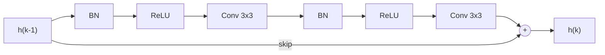
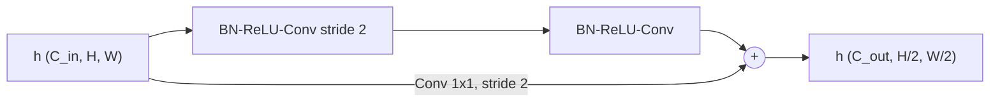
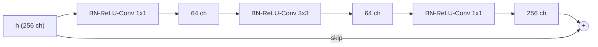
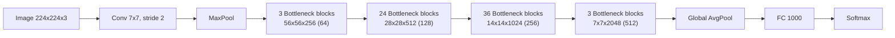
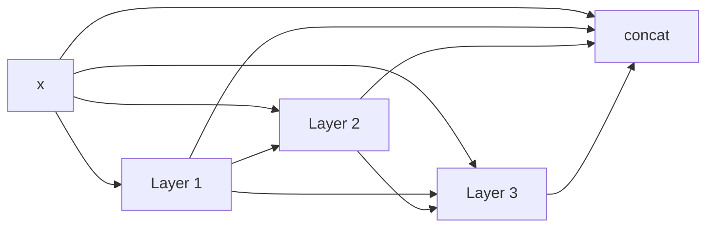
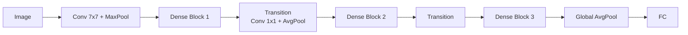
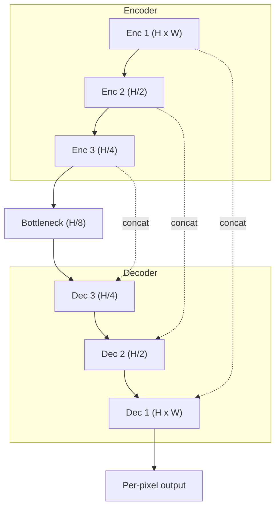
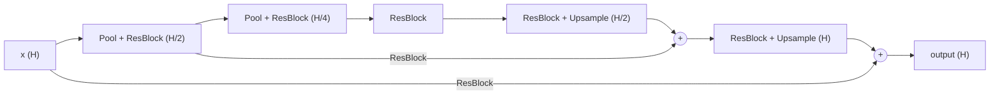

# فصل ۱۱: شبکه‌های باقیمانده ( ادامه...)
## جلسه 7
---

## معماری‌های رایج باقیمانده

تا اینجا ایدهٔ اتصال باقیمانده، ترتیب عملیات درون بلوک و نقش نرمال‌سازی دسته‌ای را دیدیم. حالا چند معماری مشهور را بررسی می‌کنیم که بر پایهٔ همین ایده‌ها ساخته شده‌اند:

- شبکهٔ **ResNet**: اتصال‌های باقیمانده با **جمع** برای طبقه‌بندی تصویر.
- شبکهٔ **DenseNet**: به‌جای جمع، خروجی‌ها را **الحاق** (Concatenate) می‌کند.
- شبکه‌های **U-Net** و **ساعت‌شنی** (Hourglass): اتصال‌های پرشی بین **مقیاس‌های مختلف** برای پیش‌بینی در سطح پیکسل.

---

## شبکهٔ باقیمانده (ResNet)

### ایدهٔ اصلی

بلوک‌های باقیمانده نخستین بار در **شبکه‌های کانولوشنی** برای **طبقه‌بندی تصویر** استفاده شدند. هر بلوک باقیمانده شامل نرمال‌سازی دسته‌ای، تابع ReLU و یک لایهٔ کانولوشنی است و این ترکیب معمولاً دو بار تکرار می‌شود، سپس نتیجه با ورودی جمع می‌شود:

$$
\mathbf{h}_k = \mathbf{h}_{k-1} + \text{Conv}\Big[\text{ReLU}\big[\text{BN}\big[\text{Conv}[\text{ReLU}[\text{BN}[\mathbf{h}_{k-1}]]]\big]\big]\Big]
$$



این همان ترتیب پیش‌فعال‌سازی است که در بخش‌های قبل دیدیم: نرمال‌سازی و ReLU در ابتدا، و پایان بلوک با یک تبدیل خطی (کانولوشن).


پیاده‌سازی این بلوک در PyTorch:

```python
import torch
import torch.nn as nn

class ResidualBlock(nn.Module):
    """Pre-activation residual block: BN -> ReLU -> Conv -> BN -> ReLU -> Conv, then add."""
    def __init__(self, channels):
        super().__init__()
        self.f = nn.Sequential(
            nn.BatchNorm2d(channels), nn.ReLU(),
            nn.Conv2d(channels, channels, kernel_size=3, padding=1),
            nn.BatchNorm2d(channels), nn.ReLU(),
            nn.Conv2d(channels, channels, kernel_size=3, padding=1),
        )

    def forward(self, x):
        return x + self.f(x)   # h_k = h_{k-1} + f_k[h_{k-1}]


block = ResidualBlock(channels=64)
x = torch.randn(8, 64, 32, 32)      # batch of 8, 64 channels, 32x32
print(block(x).shape)              
```

```
torch.Size([8, 64, 32, 32])
```

> [!tip] نکته
> برای اینکه جمع $$\mathbf{h}_{k-1} + \mathbf{f}_k[\mathbf{h}_{k-1}]$$ ممکن باشد، خروجی شاخهٔ باقیمانده باید **دقیقاً هم‌اندازهٔ** ورودی باشد. به همین دلیل از `padding=1` در کانولوشن‌های $3 \times 3$ استفاده کرده‌ایم.


توجه شود که در لایه Conv 3x3 داریم:

$$  
H_{out} = \left\lfloor \frac{H_{in} + 2P - K}{S} \right\rfloor + 1 = \frac{32 + 2(1) - 3}{1} + 1 = 32  
$$

---

### تغییر وضوح و تعداد کانال‌ها

در یک شبکهٔ کانولوشنی، معمولاً با پیشروی در شبکه **وضوح مکانی کم** و **تعداد کانال‌ها زیاد** می‌شود. اما در بلوک باقیمانده ورودی و خروجی باید هم‌اندازه باشند تا جمع ممکن شود. راه‌حل‌ها:

- **کاهش وضوح:** با کانولوشن با **گام ۲** (Stride 2) انجام می‌شود.
- **افزایش کانال‌ها:** یا با **افزودن صفر** به نمایش ورودی، یا با یک **کانولوشن** $1 \times 1$ **اضافه** روی مسیر پرشی.



```python
class DownResidualBlock(nn.Module):
    """Halves the resolution and changes the number of channels."""
    def __init__(self, in_ch, out_ch):
        super().__init__()
        self.f = nn.Sequential(
            nn.BatchNorm2d(in_ch), nn.ReLU(),
            nn.Conv2d(in_ch, out_ch, kernel_size=3, stride=2, padding=1),
            nn.BatchNorm2d(out_ch), nn.ReLU(),
            nn.Conv2d(out_ch, out_ch, kernel_size=3, padding=1),
        )
        # 1x1 convolution on the skip path so that shapes match
        self.skip = nn.Conv2d(in_ch, out_ch, kernel_size=1, stride=2)

    def forward(self, x):
        return self.skip(x) + self.f(x)


block = DownResidualBlock(64, 128)
print(block(torch.randn(8, 64, 32, 32)).shape)   
```

```
torch.Size([8, 128, 16, 16])
```

برای لایه `nn.Conv2d(in_ch, out_ch, kernel_size=3, stride=2, padding=1)` داریم:
$$  
H_{out} = \left\lfloor \frac{32 + 2(1) - 3}{2} \right\rfloor + 1 = \lfloor 15.5 \rfloor + 1 = 16  
$$
و برای لایه `self.skip = nn.Conv2d(in_ch, out_ch, kernel_size=1, stride=2)` داریم:
$$  
H_{out} = \left\lfloor \frac{32 + 2(0) - 1}{2} \right\rfloor + 1 = \lfloor 15.5 \rfloor + 1 = 16  
$$

---

### بلوک گلوگاهی (Bottleneck block)

وقتی تعداد کانال‌ها زیاد است، کانولوشن‌های $3 \times 3$ پارامترهای بسیار زیادی دارند. **بلوک گلوگاهی** این مشکل را با سه کانولوشن حل می‌کند:

۱. یک کانولوشن $1 \times 1$ که تعداد کانال‌ها را **کاهش** می‌دهد.

۲. یک کانولوشن $3 \times 3$ معمولی روی نمایش کم‌کانال.

۳. یک کانولوشن $1 \times 1$ که تعداد کانال‌ها را دوباره **افزایش** می‌دهد.



> [!example] مقایسهٔ تعداد پارامترها (بدون بایاس)
> فرض کنید ورودی ۲۵۶ کانال دارد.
> - دو کانولوشن $3 \times 3$ معمولی:
> $$
> 2 \times (3 \times 3 \times 256 \times 256) = 1{,}179{,}648
> $$
> - بلوک گلوگاهی (۲۵۶ ← ۶۴ ← ۶۴ ← ۲۵۶):
> $$
> (256 \times 64) + (3 \times 3 \times 64 \times 64) + (64 \times 256) = 69{,}632
> $$
> بلوک گلوگاهی حدوداً **۱۷ برابر پارامتر کمتری** دارد و همچنان سه لایه غیرخطی فراهم می‌کند.

```python
class BottleneckBlock(nn.Module):
    def __init__(self, channels, reduced):
        super().__init__()
        self.f = nn.Sequential(
            nn.BatchNorm2d(channels), nn.ReLU(),
            nn.Conv2d(channels, reduced, kernel_size=1),   # reduce channels
            nn.BatchNorm2d(reduced), nn.ReLU(),
            nn.Conv2d(reduced, reduced, kernel_size=3, padding=1),  
            nn.BatchNorm2d(reduced), nn.ReLU(),
            nn.Conv2d(reduced, channels, kernel_size=1),   # restore channels
        )

    def forward(self, x):
        return x + self.f(x)


block = BottleneckBlock(channels=256, reduced=64)
n_params = sum(p.numel() for p in block.parameters())
print(n_params)   # about 70k parameters (including biases and BatchNorm)
```

> [!warning] بلوک گلوگاهی با کاهش وضوح
> کلاس `BottleneckBlock` بالا ابعاد را تغییر نمی‌دهد (ورودی و خروجی هم‌اندازه‌اند). اما در ابتدای هر مرحله از ResNet (بلوک‌های «Subsample» در شکل) وضوح نصف و تعداد کانال‌ها دو برابر می‌شود. پس مثل `DownResidualBlock`، کانولوشن $3 \times 3$ گام ۲ می‌گیرد و روی مسیر پرشی یک کانولوشن $1 \times 1$ با گام ۲ قرار می‌دهیم تا شکل‌ها برای جمع یکسان شوند.

```python
class DownBottleneckBlock(nn.Module):
    """Bottleneck block that halves the resolution and changes the number of channels."""
    def __init__(self, in_ch, reduced, out_ch):
        super().__init__()
        self.f = nn.Sequential(
            nn.BatchNorm2d(in_ch), nn.ReLU(),
            nn.Conv2d(in_ch, reduced, kernel_size=1),   # reduce channels
            nn.BatchNorm2d(reduced), nn.ReLU(),
            nn.Conv2d(reduced, reduced, kernel_size=3, stride=2, padding=1),  
            nn.BatchNorm2d(reduced), nn.ReLU(),
            nn.Conv2d(reduced, out_ch, kernel_size=1),  # increase channels
        )
        # 1x1 convolution on the skip path so that shapes match
        self.skip = nn.Conv2d(in_ch, out_ch, kernel_size=1, stride=2)

    def forward(self, x):
        return self.skip(x) + self.f(x)


block = DownBottleneckBlock(in_ch=256, reduced=128, out_ch=512)
print(block(torch.randn(8, 256, 56, 56)).shape)
```

```
torch.Size([8, 512, 28, 28])
```


---

### معماری کامل ResNet-200

کتاب، معماری **ResNet-200** (با ۲۰۰ لایه) را برای طبقه‌بندی تصاویر مجموعه‌دادهٔ ImageNet نشان می‌دهد:

- **ورودی:** تصویر رنگی با اندازهٔ $$224 \times 224 \times 3$$
- **شروع شبکه:** یک کانولوشن $7 \times 7$ با گام ۲ و سپس یک لایهٔ ادغام بیشینه (Max pooling)؛ یعنی همان «لایهٔ خطی در ابتدای شبکه» که در بخش ترتیب عملیات دیدیم.
- **بدنهٔ شبکه:** تعداد زیادی بلوک گلوگاهی. هر چند بلوک یک بار وضوح نصف و تعداد کانال‌ها دو برابر می‌شود: وضوح از ۵۶ به ۲۸ و ۱۴ و ۷ می‌رسد و کانال‌ها از ۲۵۶ به ۵۱۲ و ۱۰۲۴ و ۲۰۴۸. تعداد بلوک‌ها در این چهار مرحله به ترتیب **۳، ۲۴، ۳۶ و ۳** است. چون هر بلوک گلوگاهی سه لایهٔ کانولوشن دارد، با احتساب کانولوشن ابتدایی و لایهٔ تمام‌متصل پایانی داریم:
 $$(3+24+36+3) \times 3 + 2 = 200$$
 - **پایان شبکه:** ادغام میانگین سراسری (Global average pooling) که هر کانال را به یک عدد تبدیل می‌کند، سپس یک لایهٔ تمام‌متصل که ۱۰۰۰ خروجی (برای ۱۰۰۰ کلاس) تولید می‌کند و در نهایت تابع سافت‌مکس.



> [!info] معنی نماد $H \times W \times C\,(C')$
> در برچسب‌هایی مثل `56x56x256 (64)`:
> - $56 \times 56$ وضوح مکانی (ارتفاع × عرض) نقشهٔ ویژگی در آن مرحله است.
> - $256$ تعداد کانال‌های ورودی و خروجی هر بلوک است (همان تعداد کانال روی مسیر پرشی).
> - $(64)$ تعداد کانال‌های **میانی** داخل بلوک گلوگاهی است.
>
> یعنی هر بلوک این مرحله کانال‌ها را به‌صورت $256 \xrightarrow{1\times1} 64 \xrightarrow{3\times3} 64 \xrightarrow{1\times1} 256$ تغییر می‌دهد؛ همان `BottleneckBlock(channels=256, reduced=64)`. در همهٔ مراحل، عدد داخل پرانتز یک‌چهارم تعداد کانال‌هاست.

> [!success] نتیجه
> این شبکه روی ImageNet به خطای top-5 حدود **۴٫۸٪** رسید؛ یعنی فقط در کمتر از ۵٪ تصاویر، کلاس درست جزو ۵ حدس اول شبکه نبود.


---

### استفاده از ResNet آماده در PyTorch

لازم نیست ResNet را از صفر بسازیم. کتابخانهٔ torchvision نسخه‌های مختلف ResNet (۱۸، ۳۴، ۵۰، ۱۰۱ و ۱۵۲ لایه) را همراه با **پارامترهای ازپیش‌آموزش‌دیده** روی ImageNet ارائه می‌کند.

#### ساختن مدل بدون آموزش قبلی (وزن‌های تصادفی)

```python
from torchvision.models import resnet18

model = resnet18(weights=None, num_classes=10)   # random init, 10 output classes
print(model(torch.randn(4, 3, 224, 224)).shape)  # torch.Size([4, 10])
```

#### استفاده از پارامترهای ازپیش‌آموزش‌دیده برای پیش‌بینی

```python
from torchvision.models import resnet50, ResNet50_Weights

weights = ResNet50_Weights.DEFAULT        # parameters pre-trained on ImageNet
model = resnet50(weights=weights)
model.eval()                              # important: BatchNorm uses frozen statistics

preprocess = weights.transforms()         # resize, crop and normalize like in training
# from PIL import Image
# img = Image.open("cat.jpg")
# x = preprocess(img).unsqueeze(0)
x = torch.randn(1, 3, 224, 224)           # stand-in for a real image

with torch.no_grad():
    probs = model(x).softmax(dim=1)

top5 = probs.topk(5)
labels = weights.meta["categories"]
print([labels[i] for i in top5.indices[0]])
```

> [!warning] چرا `()model.eval` مهم است؟
> در بخش نرمال‌سازی دسته‌ای دیدیم که در زمان آزمون باید از **آماره‌های ثابت** استفاده کنیم. دستور `()model.eval` همین کار را انجام می‌دهد. اگر آن را فراموش کنید، لایه‌های نرمال‌سازی دسته‌ای از آماره‌های همان دستهٔ ورودی استفاده می‌کنند و نتیجه‌ها (به‌ویژه برای یک تصویر تنها) اشتباه خواهند بود.

#### تنظیم دقیق (Fine-tuning) برای یک مسئلهٔ جدید

فرض کنید می‌خواهیم تصاویر را در ۱۰ کلاس جدید طبقه‌بندی کنیم. لایه‌های کانولوشنی ازپیش‌آموزش‌دیده را نگه می‌داریم و فقط لایهٔ آخر را عوض می‌کنیم:

```python
from torchvision.models import resnet50, ResNet50_Weights

model = resnet50(weights=ResNet50_Weights.DEFAULT)

for p in model.parameters():                       # freeze the pre-trained backbone
    p.requires_grad = False

model.fc = nn.Linear(model.fc.in_features, 10)     # new trainable head (2048 -> 10)

optimizer = torch.optim.Adam(model.fc.parameters(), lr=1e-3)
```

> [!tip] نکتهٔ عملی
> اگر دادهٔ آموزشی کافی دارید، می‌توانید پس از چند دوره آموزش لایهٔ آخر، لایه‌های دیگر را هم از حالت ثابت خارج کنید و کل شبکه را با **نرخ یادگیری کوچک** آموزش دهید.

---

## شبکهٔ متراکم (DenseNet)

### ایدهٔ اصلی

در ResNet خروجی هر بلوک با ورودی **جمع** می‌شود. شبکهٔ **DenseNet** ایدهٔ دیگری دارد: به‌جای جمع، نمایش‌ها را **الحاق** (Concatenate) می‌کند. هر لایه، **همهٔ** خروجی‌های لایه‌های قبلی را به‌عنوان ورودی دریافت می‌کند:

$$
\mathbf{h}_k = \mathbf{f}_k\Big[\text{concat}\big[\mathbf{x}, \mathbf{h}_1, \mathbf{h}_2, \dots, \mathbf{h}_{k-1}\big]\Big]
$$



> [!note] تفاوت جمع و الحاق
> - **جمع (ResNet):** اطلاعات لایه‌های قبلی با هم **ترکیب** می‌شوند و تعداد کانال‌ها ثابت می‌ماند.
> - **الحاق (DenseNet):** اطلاعات لایه‌های قبلی **دست‌نخورده کنار هم** قرار می‌گیرند و تعداد کانال‌ها افزایش می‌یابد.


### رشد تعداد کانال‌ها

اگر ورودی بلوک $C_0$ کانال داشته باشد و هر لایه $g$ کانال جدید تولید کند (که به آن **نرخ رشد** یا Growth rate می‌گویند)، پس از $\ell$ لایه تعداد کانال‌ها برابر است با:

$$
C_\ell = C_0 + \ell \cdot g
$$

> [!example] مثال عددی
> با $$C_0 = 64$$ و $$g = 32$$، پس از ۴ لایه تعداد کانال‌ها برابر $$64 + 4 \times 32 = 192$$ می‌شود.

```python
class DenseLayer(nn.Module):
    def __init__(self, in_ch, growth):
        super().__init__()
        self.f = nn.Sequential(
            nn.BatchNorm2d(in_ch), nn.ReLU(),
            nn.Conv2d(in_ch, growth, kernel_size=3, padding=1),
        )

    def forward(self, x):
        return torch.cat([x, self.f(x)], dim=1)   # concatenate along the channel axis


class DenseBlock(nn.Module):
    def __init__(self, in_ch, growth, n_layers):
        super().__init__()
        self.layers = nn.Sequential(
            *[DenseLayer(in_ch + i * growth, growth) for i in range(n_layers)]
        )

    def forward(self, x):
        return self.layers(x)


block = DenseBlock(in_ch=64, growth=32, n_layers=4)
print(block(torch.randn(1, 64, 32, 32)).shape)   # torch.Size([1, 192, 32, 32])
```

### کنترل رشد کانال‌ها: لایه‌های انتقالی

اگر الحاق را بی‌پایان ادامه دهیم، تعداد کانال‌ها بیش از حد زیاد می‌شود. برای کنترل این رشد، بین بلوک‌های متراکم **لایه‌های انتقالی** (Transition layers) قرار می‌گیرند:

- یک کانولوشن $1 \times 1$ که تعداد کانال‌ها را **کاهش** می‌دهد.
- یک لایهٔ ادغام که **وضوح** را نصف می‌کند.

```python
def transition(in_ch, out_ch):
    return nn.Sequential(
        nn.BatchNorm2d(in_ch), nn.ReLU(),
        nn.Conv2d(in_ch, out_ch, kernel_size=1),   # reduce the number of channels
        nn.AvgPool2d(kernel_size=2),               # halve the resolution
    )

t = transition(192, 96)
print(t(torch.randn(1, 192, 32, 32)).shape)      # torch.Size([1, 96, 16, 16])
```

#### نحوهٔ به‌کاربردن لایه‌های انتقالی

شبکهٔ DenseNet از چند **بلوک متراکم** پشت سر هم ساخته می‌شود و یک لایهٔ انتقالی **بین هر دو بلوک** قرار می‌گیرد (نه داخل بلوک):

- **داخل هر بلوک:** وضوح مکانی ثابت است، چون الحاق فقط بین نقشه‌های هم‌اندازه ممکن است. در عوض تعداد کانال‌ها با نرخ رشد $g$ زیاد می‌شود.
- **بین بلوک‌ها:** لایهٔ انتقالی دو کار انجام می‌دهد. کانولوشن $1 \times 1$ تعداد کانال‌ها را معمولاً **نصف** می‌کند (ضریب فشرده‌سازی $\theta = 0.5$ در نسخهٔ DenseNet-BC). ادغام میانگین $2 \times 2$ هم وضوح را نصف می‌کند.
- **بعد از آخرین بلوک:** لایهٔ انتقالی نمی‌آید. به‌جای آن ادغام میانگین سراسری و لایهٔ تمام‌متصل قرار می‌گیرد.



> [!note] چرا شکل کتاب لایهٔ انتقالی ندارد؟
> شکل کتاب در پایین فقط **یک بلوک متراکم** را نشان می‌دهد (کانال‌ها ۳ ← ۳۵ ← ۶۷ ← ۹۹ با $g=32$). وضوح در کل شکل ثابت است، پس جایی برای لایهٔ انتقالی نیست. لایه‌های انتقالی در مقالهٔ اصلی DenseNet (Huang et al., 2017) بین بلوک‌ها تعریف شده‌اند.

> [!success] نتیجه
> در DenseNet نیز مثل ResNet، خروجی نهایی ترکیبی از همهٔ نمایش‌های قبلی است و گرادیان مسیرهای کوتاهی برای بازگشت دارد. این شبکه در طبقه‌بندی تصویر نتایجی **قابل رقابت با ResNet** به دست می‌آورد.


### استفاده از DenseNet آماده در PyTorch

```python
from torchvision.models import densenet121, DenseNet121_Weights

weights = DenseNet121_Weights.DEFAULT
model = densenet121(weights=weights)       # pre-trained on ImageNet
model.eval()

# Fine-tuning for 5 new classes: in DenseNet the last layer is called "classifier"
model.classifier = nn.Linear(model.classifier.in_features, 5)
print(model(torch.randn(2, 3, 224, 224)).shape)   # torch.Size([2, 5])
```


---

## شبکه‌های U-Net و ساعت‌شنی

### مشکل: از دست رفتن جزئیات در بخش‌بندی

در **بخش‌بندی معنایی** (Semantic segmentation) باید برای **هر پیکسل** تصویر یک برچسب تعیین شود؛ پس خروجی شبکه هم‌اندازهٔ ورودی است. ساختار رایج برای این کار شبکهٔ **رمزگذار-رمزگشا** (Encoder-Decoder) است. کتاب این شبکه را در فصل ۱۰ (بخش ۱۰.۵.۳) معرفی کرده و ما در جلسه‌های فصل ۱۰ فقط اجزای آن، یعنی نمونه‌برداری کاهشی و افزایشی (جلسهٔ ۴)، را دیدیم:

- **رمزگذار:** وضوح تصویر را به‌تدریج کاهش می‌دهد و ویژگی‌های سطح بالا و معنایی می‌سازد.
- **رمزگشا:** وضوح را دوباره افزایش می‌دهد تا برای هر پیکسل یک خروجی بسازد.

> [!warning] مشکل
> همهٔ اطلاعات باید از **کم‌وضوح‌ترین** نمایش در وسط شبکه عبور کند. این نمایش برای شناختن «چه چیزی» در تصویر هست عالی است، اما جزئیات دقیق «کجا» (مثل مرزهای دقیق اشیاء) در آن از بین رفته است. پس خروجی رمزگشا معمولاً **تار و بی‌جزئیات** است.

---

### شبکهٔ U-Net

ایدهٔ **U-Net** ساده است: نمایش‌های رمزگذار را در هر مقیاس، از طریق **اتصال‌های پرشی** مستقیماً به بخش هم‌مقیاس در رمزگشا بفرستیم. به این ترتیب رمزگشا هم اطلاعات **معنایی** (از مسیر پایین) و هم جزئیات **مکانی دقیق** (از اتصال پرشی) را دارد.

در U-Net، نمایش رمزگذار با نمایش رمزگشا **الحاق** می‌شود (مثل DenseNet) و سپس چند کانولوشن روی نتیجه اعمال می‌شود. می‌توانیم این‌ها را **اتصال‌های باقیمانده در مقیاس‌های مختلف** بدانیم.



نام این شبکه از شکل نمودار آن می‌آید: رمزگذار در سمت چپ پایین می‌رود و رمزگشا در سمت راست بالا می‌آید، و کل نمودار شبیه حرف **U** می‌شود.


> [!note] نکتهٔ تاریخی
> نسخهٔ اصلی U-Net از کانولوشن‌های «معتبر» (Valid، یعنی بدون لایه‌گذاری صفر) استفاده می‌کرد؛ پس اندازهٔ نمایش‌ها بعد از هر کانولوشن کمی کوچک می‌شد و نمایش‌های رمزگذار باید پیش از الحاق **بریده** (Crop) می‌شدند. در پیاده‌سازی‌های امروزی معمولاً از لایه‌گذاری استفاده می‌شود و نیازی به بریدن نیست.

> [!example] کاربردها
> شبکهٔ U-Net ابتدا برای **بخش‌بندی تصاویر پزشکی** معرفی شد و هنوز یکی از پرکاربردترین معماری‌ها در این حوزه است (نسخهٔ سه‌بعدی آن برای تصاویر حجمی مثل MRI استفاده می‌شود). در فصل‌های بعد خواهیم دید که U-Net ستون اصلی **مدل‌های انتشار** (Diffusion models) برای تولید تصویر نیز هست.


#### یک U-Net کوچک در PyTorch

```python
def double_conv(in_ch, out_ch):
    return nn.Sequential(
        nn.Conv2d(in_ch, out_ch, kernel_size=3, padding=1), nn.BatchNorm2d(out_ch), nn.ReLU(),
        nn.Conv2d(out_ch, out_ch, kernel_size=3, padding=1), nn.BatchNorm2d(out_ch), nn.ReLU(),
    )


class TinyUNet(nn.Module):
    def __init__(self, in_ch=3, n_classes=2):
        super().__init__()
        self.pool = nn.MaxPool2d(2)
        # encoder
        self.enc1 = double_conv(in_ch, 64)
        self.enc2 = double_conv(64, 128)
        self.bottleneck = double_conv(128, 256)
        # decoder
        self.up2 = nn.ConvTranspose2d(256, 128, kernel_size=2, stride=2)
        self.dec2 = double_conv(128 + 128, 128)      # upsampled + skip
        self.up1 = nn.ConvTranspose2d(128, 64, kernel_size=2, stride=2)
        self.dec1 = double_conv(64 + 64, 64)         # upsampled + skip
        self.head = nn.Conv2d(64, n_classes, kernel_size=1)

    def forward(self, x):
        e1 = self.enc1(x)                            # full resolution
        e2 = self.enc2(self.pool(e1))                # 1/2 resolution
        b = self.bottleneck(self.pool(e2))           # 1/4 resolution
        d2 = self.dec2(torch.cat([self.up2(b), e2], dim=1))    # skip connection
        d1 = self.dec1(torch.cat([self.up1(d2), e1], dim=1))   # skip connection
        return self.head(d1)                         # class scores for every pixel


net = TinyUNet(in_ch=3, n_classes=2)
print(net(torch.randn(1, 3, 128, 128)).shape)        # torch.Size([1, 2, 128, 128])
```

> [!tip] نکته
> خروجی شبکه همان وضوح ورودی را دارد و برای **هر پیکسل** یک امتیاز برای هر کلاس تولید می‌کند. تابع زیان معمولاً آنتروپی متقاطع روی همهٔ پیکسل‌ها است: `nn.CrossEntropyLoss()(output, target_mask)`

#### استفاده از U-Net با رمزگذار ازپیش‌آموزش‌دیده

کتابخانهٔ torchvision مدل U-Net آماده ندارد، اما کتابخانهٔ `segmentation_models_pytorch` امکان ساخت U-Net با یک **رمزگذار ResNet ازپیش‌آموزش‌دیده** را فراهم می‌کند:

```python
# pip install segmentation-models-pytorch
import segmentation_models_pytorch as smp

model = smp.Unet(
    encoder_name="resnet34",        # the encoder is a ResNet-34
    encoder_weights="imagenet",     # load parameters pre-trained on ImageNet
    in_channels=3,                  # RGB input
    classes=2,                      # e.g., background vs. tumor
)
print(model(torch.randn(1, 3, 256, 256)).shape)   # torch.Size([1, 2, 256, 256])
```

> [!success] ترکیب ایده‌ها
> این مثال نشان می‌دهد ایده‌های این فصل چطور با هم ترکیب می‌شوند: یک **ResNet** با اتصال‌های باقیمانده به‌عنوان رمزگذار، و ساختار **U-Net** با اتصال‌های پرشی بین مقیاس‌ها برای بازسازی جزئیات.

---

### شبکه‌های ساعت‌شنی (Hourglass networks)

شبکه‌های **ساعت‌شنی** بسیار شبیه U-Net هستند و همان ساختار کاهش و سپس افزایش وضوح را دارند. دو تفاوت اصلی:

| ویژگی | شبکهٔ U-Net | شبکهٔ ساعت‌شنی |
|---|---|---|
| ترکیب مسیر پرشی با رمزگشا | **الحاق** | **جمع** |
| پردازش روی مسیر پرشی | ندارد (مستقیم منتقل می‌شود) | دارد (بلوک‌های باقیمانده روی مسیر پرشی) |



به دلیل شکل متقارن آن (پهن در دو سر و باریک در وسط)، به آن «ساعت‌شنی» می‌گویند.

#### شبکه‌های ساعت‌شنی پشته‌ای

در عمل، چند شبکهٔ ساعت‌شنی **پشت سر هم** قرار می‌گیرند (Stacked hourglass networks). هر ساعت‌شنی یک پیش‌بینی اولیه می‌سازد و ساعت‌شنی بعدی آن را **اصلاح** می‌کند.

> [!example] کاربرد: تخمین ژست بدن انسان
> در **تخمین ژست** (Pose estimation)، شبکه برای هر مفصل بدن (مثل زانو، آرنج و مچ) یک **نقشهٔ حرارتی** (Heatmap) تولید می‌کند که مقدار آن در محل مفصل بیشینه است. ساعت‌شنی‌های پشته‌ای می‌توانند با استفاده از روابط بین مفاصل (مثلاً «مچ باید نزدیک آرنج باشد») پیش‌بینی‌ها را مرحله به مرحله دقیق‌تر کنند.


#### یک شبکهٔ ساعت‌شنی ساده در PyTorch

ساختار ساعت‌شنی به‌طور طبیعی **بازگشتی** است: هر ساعت‌شنی شامل یک ساعت‌شنی کوچک‌تر در وسط خودش است. از بلوک `ResidualBlock` که بالاتر تعریف کردیم استفاده می‌کنیم:

```python
class Hourglass(nn.Module):
    def __init__(self, depth, channels):
        super().__init__()
        self.skip = ResidualBlock(channels)                    # processing on the skip path
        self.down = nn.Sequential(nn.MaxPool2d(2), ResidualBlock(channels))
        self.inner = (Hourglass(depth - 1, channels) if depth > 1
                      else ResidualBlock(channels))            # smaller hourglass inside
        self.up = nn.Sequential(ResidualBlock(channels),
                                nn.Upsample(scale_factor=2, mode="nearest"))

    def forward(self, x):
        return self.skip(x) + self.up(self.inner(self.down(x)))   # add, not concatenate


class StackedHourglass(nn.Module):
    def __init__(self, n_stacks=2, channels=64, n_joints=16):
        super().__init__()
        self.stem = nn.Conv2d(3, channels, kernel_size=7, padding=3)   # initial linear layer
        self.hourglasses = nn.ModuleList([Hourglass(4, channels) for _ in range(n_stacks)])
        self.heads = nn.ModuleList([nn.Conv2d(channels, n_joints, 1) for _ in range(n_stacks)])

    def forward(self, x):
        h = self.stem(x)
        heatmaps = []
        for hg, head in zip(self.hourglasses, self.heads):
            h = hg(h)
            heatmaps.append(head(h))      # one prediction per stack (refined step by step)
        return heatmaps


net = StackedHourglass()
out = net(torch.randn(1, 3, 64, 64))
print(len(out), out[-1].shape)            # 2 torch.Size([1, 16, 64, 64])
```

> [!note] نکته
> دقت کنید که ابتدای شبکه یک کانولوشن ساده (`stem`) قرار دارد و نه یک بلوک باقیمانده؛ همان قاعده‌ای که در بخش ترتیب عملیات دیدیم.

---

## کاربرد این شبکه‌ها برای سیگنال‌های یک‌بعدی

همهٔ شبکه‌هایی که در این جلسه دیدیم (ResNet، DenseNet، U-Net و ساعت‌شنی) در مقاله‌های اصلی‌شان فقط برای **تصویر دوبعدی** تعریف شده‌اند و نسخهٔ یک‌بعدی **رسمی** ندارند. torchvision هم فقط نسخه‌های دوبعدی و وزن‌های ازپیش‌آموزش‌دیده روی ImageNet را ارائه می‌کند. با این حال، ایدهٔ اصلی این شبکه‌ها (اتصال پرشی با **جمع** یا **الحاق**، بلوک گلوگاهی، کاهش و افزایش وضوح) به بُعد داده وابسته نیست. به همین دلیل در مقاله‌های پردازش سیگنال (ECG، EEG، صدا، ارتعاش و سری‌های زمانی) زیاد استفاده می‌شوند. هر مقاله پیاده‌سازی خودش را دارد، اما راهکارهای رایج را می‌توان در چند دسته خلاصه کرد:

- **۱. تبدیل مستقیم به یک‌بعدی (رایج‌ترین راه):** هر لایهٔ دوبعدی با معادل یک‌بعدی‌اش جایگزین می‌شود: `Conv1d` و `BatchNorm1d` و `AvgPool1d`/`MaxPool1d` و `Upsample`/`ConvTranspose1d`. ورودی به شکل `(N, C, L)` است که در آن **کانال‌ها** همان کانال‌های سیگنال‌اند (مثلاً ۱۲ لید ECG) و $L$ طول زمانی است. ساختار شبکه دست‌نخورده می‌ماند. نمونه‌ها: ResNet یک‌بعدی برای طبقه‌بندی سری زمانی (Wang et al., 2017) که هنوز یک baseline قوی است؛ شبکهٔ ۳۴ لایه با اتصال‌های باقیمانده برای تشخیص آریتمی از ECG (Hannun et al., 2019)؛ و Wave-U-Net برای جداسازی منابع صوتی (Stoller et al., 2018).

- **۲. کرنل‌های بزرگ‌تر یا کانولوشن گسترده (Dilated):** سیگنال‌ها معمولاً بسیار بلندند (هزاران نمونه) و کرنل $3$ میدان دید را خیلی کند بزرگ می‌کند. برای همین در نسخه‌های یک‌بعدی معمولاً کرنل‌های بزرگ‌تر ($7$ تا $15$) یا کانولوشن‌های گسترده به کار می‌روند. در WaveNet (van den Oord et al., 2016) و شبکه‌های TCN (Bai et al., 2018) بلوک‌های باقیمانده با کانولوشن‌های **علّی و گسترده** ترکیب شده‌اند تا میدان دید به‌صورت نمایی رشد کند.

- **۳. تبدیل سیگنال به تصویر و استفاده از شبکهٔ دوبعدی:** سیگنال به یک نمایش دوبعدی تبدیل می‌شود و سپس همان شبکهٔ دوبعدی (اغلب با وزن‌های ازپیش‌آموزش‌دیدهٔ ImageNet) استفاده می‌شود. رایج‌ترین تبدیل‌ها **طیف‌نگاشت** (Spectrogram از STFT یا Mel)، **اسکالوگرام** (از تبدیل موجک پیوسته) و برای سری‌های زمانی، روش‌هایی مثل Gramian Angular Field و Markov Transition Field (Wang & Oates, 2015) هستند. مزیت اصلی این راه **یادگیری انتقالی** است؛ عیب آن هزینهٔ محاسباتی بیشتر و از دست رفتن بخشی از اطلاعات (مثلاً فاز در طیف‌نگاشت) است.

- **۴. سیگنال چندکاناله به‌صورت تصویر:** گاهی سیگنال چندکاناله (مثلاً EEG با چند الکترود) به‌صورت یک ماتریس «کانال × زمان» دیده می‌شود و با کانولوشن دوبعدی پردازش می‌شود؛ به‌ویژه وقتی مجاورت کانال‌ها معنای مکانی دارد.

> [!tip] توصیه برای کار با سیگنال
> - برای شروع، راه **۱** (تبدیل مستقیم به `Conv1d`) معمولاً ساده‌ترین و مؤثرترین انتخاب است. کافی است در کدهای این جلسه `2d` را به `1d` تبدیل کنید و اندازهٔ کرنل را متناسب با طول سیگنال بزرگ‌تر بگیرید.
> - نسخه‌های یک‌بعدی وزن ازپیش‌آموزش‌دیدهٔ استاندارد ندارند و معمولاً از صفر آموزش داده می‌شوند. اگر دادهٔ کمی دارید، راه **۳** و استفاده از وزن‌های ImageNet را هم امتحان کنید.
> - در U-Net یک‌بعدی، طول سیگنال باید در هر مرحله بر $2$ بخش‌پذیر باشد تا بعد از نمونه‌افزایی، طول دو شاخه برای الحاق برابر شود. در غیر این صورت سیگنال را لایه‌گذاری (Pad) یا برش (Crop) کنید.
