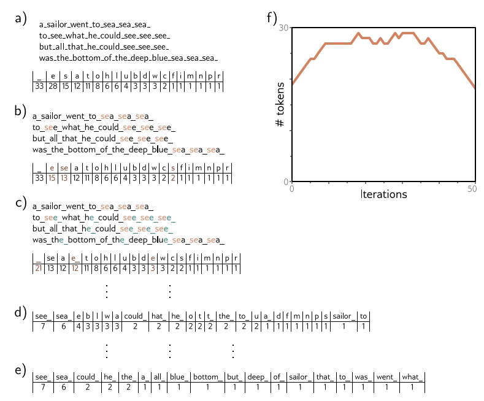
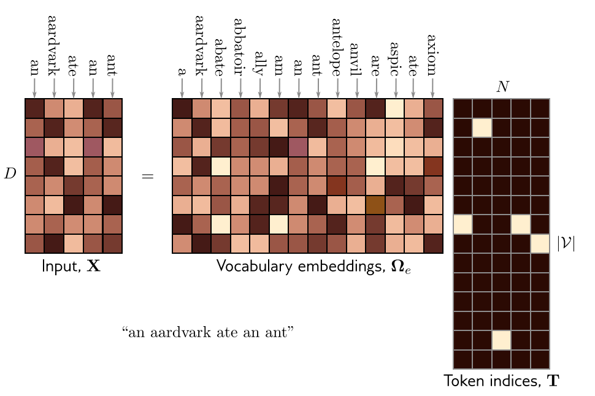
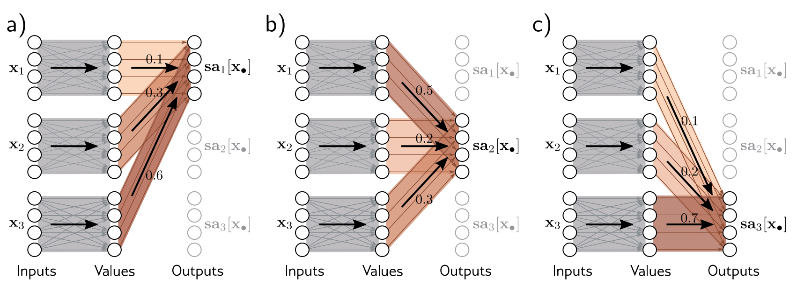
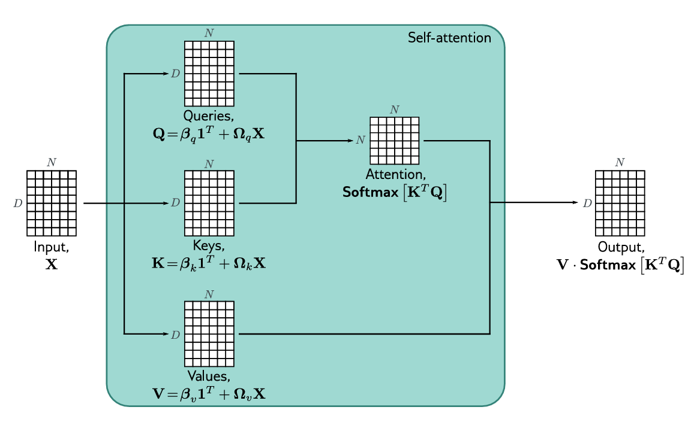

# فصل ۱۲: ترنسفورمرها (Transformers)
## جلسه 10
---

> [!abstract] طرح کلی فصل
> ترنسفورمرها معماری اصلی مدل‌های امروزی پردازش زبان طبیعی (و بسیاری از مدل‌های بینایی) هستند. در این جلسه ابتدا می‌بینیم دادهٔ متنی چه ویژگی‌هایی دارد و پردازش آن با شبکه‌هایی که تا اینجا دیده‌ایم چه چالش‌هایی دارد؛ سپس می‌بینیم متن چگونه به ورودی عددی شبکه تبدیل می‌شود. این چالش‌ها انگیزهٔ اصلی سازوکار **خودتوجهی** (Self-attention) هستند که در پایان همین جلسه معرفی می‌شود.

---
## بخش اول: پردازش داده‌های متنی

### متن به‌عنوان داده: شباهت‌ها و تفاوت‌ها با تصویر

در فصل ۱۰ دیدیم که یک تصویر، شبکه‌ای از پیکسل‌ها روی یک **صفحهٔ دوبعدی** است. یک متن را هم می‌توان دنباله‌ای از **نشانه‌ها** (Token)، مثلاً کلمه‌ها، روی یک **محور یک‌بعدی** دانست (جلسهٔ ۸). این دو نوع داده شباهت‌های مهمی دارند:

- **ساختار و ترتیب:** جای پیکسل‌ها در تصویر و ترتیب کلمه‌ها در جمله معنادار است؛ با جابه‌جا کردن آن‌ها اطلاعات اساسی از بین می‌رود.
- **تکرار الگوها در جایگاه‌های مختلف:** یک لبه در هر جای تصویر همان لبه است و عبارت «یادگیری عمیق» در هر جای جمله همان معنا را دارد. به همین دلیل در هر دو حالت می‌خواهیم پارامترها بین جایگاه‌های مختلف **به اشتراک گذاشته** شوند؛ همان ایده‌ای که در CNN (فصل ۱۰) و RNN (جلسهٔ ۸) دیدیم.
- **ابعاد بالا:** هم یک تصویر و هم یک متن، وقتی به عدد تبدیل شوند، تعداد بسیار زیادی مؤلفه دارند.

اما تفاوت‌های مهمی هم دارند:

| ویژگی                 | تصویر                                       | متن                                                 |
| --------------------- | ------------------------------------------- | --------------------------------------------------- |
| عنصر پایه              | پیکسل: یک عدد پیوسته با معنای مستقیم (شدت رنگ) | نشانه: یک **نماد گسسته** که باید به عدد تبدیل شود     |
| اندازه                | معمولاً ثابت (یا با تغییر اندازه ثابت می‌شود)    | **متغیر**: از چند کلمه تا هزاران کلمه                |
| وابستگی‌های مهم        | عمدتاً **محلی** (پیکسل‌های همسایه)              | اغلب **دوربرد** و وابسته به **محتوای** کلمه‌ها        |

همین سه تفاوت، چالش‌های اصلی پردازش متن را می‌سازند.

---

### یک مثال: نقد یک رستوران

متن کوتاه زیر را در نظر بگیرید (مثال کتاب):

> *The restaurant refused to serve me a ham sandwich because it only cooks vegetarian food. In the end, they just gave me two slices of bread. Their ambiance was just as good as the food and service.*

یعنی: «رستوران از سرو کردن ساندویچ ژامبون به من خودداری کرد، چون فقط غذای گیاهی می‌پزد. در نهایت فقط دو تکه نان به من دادند. فضای آنجا هم به همان خوبیِ غذا و سرویسش بود.»

فرض کنید بخواهیم شبکه‌ای بسازیم که این متن را به یک نمایش مناسب برای کارهای بعدی (مثلاً تشخیص مثبت یا منفی بودن نظر) تبدیل کند. سه چالش اصلی پیش می‌آید.

#### ۱. ورودی بسیار بزرگ است

این متن ۳۷ کلمه دارد. اگر هر کلمه با یک بردار نهفته (بخش دوم) به طول ۱۰۲۴ نمایش داده شود، ورودی شبکه حتی برای همین متن کوتاه شامل

$$
37 \times 1024 = 37{,}888
$$

عدد است. یک لایهٔ تمام‌متصل که این ورودی را به خروجی‌ای با همین اندازه ببرد، به $37{,}888^2 \approx 1.4$ میلیارد وزن نیاز دارد؛ آن هم فقط برای یک لایه و یک متن ۳۷ کلمه‌ای.

#### ۲. طول ورودی متغیر است

هر متن طول متفاوتی دارد؛ پس حتی روشن نیست یک شبکهٔ تمام‌متصل با ابعاد ثابت را چگونه باید روی آن اعمال کرد. چالش‌های ۱ و ۲ نشان می‌دهند که شبکه باید پارامترها را بین کلمه‌ها در **جایگاه‌های مختلف به اشتراک بگذارد**، همان‌طور که شبکه‌های کانولوشنی پارامترها را بین جایگاه‌های مختلف تصویر به اشتراک می‌گذارند.

#### ۳. زبان طبیعی مبهم است

از ساختار دستوری جملهٔ اول به‌تنهایی مشخص نیست که ضمیر **it** به **restaurant** برمی‌گردد یا به **ham sandwich**. ما می‌فهمیم که منظور رستوران است، چون این «رستوران» است که غذا می‌پزد، نه «ساندویچ». پس برای فهمیدن متن، کلمهٔ it باید به نحوی به کلمهٔ restaurant **متصل** شود.

نکتهٔ مهم این است که این اتصال نه به **فاصلهٔ** دو کلمه، بلکه به **خود کلمه‌ها** بستگی دارد. در زبان فارسی هم همین وضعیت را داریم:

- در جملهٔ جلسهٔ ۸ («**علی** که سال‌ها در خارج از کشور زندگی کرده بود و تازه به شهرش برگشته بود، از دیدن دوستان قدیمی‌**اش** خوشحال شد»)، ضمیر «ـَش» باید به «علی» متصل شود که چندین کلمه قبل‌تر آمده است.
- معنای یک کلمه گاهی فقط با کلمه‌های اطرافش روشن می‌شود: «**شیر** جنگل» (جانور)، «یک لیوان **شیر**» (نوشیدنی) و «**شیر** آب».

> [!note] نکتهٔ کلیدی
> برای فهمیدن متن، شبکه باید بین کلمه‌ها **اتصال** برقرار کند و **قدرت** این اتصال‌ها باید به **محتوای خود کلمه‌ها** بستگی داشته باشد، نه به جایگاه ثابت آن‌ها. این دقیقاً برخلاف هستهٔ کانولوشن است که وزن‌هایش برای همهٔ ورودی‌ها ثابت و فقط به فاصلهٔ نسبی وابسته است.

---

### چرا شبکه‌های بازگشتی کافی نیستند؟

شبکه‌های بازگشتی (جلسه‌های ۸ و ۹) دو چالش اول را حل می‌کنند: دنباله‌هایی با طول دلخواه را می‌پذیرند و پارامترهایشان در همهٔ گام‌ها مشترک است. اما برای چالش سوم مشکل دارند:

- اطلاعات «علی» یا «restaurant» باید از طریق **ده‌ها گام** حالت پنهان به «ـَش» یا «it» برسد؛ در جلسهٔ ۹ دیدیم که گرادیان در این مسیر با **حاصل‌ضرب ژاکوبی‌ها** محو می‌شود و حتی LSTM هم همهٔ گذشته را باید در یک **بردار با اندازهٔ ثابت** فشرده کند.
- پردازش **ترتیبی** است: گام $t$ تا پایان گام $t-1$ قابل محاسبه نیست؛ پس نمی‌توان از توان پردازش **موازی** GPU به‌طور کامل استفاده کرد.

> [!tip] از مدل چه می‌خواهیم؟
> مدلی که (۱) دنباله‌هایی با طول دلخواه را بپذیرد، (۲) پارامترها را بین جایگاه‌ها به اشتراک بگذارد، (۳) هر کلمه را **مستقیماً** و با قدرتی وابسته به **محتوا** به کلمه‌های دیگر وصل کند، هر قدر هم که دور باشند، و (۴) همهٔ جایگاه‌ها را **هم‌زمان** پردازش کند. سازوکار خودتوجهی دقیقاً همین ویژگی‌ها را دارد.

---
## بخش دوم: از متن به بردار

شبکهٔ عصبی با عدد کار می‌کند، اما متن دنباله‌ای از نمادهای گسسته است. تبدیل متن به ورودی شبکه دو مرحله دارد: **نشانه‌گذاری** (Tokenization) و **نهفته‌سازی** (Embedding). در جلسهٔ ۹ (بخش نهم) لایهٔ `nn.Embedding` را به‌عنوان اولین لایهٔ یک طبقه‌بند متن به کار بردیم؛ اینجا دقیق‌تر می‌بینیم این لایه چه می‌کند و نشانه‌ها از کجا می‌آیند.

### نشانه‌گذاری

ابتدا متن به واحدهای کوچکی به نام **نشانه** (Token) شکسته می‌شود و هر نشانه یک شمارهٔ صحیح در یک **واژه‌نامه** (Vocabulary) $\mathcal{V}$ می‌گیرد. سه انتخاب طبیعی وجود دارد:

- **کلمه به‌عنوان نشانه:** ساده و قابل‌فهم است، اما واژه‌نامه بسیار بزرگ می‌شود (همهٔ صورت‌های یک کلمه مثل «کتاب»، «کتاب‌ها»، «کتابم» و «کتاب‌هایمان» جدا شمرده می‌شوند) و کلمه‌ای که در دادهٔ آموزشی نبوده (مثلاً یک غلط املایی یا یک اسم خاص تازه) نشانه‌ای ندارد.
- **حرف به‌عنوان نشانه:** واژه‌نامه کوچک است و هیچ کلمه‌ای بی‌نشانه نمی‌ماند، اما دنباله‌ها بسیار بلند می‌شوند و یک حرف به‌تنهایی معنای زیادی ندارد.
- **زیرکلمه به‌عنوان نشانه** (Sub-word tokenization): راه میانه‌ای که در عمل استفاده می‌شود. کلمه‌ها و تکه‌کلمه‌های پرتکرار نشانهٔ خودشان را دارند و کلمه‌های کم‌تکرار به چند تکهٔ پرتکرار شکسته می‌شوند؛ مثلاً «کتاب‌هایمان» ممکن است به «کتاب» + «‌ها» + «یمان» شکسته شود.

یک الگوریتم رایج برای ساختن واژه‌نامهٔ زیرکلمه‌ای، **رمزگذاری جفت بایت** (Byte Pair Encoding, BPE) است: کار با واژه‌نامه‌ای از حرف‌ها شروع می‌شود و در هر مرحله پرتکرارترین **جفت نشانهٔ مجاور** در متن‌های آموزشی با هم ادغام و به یک نشانهٔ تازه تبدیل می‌شوند؛ این کار تا رسیدن واژه‌نامه به اندازهٔ دلخواه (معمولاً چند ده هزار نشانه) ادامه می‌یابد.



شکل بالا اجرای BPE را روی چند سطر از یک شعر کودکانه نشان می‌دهد (فاصله با «_» نمایش داده شده است):

- **(a)** در شروع، نشانه‌ها فقط حرف‌ها و فاصله‌اند و جدول، تعداد تکرار هر کدام را نشان می‌دهد.
- **(b)** در هر تکرار، پرتکرارترین جفت نشانهٔ مجاور (اینجا `se`) ادغام می‌شود. نشانهٔ تازه‌ای ساخته می‌شود و شمارش `s` و `e` کم می‌شود. آخرین نویسهٔ نشانهٔ اول در جفت نمی‌تواند فاصله باشد؛ پس ادغام هرگز از مرز دو کلمه نمی‌گذرد.
- **(c)** در تکرار دوم، `e` و فاصله ادغام می‌شوند و `e_` ساخته می‌شود؛ نشانه‌ای که پایان کلمه را هم نشان می‌دهد.
- **(d)** پس از ۲۳ تکرار، نشانه‌ها آمیخته‌ای از حرف‌ها، تکه‌کلمه‌ها و کلمه‌های پرتکرار (`see_`، `sea_`، `could_`) هستند.
- **(e)** اگر ادامه دهیم، سرانجام هر نشانه یک کلمهٔ کامل می‌شود.
- **(f)** تعداد نشانه‌ها ابتدا زیاد می‌شود (تکه‌کلمه‌ها به حرف‌ها اضافه می‌شوند) و سپس کم می‌شود (تکه‌ها با هم ادغام می‌شوند).

در عمل متن آموزشی بسیار بزرگ است و الگوریتم وقتی متوقف می‌شود که اندازهٔ واژه‌نامه به مقدار ازپیش‌تعیین‌شده برسد. علائم نگارشی و حروف بزرگ هم نویسه‌های جداگانه‌ای در نظر گرفته می‌شوند.

### نهفته‌سازی: از نشانه به بردار

هر نشانهٔ واژه‌نامه یک **بردار نهفته** (Embedding vector) با $D$ بعد دارد. همهٔ این بردارها ستون‌های یک ماتریس $\boldsymbol{\Omega}_e \in \mathbb{R}^{D \times |\mathcal{V}|}$ هستند.

برای متنی با $N$ نشانه، ابتدا هر نشانه را با یک بردار **یک‌داغ** (One-hot) به طول $|\mathcal{V}|$ نشان می‌دهیم و این بردارها را ستون‌های ماتریس $\mathbf{T} \in \mathbb{R}^{|\mathcal{V}| \times N}$ قرار می‌دهیم. ورودی شبکه چنین به دست می‌آید:

$$
\mathbf{X} = \boldsymbol{\Omega}_e\, \mathbf{T}, \qquad \mathbf{X} = \big[\mathbf{x}_1, \mathbf{x}_2, \dots, \mathbf{x}_N\big] \in \mathbb{R}^{D \times N}
$$

ضرب در یک بردار یک‌داغ فقط **یک ستون** از $\boldsymbol{\Omega}_e$ را برمی‌دارد؛ پس $\mathbf{x}_n$ همان بردار نهفتهٔ نشانهٔ $n$ام است. اندازه‌های معمول $D = 1024$ و $|\mathcal{V}| \approx 30{,}000$ است.



شکل بالا این ضرب را برای متن «an aardvark ate an ant» نشان می‌دهد: هر ستون $\mathbf{T}$ فقط یک درایهٔ ۱ دارد (خانهٔ روشن) که شمارهٔ نشانه را در واژه‌نامه مشخص می‌کند، و ضرب $\boldsymbol{\Omega}_e \mathbf{T}$ ستون متناظر را از $\boldsymbol{\Omega}_e$ برمی‌دارد. دقت کنید که دو ستون مربوط به کلمهٔ «an» در $\mathbf{X}$ **یکسان‌اند**؛ نهفتهٔ اولیه به جایگاه و بافت کلمه بستگی ندارد.

> [!note] نکتهٔ کلیدی
> ماتریس $\boldsymbol{\Omega}_e$ **پارامتر** شبکه است و همراه با بقیهٔ شبکه آموزش داده می‌شود؛ پس شبکه خودش یاد می‌گیرد هر نشانه را با چه برداری نمایش دهد. در عمل نشانه‌هایی که نقش یا معنای مشابهی دارند، بردارهای نزدیک به هم پیدا می‌کنند. همچنین یک نشانه در هر جای متن **همان** بردار را می‌گیرد؛ این خودش نوعی اشتراک پارامتر است.

> [!note] نمادگذاری این فصل
> از این فصل، مانند کتاب، تعداد نشانه‌ها را $N$ و نمایش نشانهٔ $n$ام را $\mathbf{x}_n$ می‌نامیم و ورودی‌ها را **ستون‌های** ماتریس $\mathbf{X}$ با ابعاد $D \times N$ قرار می‌دهیم. این همان دنبالهٔ $\mathbf{x}_1, \dots, \mathbf{x}_T$ جلسه‌های ۸ و ۹ است؛ فقط $T$ به $N$ تغییر نام داده است. در PyTorch ترتیب ابعاد برعکس است: `nn.Embedding` ماتریس $\boldsymbol{\Omega}_e^{\top}$ را با شکل `(|V|, D)` ذخیره می‌کند و خروجی آن برای یک متن شکل `(N, D)` دارد.

کد زیر نشان می‌دهد که `nn.Embedding` همان ضرب در ماتریس یک‌داغ را انجام می‌دهد، اما به‌جای ضرب، ستون (در PyTorch: سطر) متناظر را مستقیماً **برمی‌دارد** که بسیار سریع‌تر است:

```python
import torch
import torch.nn as nn

torch.manual_seed(0)

V, D = 10, 4                        # vocabulary size, embedding size
embed = nn.Embedding(V, D)          # stores Omega_e as a V x D table

tokens = torch.tensor([3, 7, 3])    # token ids of a 3-token text (N = 3)
X1 = embed(tokens)                  # lookup: one row per token -> (N, D)

T = nn.functional.one_hot(tokens, V).float()   # one-hot rows -> (N, V)
X2 = T @ embed.weight                          # matrix product -> (N, D)

print("X shape:", tuple(X1.shape))
print("lookup == one-hot product:", torch.allclose(X1, X2))
print("same token, same vector:", torch.equal(X1[0], X1[2]))
```

```
X shape: (3, 4)
lookup == one-hot product: True
same token, same vector: True
```

اکنون متن به ماتریس $\mathbf{X}$ تبدیل شده است. در بخش بعد می‌بینیم سازوکار **خودتوجهی** چگونه بردارهای $\mathbf{x}_1, \dots, \mathbf{x}_N$ را با وزن‌هایی که به **محتوای** خودشان بستگی دارد به هم متصل می‌کند.

---
## بخش سوم: خودتوجهی ضرب نقطه‌ای (Dot-product self-attention)

در بخش اول دیدیم که شبکهٔ مناسب برای متن باید (۱) پارامترها را بین جایگاه‌ها به اشتراک بگذارد، (۲) با ورودی‌هایی با طول متغیر کار کند و (۳) بین کلمه‌ها اتصال‌هایی برقرار کند که قدرتشان به **محتوای** کلمه‌ها بستگی دارد. **بلوک خودتوجهی** (Self-attention block) `[.]sa` هر سه ویژگی را دارد.

این بلوک $N$ ورودی $\mathbf{x}_1, \dots, \mathbf{x}_N$ (هر کدام یک بردار $D$ بعدی، یعنی ستون‌های $\mathbf{X}$) را می‌گیرد و $N$ خروجی با همان اندازه برمی‌گرداند. محاسبه دو مرحله دارد: ابتدا از هر ورودی یک **مقدار** (Value) ساخته می‌شود و سپس هر خروجی، ترکیبی وزن‌دار از همهٔ این مقدارها است.

---

### محاسبه و وزن‌دهی مقدارها

ابتدا برای هر ورودی $\mathbf{x}_m$ یک بردار **مقدار** با یک تبدیل خطی ساخته می‌شود:

$$
\mathbf{v}_m = \boldsymbol{\beta}_v + \boldsymbol{\Omega}_v\, \mathbf{x}_m
$$

که در آن $\boldsymbol{\Omega}_v \in \mathbb{R}^{D \times D}$ و $\boldsymbol{\beta}_v\in\mathbb{R}^{D}$ برای **همهٔ** ورودی‌ها یکسان‌اند. سپس خروجی $n$ام، **جمع وزن‌دار** همهٔ مقدارهاست:

$$
\mathbf{sa}_n[\mathbf{x}_1, \dots, \mathbf{x}_N] = \sum_{m=1}^{N} a[\mathbf{x}_m, \mathbf{x}_n]\; \mathbf{v}_m
$$

ضریب $a[\mathbf{x}_m, \mathbf{x}_n]$ **وزن توجه** (Attention weight) است: نشان می‌دهد خروجی $n$ام چقدر به ورودی $m$ام «توجه می‌کند». این وزن‌ها نامنفی‌اند و برای هر خروجی جمعشان برابر ۱ است:

$$
a[\mathbf{x}_m, \mathbf{x}_n] \ge 0, \qquad \sum_{m=1}^{N} a[\mathbf{x}_m, \mathbf{x}_n] = 1
$$

پس هر خروجی یک **میانگین وزنی** از مقدارهاست.

شکل زیر این محاسبه را برای $N = 3$ ورودی با $D = 4$ نشان می‌دهد. خطوط خاکستری، تبدیل خطی یکسانی ($\boldsymbol{\Omega}_v$ و $\boldsymbol{\beta}_v$) هستند که هر ورودی را به مقدار متناظرش می‌برند. خطوط قهوه‌ای، وزن‌های توجه‌اند: در (a) خروجی اول با وزن‌های $0.1$، $0.3$ و $0.6$ از سه مقدار ساخته می‌شود، یعنی

$$
\mathbf{sa}_1 = 0.1\,\mathbf{v}_1 + 0.3\,\mathbf{v}_2 + 0.6\,\mathbf{v}_3
$$

و در (b) و (c) خروجی‌های دوم و سوم با وزن‌های **متفاوتی** از **همان** مقدارها ساخته می‌شوند.



> [!note] خودتوجهی به‌عنوان «مسیردهی»
> می‌توان خودتوجهی را این‌طور دید: مقدارها به‌طور جداگانه و با یک تبدیل مشترک از ورودی‌ها ساخته می‌شوند و سپس وزن‌های توجه تعیین می‌کنند هر مقدار با چه سهمی به هر خروجی **هدایت** شود. اگر وزن‌های توجه ثابت بودند، کل بلوک یک تبدیل خطی ساده بود؛ اما در ادامه می‌بینیم که این وزن‌ها **خودشان تابعی از ورودی‌ها** هستند و همین، بلوک را غیرخطی می‌کند.

شکل زیر همین دو مرحله را با جزئیات بیشتر نشان می‌دهد ($N = 3$ ورودی، هر کدام با $D = 4$):


- **(a)** هر ورودی $\mathbf{x}_m$ به‌طور **مستقل** و با **همان** وزن‌های $\boldsymbol{\Omega}_v$ (رنگ یکسان یعنی وزن یکسان) و بایاس‌های $\boldsymbol{\beta}_v$ (در شکل نشان داده نشده) به مقدار $\mathbf{v}_m = \boldsymbol{\beta}_v + \boldsymbol{\Omega}_v \mathbf{x}_m$ تبدیل می‌شود. هر خروجی ترکیبی خطی از مقدارهاست و وزن توجه $a[\mathbf{x}_m, \mathbf{x}_n]$ سهم مقدار $m$ام در خروجی $n$ام را تعیین می‌کند.
- **(b)** اگر همهٔ ورودی‌ها را پشت سر هم در یک بردار بزرگ $ND$ بعدی بچینیم، تبدیل ورودی‌ها به مقدارها یک ماتریس $ND \times ND$ است که **بلوک‌قطری** است: روی قطر آن $N$ نسخهٔ یکسان از $\boldsymbol{\Omega}_v$ قرار دارد و بقیهٔ درایه‌ها صفرند. یعنی هر مقدار فقط از ورودی خودش ساخته می‌شود.
- **(c)** تبدیل مقدارها به خروجی‌ها هم یک ماتریس $ND \times ND$ است، اما ساختار دیگری دارد: بلوک $(m, n)$ آن برابر $a[\mathbf{x}_m, \mathbf{x}_n]\,\mathbf{I}$ است، یعنی ماتریس همانی ضرب در وزن توجه. پس هر مؤلفهٔ یک مقدار فقط با **همان** مؤلفه در خروجی‌ها ترکیب می‌شود.

اگر وزن‌های توجه ثابت بودند، کل بلوک فقط حاصل‌ضرب این دو ماتریس خلوت، یعنی یک تبدیل خطی بزرگ، بود. با این ساختار، تعداد پارامترها به‌جای $(ND)^2$ فقط به اندازهٔ $\boldsymbol{\Omega}_v$ و $\boldsymbol{\beta}_v$ است.

> [!note] نمادگذاری
> در این فصل، $a[\mathbf{x}_m, \mathbf{x}_n]$ نماد **وزن توجه** است و ربطی به تابع فعال‌سازی $\mathbf{a}[\cdot]$ جلسه‌های قبل ندارد. در بلوک خودتوجهی هیچ تابع فعال‌سازی‌ای به کار نمی‌رود.

---

### محاسبهٔ وزن‌های توجه

برای اینکه وزن توجه به محتوای ورودی‌ها بستگی داشته باشد، از هر ورودی دو بردار دیگر هم با تبدیل‌های خطی جداگانه ساخته می‌شود:

$$
\mathbf{q}_n = \boldsymbol{\beta}_q + \boldsymbol{\Omega}_q\, \mathbf{x}_n \quad \text{(پرسش، Query)},
\qquad
\mathbf{k}_m = \boldsymbol{\beta}_k + \boldsymbol{\Omega}_k\, \mathbf{x}_m \quad \text{(کلید، Key)}
$$

سپس **ضرب نقطه‌ای** (Dot product) پرسش خروجی $n$ با کلید هر ورودی $m$ محاسبه و با تابع **`softmax`** روی $m$ نرمال می‌شود:

$$
a[\mathbf{x}_m, \mathbf{x}_n] = \text{softmax}_m\big[\mathbf{k}_{\bullet}^{\top} \mathbf{q}_n\big] = \frac{\exp\big[\mathbf{k}_m^{\top} \mathbf{q}_n\big]}{\sum_{m'=1}^{N} \exp\big[\mathbf{k}_{m'}^{\top} \mathbf{q}_n\big]}
$$

تابع softmax تضمین می‌کند که وزن‌ها مثبت باشند و جمعشان برای هر خروجی ۱ شود.

- ضرب نقطه‌ای $\mathbf{k}_m^{\top}\mathbf{q}_n$ معیاری از **شباهت** دو بردار است: هرچه کلید ورودی $m$ با پرسش خروجی $n$ هم‌جهت‌تر باشد، وزن توجه بزرگ‌تر است.
- نام‌های «پرسش» و «کلید» از **بازیابی اطلاعات** (Information retrieval) آمده‌اند: خروجی $n$ با پرسش خود در میان کلیدهای همهٔ ورودی‌ها جست‌وجو می‌کند و از مقدار ورودی‌هایی که کلیدشان بیشتر با پرسش جور است، سهم بیشتری برمی‌دارد.

شکل زیر کل محاسبهٔ وزن‌های توجه را نشان می‌دهد:


- **(a)** برای هر ورودی $\mathbf{x}_n$، بردار پرسش $\mathbf{q}_n = \boldsymbol{\beta}_q + \boldsymbol{\Omega}_q \mathbf{x}_n$ و بردار کلید $\mathbf{k}_n = \boldsymbol{\beta}_k + \boldsymbol{\Omega}_k \mathbf{x}_n$ محاسبه می‌شود.
- **(b)** ضرب نقطه‌ای هر پرسش با هر سه کلید محاسبه می‌شود (ماتریس $3 \times 3$ با درایهٔ $\mathbf{k}_m^{\top}\mathbf{q}_n$) و softmax روی هر **ستون** اعمال می‌شود تا وزن‌های توجهِ نامنفی با جمع ۱ به دست آیند.
- **(c)** این وزن‌ها، از طریق همان ماتریس خلوت شکل قبل (قسمت c)، مقدارها را به خروجی‌ها هدایت می‌کنند.

> [!note] ابعاد پرسش، کلید و مقدار
> پرسش و کلید باید **هم‌بعد** باشند تا ضرب نقطه‌ای آن‌ها تعریف شود، اما این بعد می‌تواند با بعد ورودی فرق داشته باشد. بعد مقدارها معمولاً برابر بعد ورودی ($D$) انتخاب می‌شود تا اندازهٔ نمایش هر نشانه پس از عبور از بلوک تغییر نکند. در این جلسه برای سادگی هر سه را $D$ بعدی در نظر می‌گیریم.

> [!example] شهود
> در مثال نقد رستوران، شبکه می‌تواند یاد بگیرد که پرسشِ ساخته‌شده از کلمهٔ **it** با کلیدِ ساخته‌شده از کلمهٔ **restaurant** ضرب نقطه‌ای بزرگی داشته باشد. در این صورت خروجی متناظر با it، سهم بزرگی از مقدارِ restaurant را دریافت می‌کند؛ یعنی اطلاعات «رستوران» مستقیماً، و بدون عبور از ده‌ها گام میانی، به جایگاه it منتقل می‌شود.

---

### ویژگی‌های خودتوجهی

- **اشتراک پارامتر و طول متغیر:** پارامترهای بلوک فقط $\boldsymbol{\Omega}_v, \boldsymbol{\Omega}_q, \boldsymbol{\Omega}_k \in \mathbb{R}^{D \times D}$ و $\boldsymbol{\beta}_v, \boldsymbol{\beta}_q, \boldsymbol{\beta}_k \in \mathbb{R}^{D}$ هستند که برای همهٔ جایگاه‌ها مشترک‌اند. تعداد آن‌ها، $3D^2 + 3D$، به $N$ بستگی ندارد؛ برای $D = 1024$ حدود $3.1$ میلیون پارامتر است، در مقایسه با $1.4$ میلیارد وزنِ لایهٔ تمام‌متصل در بخش اول، که تازه فقط برای متن‌هایی با دقیقاً ۳۷ کلمه کار می‌کرد.
- **اتصال وابسته به محتوا:** وزن‌های توجه از ورودی‌ها محاسبه می‌شوند؛ پس الگوی اتصال بین کلمه‌ها برای هر متن متفاوت است.
- **اتصال مستقیم بین هر دو جایگاه:** هر خروجی مستقیماً به همهٔ ورودی‌ها دسترسی دارد، هر قدر هم دور باشند؛ برخلاف RNN که اطلاعات باید از طریق زنجیرهٔ حالت‌های پنهان منتقل شود.
- **هزینه:** تعداد وزن‌های توجه $N^2$ است (هر خروجی با هر ورودی)؛ پس هزینهٔ محاسبه با **مربع** طول متن رشد می‌کند.

---

### شکل ماتریسی

اگر ورودی‌ها ستون‌های $\mathbf{X} \in \mathbb{R}^{D \times N}$ باشند، مقدارها، پرسش‌ها و کلیدها برای همهٔ جایگاه‌ها با یک ضرب ماتریسی به دست می‌آیند:

$$
\mathbf{V}[\mathbf{X}] = \boldsymbol{\beta}_v \mathbf{1}^{\top} + \boldsymbol{\Omega}_v \mathbf{X},
\qquad
\mathbf{Q}[\mathbf{X}] = \boldsymbol{\beta}_q \mathbf{1}^{\top} + \boldsymbol{\Omega}_q \mathbf{X},
\qquad
\mathbf{K}[\mathbf{X}] = \boldsymbol{\beta}_k \mathbf{1}^{\top} + \boldsymbol{\Omega}_k \mathbf{X}
$$

که در آن $\mathbf{1}$ برداری با $N$ درایهٔ ۱ است. درایهٔ $(m, n)$ ماتریس $\mathbf{K}[\mathbf{X}]^{\top}\mathbf{Q}[\mathbf{X}] \in \mathbb{R}^{N \times N}$ همان $\mathbf{k}_m^{\top}\mathbf{q}_n$ است؛ پس با اعمال softmax روی **هر ستون** این ماتریس، ستون $n$ام شامل وزن‌های توجه خروجی $n$ام می‌شود. در نهایت:

$$
\mathbf{Sa}[\mathbf{X}] = \mathbf{V}[\mathbf{X}]\; \text{Softmax}\Big[\mathbf{K}[\mathbf{X}]^{\top} \mathbf{Q}[\mathbf{X}]\Big]
$$

ستون $n$ام حاصل‌ضرب، همان $\sum_m a[\mathbf{x}_m, \mathbf{x}_n]\,\mathbf{v}_m$ است. همهٔ خروجی‌ها با چند ضرب ماتریسی و **به‌طور هم‌زمان** محاسبه می‌شوند؛ برخلاف RNN که گام‌ها باید یکی پس از دیگری محاسبه شوند.



شکل بالا خودتوجهی را در شکل ماتریسی نشان می‌دهد:

- ورودی‌ها $\mathbf{x}_1, \ldots, \mathbf{x}_N$ در ستون‌های ماتریس $\mathbf{X}$ با اندازهٔ $D \times N$ ذخیره می‌شوند.
- ماتریس $\mathbf{X}$ به‌طور جداگانه سه بار پردازش می‌شود تا ماتریس پرسش $\mathbf{Q}$، ماتریس کلید $\mathbf{K}$ و ماتریس مقدار $\mathbf{V}$ (هر سه $D \times N$) به دست آیند.
- همهٔ ضرب‌های نقطه‌ای $\mathbf{k}_m^{\top}\mathbf{q}_n$ با یک ضرب ماتریسی $\mathbf{K}^{\top}\mathbf{Q}$ محاسبه می‌شوند که ماتریسی $N \times N$ است.
- `softmax` به‌طور **مستقل روی هر ستون** این ماتریس اعمال می‌شود و وزن‌های توجه را می‌دهد.
- در پایان، ماتریس توجه از سمت راست در $\mathbf{V}$ ضرب می‌شود ($\mathbf{V}\,\text{Softmax}[\mathbf{K}^{\top}\mathbf{Q}]$)؛ خروجی $D \times N$ است، یعنی **هم‌اندازهٔ ورودی**.

کد زیر همین شکل ماتریسی را برای $N = 3$ و $D = 4$ پیاده‌سازی می‌کند (ورودی‌ها، مانند متن، ستون‌های $\mathbf{X}$ هستند):

```python
import torch

torch.manual_seed(0)
torch.set_printoptions(precision=3, sci_mode=False)

D, N = 4, 3
X = torch.randn(D, N)                      # columns are the inputs x_1, ..., x_N

Omega_v, Omega_q, Omega_k = (0.5 * torch.randn(D, D) for _ in range(3))
beta_v, beta_q, beta_k = (0.5 * torch.randn(D, 1) for _ in range(3))

V = beta_v + Omega_v @ X                   # values  (D, N)
Q = beta_q + Omega_q @ X                   # queries (D, N)
K = beta_k + Omega_k @ X                   # keys    (D, N)

A = torch.softmax(K.T @ Q, dim=0)          # attention weights (N, N); column n -> output n
Sa = V @ A                                 # outputs (D, N)

print("attention weights:")
print(A)
print("column sums:", A.sum(dim=0))

# output n = weighted sum of all values, with the weights in column n of A
n = 0
print("Sa[:, 0] == sum_m a[m, 0] v_m:", torch.allclose(Sa[:, n], V @ A[:, n]))
```

```
attention weights:
tensor([[0.796, 0.984, 0.392],
        [0.173, 0.016, 0.306],
        [0.031, 0.000, 0.302]])
column sums: tensor([1.000, 1.000, 1.000])
Sa[:, 0] == sum_m a[m, 0] v_m: True
```

ستون اول ماتریس وزن‌ها نشان می‌دهد که خروجی اول حدود $80\%$ از مقدار ورودی اول، $17\%$ از ورودی دوم و $3\%$ از ورودی سوم را برمی‌دارد؛ جمع هر ستون دقیقاً ۱ است.

---
