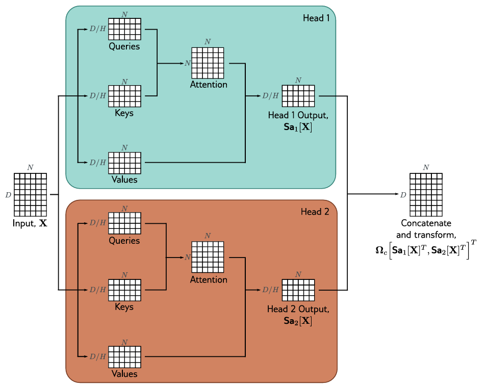

# فصل ۱۲: ترنسفورمرها (Transformers)
## جلسه 11
---

## بخش چهارم: گسترش‌های خودتوجهی ضرب نقطه‌ای

در جلسهٔ ۱۰ دیدیم که خودتوجهی ضرب نقطه‌ای در شکل ماتریسی به صورت زیر است:

$$
\mathbf{Sa}[\mathbf{X}] = \mathbf{V}[\mathbf{X}]\; \text{Softmax}\Big[\mathbf{K}[\mathbf{X}]^{\top} \mathbf{Q}[\mathbf{X}]\Big]
$$

این سازوکار در عمل تقریباً همیشه با سه گسترش به کار می‌رود: **رمزگذاری موقعیت** که ترتیب نشانه‌ها را وارد مدل می‌کند، **مقیاس‌دهی** ضرب‌های نقطه‌ای که آموزش را پایدار می‌کند، و **چند سر** که چند سازوکار توجه را به‌طور موازی اجرا می‌کند.

### رمزگذاری موقعیت (Positional encoding)

#### مشکل: خودتوجهی ترتیب را نمی‌بیند

در خودتوجهی، پارامترهای $\boldsymbol{\Omega}_v, \boldsymbol{\Omega}_q, \boldsymbol{\Omega}_k$ و $\boldsymbol{\beta}_v, \boldsymbol{\beta}_q, \boldsymbol{\beta}_k$ بین همهٔ جایگاه‌ها مشترک‌اند و وزن‌های توجه فقط به **محتوای** ورودی‌ها بستگی دارند، نه به جای آن‌ها. نتیجه این است که اگر ترتیب ورودی‌ها را عوض کنیم، خروجی‌ها هم دقیقاً به همان ترتیب جابه‌جا می‌شوند. اگر $\mathbf{P}$ یک **ماتریس جایگشت** (Permutation matrix) $N \times N$ باشد، $\mathbf{X}\mathbf{P}$ همان ستون‌های $\mathbf{X}$ با ترتیبی دیگر است و:

$$
\mathbf{Sa}[\mathbf{X}\mathbf{P}] = \mathbf{Sa}[\mathbf{X}]\,\mathbf{P}
$$

یعنی خودتوجهی نسبت به جایگشت ورودی‌ها **هم‌وردا** (Equivariant) است (مفهوم هم‌وردایی را در جلسهٔ ۲ دیدیم). دلیل آن:

- چون همهٔ ستون‌های $\boldsymbol{\beta}_v\mathbf{1}^{\top}$ یکسان‌اند، $\boldsymbol{\beta}_v\mathbf{1}^{\top}\mathbf{P} = \boldsymbol{\beta}_v\mathbf{1}^{\top}$ و در نتیجه $\mathbf{V}[\mathbf{X}\mathbf{P}] = \mathbf{V}[\mathbf{X}]\mathbf{P}$؛ برای $\mathbf{Q}$ و $\mathbf{K}$ هم همین‌طور.
- ماتریس ضرب‌های نقطه‌ای به $\mathbf{P}^{\top}\mathbf{K}^{\top}\mathbf{Q}\mathbf{P}$ تبدیل می‌شود، یعنی سطرها و ستون‌هایش به یک ترتیب جابه‌جا می‌شوند. `softmax` ستونی با این جابه‌جایی جابه‌جا می‌شود: $\text{Softmax}[\mathbf{P}^{\top}\mathbf{A}\mathbf{P}] = \mathbf{P}^{\top}\text{Softmax}[\mathbf{A}]\mathbf{P}$.
- بنابراین $\mathbf{Sa}[\mathbf{X}\mathbf{P}] = \mathbf{V}\mathbf{P}\,\mathbf{P}^{\top}\text{Softmax}[\mathbf{K}^{\top}\mathbf{Q}]\,\mathbf{P} = \mathbf{Sa}[\mathbf{X}]\,\mathbf{P}$، چون $\mathbf{P}\mathbf{P}^{\top} = \mathbf{I}$.

اما ترتیب کلمه‌ها در متن معنادار است: دو جملهٔ «علی به رضا زنگ زد» و «رضا به علی زنگ زد» دقیقاً همان کلمه‌ها را دارند، ولی معنایشان متفاوت است. خودتوجهی به‌تنهایی برای کلمهٔ «علی» در هر دو جمله **همان خروجی** را می‌سازد. پس باید اطلاعات موقعیت را به‌طور صریح به مدل بدهیم.

#### رمزگذاری موقعیت مطلق (Absolute positional encoding)

ساده‌ترین راه این است که یک ماتریس $\boldsymbol{\Pi} \in \mathbb{R}^{D \times N}$ به ورودی اضافه کنیم:

$$
\mathbf{X} \;\longrightarrow\; \mathbf{X} + \boldsymbol{\Pi}
$$

ستون $n$ام $\boldsymbol{\Pi}$ برداری است که فقط به موقعیت $n$ بستگی دارد و برای هر موقعیت متفاوت است؛ بنابراین یک کلمه در دو موقعیت مختلف، دو ورودی متفاوت خواهد داشت. ماتریس $\boldsymbol{\Pi}$ را می‌توان به دو صورت ساخت.

**از پیش تعیین‌شده:** رایج‌ترین انتخاب، رمزگذاری **سینوسی** مقالهٔ اصلی ترنسفورمر است. برای موقعیت $n$ و $i = 0, 1, \ldots, D/2 - 1$:

$$
\Pi_{2i,\,n} = \sin\!\left(\frac{n}{10000^{2i/D}}\right),
\qquad
\Pi_{2i+1,\,n} = \cos\!\left(\frac{n}{10000^{2i/D}}\right)
$$

هر جفت سطر یک موج سینوسی با بسامد متفاوت است: سطرهای بالایی با تغییر $n$ سریع نوسان می‌کنند و سطرهای پایینی بسیار کند؛ مانند عقربه‌های ثانیه‌شمار، دقیقه‌شمار و ساعت‌شمار که با هم یک زمان را به‌طور یکتا نشان می‌دهند. این رمزگذاری پارامتر ندارد و برای هر طولی تعریف می‌شود.

**یادگرفتنی:** درایه‌های $\boldsymbol{\Pi}$ پارامترهایی هستند که همراه با بقیهٔ شبکه آموزش می‌بینند. در این حالت طول دنباله نمی‌تواند از بیشینهٔ $N$ در زمان آموزش بیشتر شود.

> [!note] جای اضافه کردن $\boldsymbol{\Pi}$
> رمزگذاری موقعیت معمولاً یک بار به ورودی شبکه اضافه می‌شود، ولی می‌توان آن را در هر لایه هم اضافه کرد. گاهی هم $\boldsymbol{\Pi}$ فقط هنگام محاسبهٔ پرسش‌ها و کلیدها به $\mathbf{X}$ اضافه می‌شود و در محاسبهٔ مقدارها نه.

#### رمزگذاری موقعیت نسبی (Relative positional encoding)

موقعیت مطلق یک کلمه اغلب چندان مهم نیست؛ مثلاً یک جمله چه در ابتدای متن باشد و چه در انتهای آن، معنایش یکی است. آنچه مهم است **فاصلهٔ نسبی** کلمه‌هاست. درایهٔ $(m, n)$ ماتریس توجه به کلید موقعیت $m$ و پرسش موقعیت $n$ مربوط است؛ پس به یک فاصلهٔ مشخص $m - n$ مربوط است. در رمزگذاری نسبی، برای هر فاصله یک پارامتر $\pi_{m-n}$ یاد گرفته می‌شود و با آن ماتریس توجه تغییر داده می‌شود؛ مثلاً $\pi_{m-n}$ پیش از `softmax` به $\mathbf{k}_m^{\top}\mathbf{q}_n$ اضافه می‌شود (یا در آن ضرب می‌شود). به این ترتیب مدل می‌تواند الگوهایی مانند «به کلمهٔ قبلی توجه کن» را مستقل از جای جمله در متن یاد بگیرد.

کد زیر هم‌وردایی خودتوجهی را بررسی می‌کند و نشان می‌دهد که افزودن رمزگذاری سینوسی آن را از بین می‌برد:

```python
import torch

torch.manual_seed(0)

def self_attention(X, Ov, Oq, Ok, bv, bq, bk):
    V, Q, K = bv + Ov @ X, bq + Oq @ X, bk + Ok @ X
    return V @ torch.softmax(K.T @ Q, dim=0)

D, N = 4, 3
X = torch.randn(D, N)
params = [0.5 * torch.randn(D, D) for _ in range(3)] + [0.5 * torch.randn(D, 1) for _ in range(3)]

P = torch.eye(N)[:, [2, 0, 1]]             # permutation matrix: reorders the columns of X
print("Sa[XP] == Sa[X]P :", torch.allclose(self_attention(X @ P, *params),
                                           self_attention(X, *params) @ P, atol=1e-6))

# sinusoidal positional encoding Pi (D x N), added to the input
pos = torch.arange(N).float()                            # positions 0, ..., N-1
freq = 1.0 / 10000 ** (torch.arange(0, D, 2).float() / D)
Pi = torch.zeros(D, N)
Pi[0::2] = torch.sin(freq[:, None] * pos)
Pi[1::2] = torch.cos(freq[:, None] * pos)

print("with Pi          :", torch.allclose(self_attention(X @ P + Pi, *params),
                                           self_attention(X + Pi, *params) @ P, atol=1e-6))
```

```
Sa[XP] == Sa[X]P : True
with Pi          : False
```

### خودتوجهی ضرب نقطه‌ای مقیاس‌شده (Scaled dot-product self-attention)

ضرب‌های نقطه‌ای $\mathbf{k}_m^{\top}\mathbf{q}_n$ می‌توانند اندازهٔ بزرگی داشته باشند. در این حالت `softmax` **اشباع** می‌شود: بزرگ‌ترین مقدار وزنی نزدیک ۱ و بقیه وزنی نزدیک صفر می‌گیرند. اگر $s_j$ ورودی‌های `softmax` و $a_m$ خروجی‌های آن باشند، مشتق آن $\partial a_m / \partial s_j = a_m(\delta_{mj} - a_j)$ است و وقتی بردار وزن‌ها تقریباً یک‌داغ باشد، همهٔ این مشتق‌ها تقریباً صفرند. یعنی تغییرهای کوچک در ورودی‌ها تقریباً هیچ اثری بر خروجی ندارند و آموزش شبکه دشوار می‌شود.

چرا ضرب‌های نقطه‌ای بزرگ می‌شوند؟ اگر درایه‌های $\mathbf{q}$ و $\mathbf{k}$ مستقل، با میانگین صفر و واریانس ۱ باشند، $\mathbf{k}^{\top}\mathbf{q} = \sum_{d=1}^{D_q} k_d\, q_d$ مجموع $D_q$ جملهٔ مستقل با واریانس ۱ است؛ پس واریانس آن $D_q$ و انحراف معیارش $\sqrt{D_q}$ است ($D_q$ بُعد پرسش‌ها و کلیدهاست). برای $D_q = 1024$ این انحراف معیار ۳۲ است. راه‌حل این است که ضرب‌های نقطه‌ای را بر $\sqrt{D_q}$ تقسیم کنیم:

$$
\mathbf{Sa}[\mathbf{X}] = \mathbf{V}[\mathbf{X}]\; \text{Softmax}\!\left[\frac{\mathbf{K}[\mathbf{X}]^{\top} \mathbf{Q}[\mathbf{X}]}{\sqrt{D_q}}\right]
$$

این شکل را **خودتوجهی ضرب نقطه‌ای مقیاس‌شده** می‌نامند و تقریباً همهٔ ترنسفورمرها از آن استفاده می‌کنند.

```python
import torch

torch.manual_seed(0)
torch.set_printoptions(precision=3, sci_mode=False)

for Dq in [4, 64, 1024]:
    q, k = torch.randn(Dq, 10000), torch.randn(Dq, 10000)    # 10000 random (q, k) pairs
    dots = (k * q).sum(dim=0)                                 # k^T q
    print(f"D_q = {Dq:4d}:  std(k^T q) = {dots.std():5.2f},  std(k^T q / sqrt(D_q)) = {(dots / Dq**0.5).std():.2f}")

s = torch.randn(6)                         # scaled scores of one query against N = 6 keys
print("softmax[s]     :", torch.softmax(s, dim=0))
print("softmax[32 * s]:", torch.softmax(32 * s, dim=0))      # the same scores without scaling, D_q = 1024
```

```
D_q =    4:  std(k^T q) =  1.99,  std(k^T q / sqrt(D_q)) = 1.00
D_q =   64:  std(k^T q) =  7.91,  std(k^T q / sqrt(D_q)) = 0.99
D_q = 1024:  std(k^T q) = 32.05,  std(k^T q / sqrt(D_q)) = 1.00
softmax[s]     : tensor([0.276, 0.070, 0.111, 0.226, 0.111, 0.207])
softmax[32 * s]: tensor([0.998, 0.000, 0.000, 0.002, 0.000, 0.000])
```

بدون مقیاس‌دهی، تقریباً همهٔ وزن به یک ورودی می‌رسد و `softmax` اشباع شده است؛ با مقیاس‌دهی، وزن‌ها بین ورودی‌ها پخش‌اند.

### چند سر (Multiple heads)

در عمل معمولاً چند سازوکار خودتوجهی به‌طور **موازی** اجرا می‌شوند که هر کدام را یک **سر** (Head) می‌نامند. با $H$ سر، سر $h$ام پارامترهای مخصوص خودش را دارد:

$$
\mathbf{V}_h = \boldsymbol{\beta}_{vh}\mathbf{1}^{\top} + \boldsymbol{\Omega}_{vh}\mathbf{X},
\qquad
\mathbf{Q}_h = \boldsymbol{\beta}_{qh}\mathbf{1}^{\top} + \boldsymbol{\Omega}_{qh}\mathbf{X},
\qquad
\mathbf{K}_h = \boldsymbol{\beta}_{kh}\mathbf{1}^{\top} + \boldsymbol{\Omega}_{kh}\mathbf{X}
$$

$$
\mathbf{Sa}_h[\mathbf{X}] = \mathbf{V}_h\; \text{Softmax}\!\left[\frac{\mathbf{K}_h^{\top} \mathbf{Q}_h}{\sqrt{D_q}}\right]
$$

اگر بُعد ورودی‌ها $D$ باشد، معمولاً هر سر پرسش‌ها، کلیدها و مقدارهایی با بُعد $D/H$ دارد؛ یعنی $\boldsymbol{\Omega}_{vh}, \boldsymbol{\Omega}_{qh}, \boldsymbol{\Omega}_{kh} \in \mathbb{R}^{(D/H) \times D}$ و $D_q = D/H$. خروجی‌های سرها **زیر هم** قرار می‌گیرند و یک تبدیل خطی دیگر، $\boldsymbol{\Omega}_c \in \mathbb{R}^{D \times D}$، آن‌ها را با هم ترکیب می‌کند:

$$
\mathbf{MhSa}[\mathbf{X}] = \boldsymbol{\Omega}_c \Big[\mathbf{Sa}_1[\mathbf{X}]^{\top}, \mathbf{Sa}_2[\mathbf{X}]^{\top}, \ldots, \mathbf{Sa}_H[\mathbf{X}]^{\top}\Big]^{\top}
$$



شکل بالا خودتوجهی چندسر را با دو سر نشان می‌دهد:

- خودتوجهی به‌طور موازی در چند «سر» انجام می‌شود؛ اینجا دو سر در کادرهای فیروزه‌ای و نارنجی رسم شده‌اند.
- هر سر پرسش‌ها، کلیدها و مقدارهای **مخصوص خودش** را دارد که هر کدام $(D/H) \times N$ هستند، و ماتریس توجه $N \times N$ خودش را می‌سازد.
- خروجی هر سر، $\mathbf{Sa}_h[\mathbf{X}]$، یک ماتریس $(D/H) \times N$ است.
- خروجی سرها **به‌صورت عمودی** به هم الحاق می‌شوند و ماتریسی $D \times N$ می‌سازند؛ سپس تبدیل خطی $\boldsymbol{\Omega}_c$ آن‌ها را دوباره ترکیب می‌کند. خروجی نهایی هم‌اندازهٔ ورودی است.

چرا چند سر؟ هر سر می‌تواند به نوع متفاوتی از رابطه بین کلمه‌ها توجه کند؛ مثلاً یک سر ضمیر را به اسم مرجعش (it → restaurant) وصل کند و سری دیگر فعل را به فاعلش. در عمل به نظر می‌رسد چند سر برای خوب کار کردن ترنسفورمر لازم است؛ یکی از توضیح‌های پیشنهادی این است که چند سر خودتوجهی را در برابر مقداردهی اولیهٔ بد مقاوم‌تر می‌کند.

> [!note] هزینهٔ چند سر
> چون هر سر بُعد $D/H$ دارد، تعداد پارامترهای پرسش‌ها، کلیدها و مقدارها همان $3D^2 + 3D$ حالت تک‌سر است؛ فقط $D^2$ پارامتر $\boldsymbol{\Omega}_c$ اضافه می‌شود. برای مثال نقد رستوران با $D = 1024$ و $H = 16$ سر (هر سر با بُعد 64)، تعداد پارامترها $3{,}148{,}800 + 1{,}048{,}576 = 4{,}197{,}376$ است. در پیاده‌سازی هم ماتریس‌های $\boldsymbol{\Omega}_{qh}$ همهٔ سرها زیر هم یک ماتریس $D \times D$ می‌سازند؛ پس پرسش‌های همهٔ سرها با یک ضرب ماتریسی محاسبه و سپس بین سرها تقسیم می‌شوند.

کد زیر خودتوجهی چندسر را از روی فرمول بالا پیاده‌سازی می‌کند و نتیجه را با `nn.MultiheadAttention` مقایسه می‌کند. توجه کنید که PyTorch ورودی‌ها را در **سطرها** نگه می‌دارد و ماتریس‌های $\boldsymbol{\Omega}_q, \boldsymbol{\Omega}_k, \boldsymbol{\Omega}_v$ همهٔ سرها را زیر هم در `in_proj_weight` ذخیره می‌کند:

```python
import torch

torch.manual_seed(0)

D, N, H = 8, 5, 2
Dh = D // H                                   # size of each head: D/H
X = torch.randn(D, N)                         # columns are the inputs

mha = torch.nn.MultiheadAttention(embed_dim=D, num_heads=H)
torch.nn.init.normal_(mha.in_proj_bias)       # make the biases beta_q, beta_k, beta_v nonzero
torch.nn.init.zeros_(mha.out_proj.bias)       # the formula above has no bias after Omega_c

Omega_q, Omega_k, Omega_v = mha.in_proj_weight.chunk(3)      # each D x D (rows = all heads)
beta_q, beta_k, beta_v = (b[:, None] for b in mha.in_proj_bias.chunk(3))
Omega_c = mha.out_proj.weight                                 # D x D

heads = []
for h in range(H):
    r = slice(h * Dh, (h + 1) * Dh)           # rows that belong to head h
    Q = beta_q[r] + Omega_q[r] @ X            # (D/H, N)
    K = beta_k[r] + Omega_k[r] @ X
    V = beta_v[r] + Omega_v[r] @ X
    heads.append(V @ torch.softmax(K.T @ Q / Dh ** 0.5, dim=0))   # Sa_h[X]  (D/H, N)

MhSa = Omega_c @ torch.cat(heads, dim=0)      # stack vertically -> (D, N), then recombine

# PyTorch stores the inputs as ROWS: shape (N, batch, D)
out, _ = mha(X.T[:, None], X.T[:, None], X.T[:, None])
print("output shape:", tuple(MhSa.shape))
print("same as nn.MultiheadAttention:", torch.allclose(MhSa, out[:, 0].T, atol=1e-6))
print("parameters:", sum(p.numel() for p in mha.parameters()) - D)   # minus the out_proj bias
```

```
output shape: (8, 5)
same as nn.MultiheadAttention: True
parameters: 280
```

برای $D = 8$ تعداد پارامترها $3 \cdot 8^2 + 3 \cdot 8 + 8^2 = 280$ است که با فرمول بالا می‌خواند.

---
