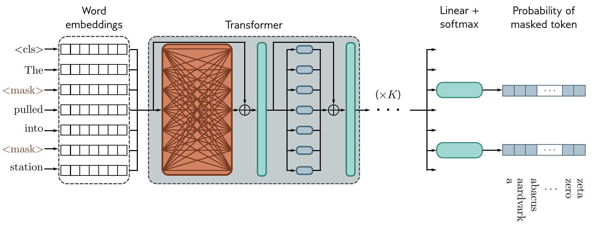
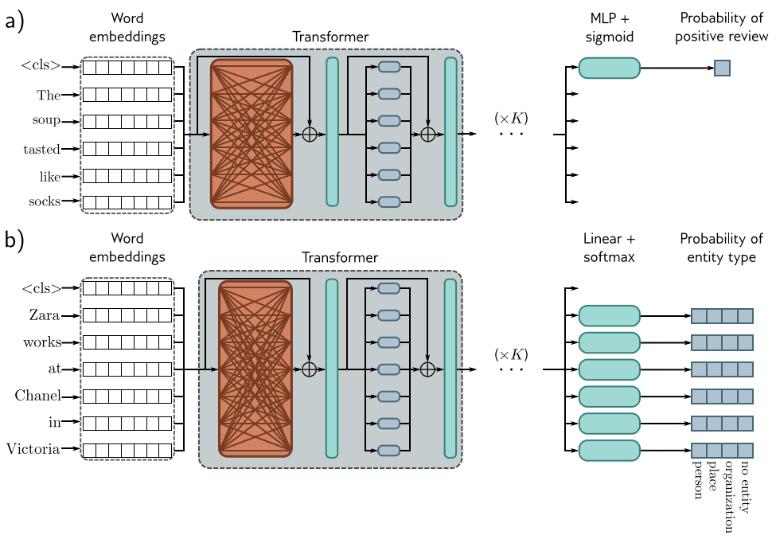
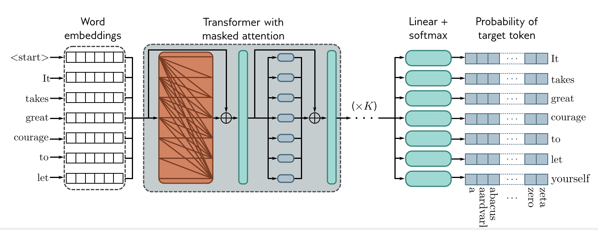
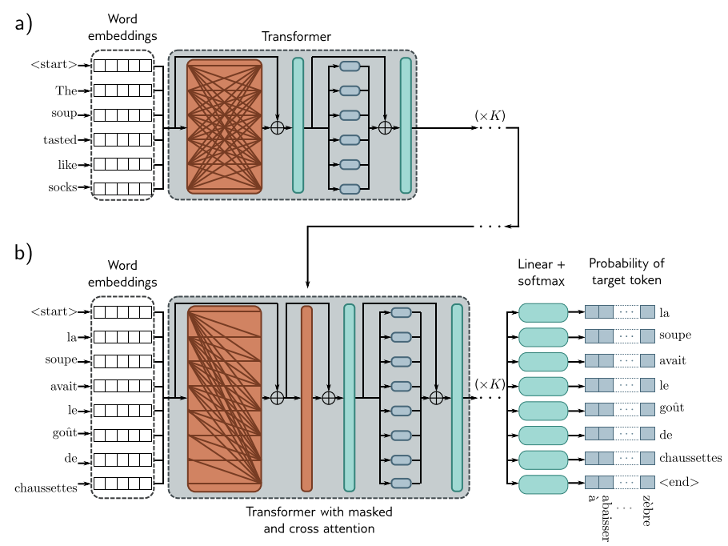
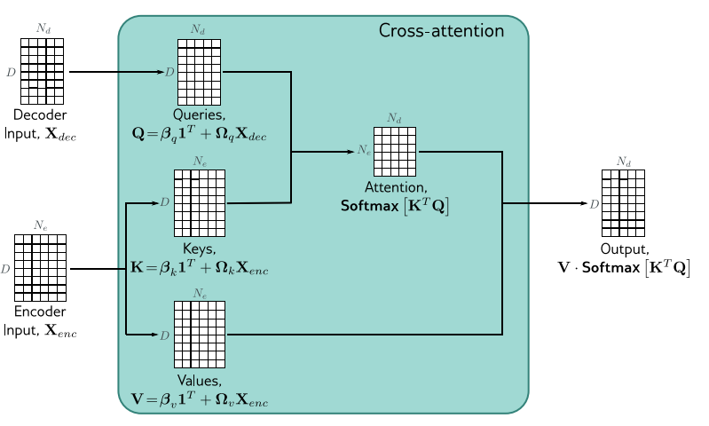

# فصل ۱۲: ترنسفورمرها (Transformers) ادامه...
## جلسه 12
---

## بخش هفتم: نمونهٔ یک مدل رمزگذار: BERT

در پایان جلسهٔ ۱۱ دیدیم که ترنسفورمرها سه خانوادهٔ اصلی دارند. در این بخش اولین خانواده، یعنی **رمزگذار**، را با مشهورترین نمونه‌اش، **BERT** (Bidirectional Encoder Representations from Transformers)، بررسی می‌کنیم. ایدهٔ اصلی ساده است و در دو مرحله اجرا می‌شود:

1. **پیش‌آموزش** (Pre-training): مدل روی حجم بسیار زیادی متن **بدون برچسب** آموزش می‌بیند تا آمار کلی زبان را یاد بگیرد.
2. **تنظیم دقیق** (Fine-tuning): مدل پیش‌آموزش‌دیده با کمی دادهٔ **برچسب‌دار** برای یک کار مشخص، مثل تحلیل احساس، تنظیم می‌شود.

این همان ایدهٔ **یادگیری انتقالی** است که در فصل ۱۱ (جلسهٔ ۷ و پروژهٔ ۲) با شبکه‌های ازپیش‌آموزش‌دیده روی ImageNet دیدیم؛ فقط اینجا پیش‌آموزش به برچسب نیاز ندارد.

### معماری BERT

BERT یک پشتهٔ ساده از لایه‌های ترنسفورمر جلسهٔ ۱۱ است. نسخهٔ بزرگ آن این مشخصات را دارد:

| مشخصه | مقدار |
| --- | --- |
| اندازهٔ واژه‌نامه $\lvert\mathcal{V}\rvert$ | $30{,}000$ نشانه |
| بُعد نهفته $D$ | $1024$ |
| تعداد لایه‌ها $K$ | $24$ |
| تعداد سرها $H$ | $16$ (هر سر با بُعد $64$) |
| لایهٔ پنهان شبکهٔ تمام‌متصل | $4096 = 4D$ |
| بیشینهٔ طول ورودی | $512$ نشانه |
| تعداد کل پارامترها | حدود $340$ میلیون |

این همان مدل جدول جلسهٔ ۱۱ است، با ۲۴ لایه به‌جای ۱۲: $24 \times 12.6 \approx 302$ میلیون پارامتر در لایه‌ها و حدود $31$ میلیون در ماتریس نهفته‌سازی؛ بقیه مربوط به رمزگذاری موقعیت یادگرفتنی و چند جزء کوچک است.

در ابتدای هر ورودی یک نشانهٔ ویژه به نام `<cls>` قرار می‌گیرد. این نشانه کلمهٔ واقعی نیست؛ اما چون از طریق خودتوجهی با همهٔ نشانه‌ها در تعامل است، خروجی متناظر با آن می‌تواند نمایشی از **کل متن** باشد.

### پیش‌آموزش: پیش‌بینی کلمه‌های پوشانده

برای آموزش به برچسب نیاز داریم، اما برچسب‌گذاری میلیاردها کلمه ممکن نیست. راه‌حل BERT این است که برچسب را **از خود متن** بسازد؛ به این روش **یادگیری خودنظارتی** (Self-supervised learning) می‌گویند. بخش کوچکی از نشانه‌های ورودی (حدود ۱۵٪) به‌طور تصادفی با نشانهٔ عمومی `<mask>` جایگزین می‌شوند و مدل باید کلمهٔ اصلی را حدس بزند:

- ورودی: `<cls> The <mask> pulled into <mask> station`
- هدف: کلمهٔ اول پوشانده‌شده `train` و دومی `the` است.



شکل بالا پیش‌آموزش یک رمزگذار شبیه BERT را نشان می‌دهد:

- نشانه‌های ورودی، همراه با نشانهٔ ویژهٔ `<cls>` که شروع دنباله را مشخص می‌کند، به نهفته‌ها تبدیل می‌شوند. در این شکل نهفته‌ها **سطر** هستند (نه ستون)؛ پس کادر «Word embeddings» همان $\mathbf{X}^{\top}$ است.
- نهفته‌ها از چند لایهٔ ترنسفورمر می‌گذرند. اتصال‌های نارنجی نشان می‌دهند که در این لایه‌ها **هر نشانه به همهٔ نشانه‌های دیگر** توجه می‌کند.
- برای هر نشانهٔ پوشانده، نهفتهٔ خروجی متناظر از یک لایهٔ خطی و `softmax` می‌گذرد و یک توزیع احتمال روی همهٔ $|\mathcal{V}|$ کلمهٔ واژه‌نامه می‌سازد. روی هر کدام یک **زیان آنتروپی متقاطع** (طبقه‌بندی چندکلاسه) اعمال می‌شود.
- **مزیت:** برای حدس کلمهٔ گم‌شده، مدل از بافت **هر دو طرف** آن (چپ و راست) استفاده می‌کند؛ حرف B در نام BERT (Bidirectional) به همین اشاره دارد.
- **عیب:** استفاده از داده کارآمد نیست. در این مثال هفت نشانه پردازش می‌شوند تا فقط **دو** جمله به تابع زیان اضافه شود.

> [!example] مثال
> فرض کنید مدل برای اولین `<mask>` به کلمهٔ `train` احتمال $0.6$ بدهد. زیان این موقعیت $-\log 0.6 \approx 0.51$ است. اگر احتمال کلمهٔ درست $0.01$ باشد، زیان $-\log 0.01 \approx 4.6$ می‌شود. زیان کل، میانگین این مقدار روی همهٔ موقعیت‌های پوشانده است؛ موقعیت‌های دیگر در زیان شرکت نمی‌کنند.

چرا این کار ساده مفید است؟ برای حدس درست کلمهٔ پوشانده در «قطار وارد `<mask>` شد»، مدل باید بداند پس از «وارد … شد» معمولاً یک مکان می‌آید (**دستور زبان**)، قطار به ایستگاه وارد می‌شود و نه به آشپزخانه (**معنا**)، و ایستگاه قطار چه نقشی دارد (**دانش عمومی**). پس با حل این مسئله روی میلیاردها جمله، مدل نمایش‌هایی از متن می‌سازد که برای کارهای بسیار متفاوتی مفیدند.

> [!note] پیش‌بینی جملهٔ بعد
> در نسخهٔ اصلی BERT کار دیگری هم در پیش‌آموزش وجود داشت: دو جمله با هم به مدل داده می‌شدند و مدل باید از روی خروجی `<cls>` تشخیص می‌داد که آیا جملهٔ دوم واقعاً در متن اصلی پس از اولی آمده است یا نه. پژوهش‌های بعدی نشان دادند که این کار اهمیت زیادی ندارد.

### تنظیم دقیق

پس از پیش‌آموزش، لایهٔ خطی و `softmax` پیش‌بینی کلمه کنار گذاشته می‌شود و به‌جای آن یک لایهٔ خطی یا یک MLP کوچک، متناسب با خروجی مورد نیاز، به رمزگذار اضافه می‌شود. سپس کل شبکه (یا فقط لایهٔ تازه) با دادهٔ برچسب‌دارِ آن کار آموزش می‌بیند. چون مدل از قبل زبان را می‌شناسد، معمولاً چند هزار نمونهٔ برچسب‌دار کافی است.



شکل بالا دو نمونه از این کارها را نشان می‌دهد:

-   **شکل (a) طبقه‌بندی متن:** در این مسئلهٔ تحلیل احساس، فقط نهفتهٔ خروجی `<cls>` به یک MLP و تابع سیگموید داده می‌شود تا احتمال **مثبت** بودن نقد به دست آید. برای جملهٔ «The soup tasted like socks» (سوپ مزهٔ جوراب می‌داد!) انتظار داریم این احتمال کم باشد.
-  **شکل (b) طبقه‌بندی کلمه:** در این مسئلهٔ **تشخیص موجودیت‌های نام‌دار** (Named entity recognition)، نهفتهٔ خروجی **هر کلمه** به یک لایهٔ خطی و `softmax` با چهار کلاس داده می‌شود: شخص، مکان، سازمان، یا هیچ‌کدام. در «Zara works at Chanel in Victoria»، انتظار داریم Zara شخص، Chanel سازمان و Victoria مکان تشخیص داده شود.

هر دو کار از یک رمزگذار پیش‌آموزش‌دیده استفاده می‌کنند و فقط **لایهٔ خروجی** آن‌ها متفاوت است. این دو کار همان دسته‌های «چندبه‌یک» و «چندبه‌چند هم‌زمان» جلسهٔ ۸ هستند.

> [!note] پیش‌بینی بازهٔ متن
> نوع سومی از کارها هم با همین روش حل می‌شود: در **پرسش و پاسخ**، یک پرسش و یک متن به مدل داده می‌شود و مدل باید بازه‌ای از متن را که پاسخ پرسش است مشخص کند. برای هر نشانهٔ متن، دو احتمال پیش‌بینی می‌شود: اینکه **شروع** پاسخ باشد و اینکه **پایان** آن باشد.

کد زیر یک رمزگذار کوچک و آموزش‌ندیده را با هر دو مرحله نشان می‌دهد. در پیش‌آموزش فقط موقعیت‌های پوشانده در زیان شرکت می‌کنند (بقیه با برچسب `-100` نادیده گرفته می‌شوند). در تنظیم دقیق، همان رمزگذار با دو سر خروجی متفاوت به کار می‌رود. رمزگذاری موقعیت را برای کوتاه شدن کد حذف کرده‌ایم:

```python
import torch
import torch.nn as nn

torch.manual_seed(0)

V, D, H, K = 100, 16, 2, 2               # vocabulary, embedding size, heads, layers
CLS, MASK = 0, 1                         # ids of the special tokens <cls> and <mask>

embed = nn.Embedding(V, D)
layer = nn.TransformerEncoderLayer(d_model=D, nhead=H, dim_feedforward=4 * D, dropout=0.0)
encoder = nn.TransformerEncoder(layer, num_layers=K, enable_nested_tensor=False)
mlm_head = nn.Linear(D, V)               # pre-training: scores for every word of the vocabulary

tokens = torch.tensor([CLS, 17, 42, 63, 8, 25, 91])     # "<cls> The train pulled into the station"
N = len(tokens)

# 1) pre-training: mask some tokens and predict them
masked = torch.tensor([2, 5])                           # positions replaced with <mask>
inputs = tokens.clone()
inputs[masked] = MASK
targets = torch.full((N,), -100)                        # -100 = ignored by the loss
targets[masked] = tokens[masked]

out = encoder(embed(inputs)[:, None])[:, 0]             # output embeddings (N, D)
loss = nn.functional.cross_entropy(mlm_head(out), targets, ignore_index=-100)
print("output embeddings:", tuple(out.shape))
print("positions in the loss:", (targets != -100).sum().item(), "of", N)
print(f"masked-LM loss: {loss.item():.3f}   (log V = {torch.log(torch.tensor(V)).item():.3f})")

# 2) fine-tuning heads on the same encoder
sentiment_head = nn.Linear(D, 1)         # text classification: uses only the <cls> output
ner_head = nn.Linear(D, 4)               # word classification: person, place, organization, no entity
out = encoder(embed(tokens)[:, None])[:, 0]
p_positive = torch.sigmoid(sentiment_head(out[0]))
p_entity = torch.softmax(ner_head(out[1:]), dim=-1)
print("P(positive review):", tuple(p_positive.shape), " P(entity type) per word:", tuple(p_entity.shape))
```

```
output embeddings: (7, 16)
positions in the loss: 2 of 7
masked-LM loss: 4.245   (log V = 4.605)
P(positive review): (1,)  P(entity type) per word: (6, 4)
```

زیان مدل آموزش‌ندیده نزدیک به $\log|\mathcal{V}| = \log 100 \approx 4.6$ است؛ یعنی تقریباً همان زیان حدس کاملاً تصادفی بین ۱۰۰ کلمه. هدف پیش‌آموزش پایین آوردن این عدد است.

---

## بخش هشتم: نمونهٔ یک مدل رمزگشا: GPT-3

خانوادهٔ دوم ترنسفورمرها **رمزگشا** است. هدف رمزگشا ساختن نمایشی از متن نیست؛ رمزگشا **نشانهٔ بعدی** را پیش‌بینی می‌کند و به این ترتیب می‌تواند متن تولید کند. مشهورترین نمونه‌های آن مدل‌های GPT هستند؛ در اینجا GPT-3 را بررسی می‌کنیم.

### مدل‌سازی زبان

یک **مدل زبانی** (Language model) به هر دنباله از نشانه‌ها $t_1, t_2, \ldots, t_N$ یک احتمال نسبت می‌دهد. طبق قاعدهٔ ضرب احتمال، این احتمال را می‌توان به حاصل‌ضرب احتمال‌های شرطی شکست:

$$
\Pr(t_1, t_2, \ldots, t_N) = \prod_{n=1}^{N} \Pr(t_n \mid t_1, \ldots, t_{n-1})
$$

یعنی کافی است مدل بتواند در هر جایگاه، با دیدن نشانه‌های **قبلی**، توزیع احتمال نشانهٔ **بعدی** را بدهد. برای مثال برای جملهٔ «امروز هوا خیلی سرد است»:

$$
\Pr(\text{امروز}) \cdot \Pr(\text{هوا} \mid \text{امروز}) \cdot \Pr(\text{خیلی} \mid \text{امروز هوا}) \cdot \Pr(\text{سرد} \mid \text{امروز هوا خیلی}) \cdot \Pr(\text{است} \mid \ldots)
$$

مدل خوب به «سرد» یا «گرم» پس از «امروز هوا خیلی» احتمال زیاد می‌دهد و به «کتاب» احتمال بسیار کم.

### خودتوجهی پوشیده (Masked self-attention)

برای آموزش، کل جمله را یک‌جا به شبکه می‌دهیم و در هر جایگاه $n$ نشانهٔ $t_{n+1}$ را پیش‌بینی می‌کنیم. اما در خودتوجهی معمولی هر نشانه به **همهٔ** نشانه‌ها، از جمله نشانه‌های بعدی، توجه می‌کند؛ پس مدل می‌تواند پاسخ را «از روی دست» نشانهٔ بعدی بخواند و هیچ چیز مفیدی یاد نگیرد.

راه‌حل این است که خروجی جایگاه $n$ فقط به نشانه‌های $1$ تا $n$ وابسته باشد. برای این کار، پیش از `softmax`، ضرب‌های نقطه‌ای مربوط به کلیدهای **بعدی** ($m > n$) را برابر $-\infty$ قرار می‌دهیم:

$$
\mathbf{k}_m^{\top}\mathbf{q}_n \;\leftarrow\; -\infty \qquad \text{برای } m > n
$$

چون $e^{-\infty} = 0$، وزن توجه این کلیدها صفر می‌شود و بقیهٔ وزن‌ها همچنان جمعشان ۱ است. در ماتریس توجه (سطر $m$ کلید و ستون $n$ پرسش)، همهٔ درایه‌های **زیر قطر** صفر می‌شوند.



شکل بالا آموزش یک رمزگشای شبیه GPT-3 را نشان می‌دهد:

- ورودی جملهٔ «It takes great courage to let» است که یک نشانهٔ ویژهٔ `<start>` در ابتدای آن قرار گرفته و هر نشانه به نهفته تبدیل شده است.
- در لایه‌های ترنسفورمر از **خودتوجهی پوشیده** استفاده می‌شود: اتصال‌های نارنجی نشان می‌دهند که هر نشانه فقط به خودش و نشانه‌های **پیش از** خودش توجه می‌کند.
- خروجی هر جایگاه از یک لایهٔ خطی و `softmax` می‌گذرد و توزیع احتمال **نشانهٔ بعدی** را روی کل واژه‌نامه می‌دهد: خروجی `<start>` باید `It` را پیش‌بینی کند، خروجی `It` باید `takes` را، و همین‌طور تا خروجی `let` که باید `yourself` را پیش‌بینی کند.
- برخلاف BERT، **همهٔ** جایگاه‌ها در زیان شرکت می‌کنند: هفت نشانه پردازش می‌شوند و هفت جمله به زیان اضافه می‌شود. پس استفاده از داده بسیار کارآمدتر است. در عوض، هر نشانه فقط بافت **سمت چپ** خود را می‌بیند.

کد زیر خودتوجهی پوشیده را با نمادگذاری ستونی پیاده‌سازی می‌کند و نشان می‌دهد که تغییر آخرین نشانه هیچ خروجی قبلی را تغییر نمی‌دهد:

```python
import torch

torch.manual_seed(0)
torch.set_printoptions(precision=2, sci_mode=False)

D, N = 4, 4
X = torch.randn(D, N)                                   # columns are the inputs
Omega_v, Omega_q, Omega_k = (0.5 * torch.randn(D, D) for _ in range(3))

def masked_self_attention(X):
    V, Q, K = Omega_v @ X, Omega_q @ X, Omega_k @ X
    S = K.T @ Q / D ** 0.5                              # entry (m, n): key m, query n
    future = torch.ones(N, N).tril(diagonal=-1).bool()  # m > n: key comes after query
    S = S.masked_fill(future, float("-inf"))            # e^(-inf) = 0 after softmax
    A = torch.softmax(S, dim=0)
    return V @ A, A

Sa, A = masked_self_attention(X)
print("attention weights (column n = output n):")
print(A)

# changing the last token does not change any earlier output
X2 = X.clone()
X2[:, -1] = torch.randn(D)
Sa2, _ = masked_self_attention(X2)
print("outputs 1..N-1 unchanged:", torch.allclose(Sa[:, :-1], Sa2[:, :-1]))
print("output N changed:        ", not torch.allclose(Sa[:, -1], Sa2[:, -1]))
```

```
attention weights (column n = output n):
tensor([[1.00, 0.60, 0.20, 0.11],
        [0.00, 0.40, 0.60, 0.75],
        [0.00, 0.00, 0.20, 0.09],
        [0.00, 0.00, 0.00, 0.04]])
outputs 1..N-1 unchanged: True
output N changed:         True
```

ستون اول فقط یک وزن غیرصفر دارد (خروجی اول فقط خودش را می‌بیند) و ستون آخر به هر چهار ورودی توجه می‌کند.

### تولید متن

پس از آموزش، متن **یک نشانه در هر گام** تولید می‌شود؛ به این روش **خودبازگشتی** (Autoregressive) می‌گویند:

1. ورودی را با `<start>` (یا با یک متن آغازین) شروع می‌کنیم.
2. شبکه توزیع احتمال نشانهٔ بعدی را می‌دهد و از آن یک نشانه انتخاب می‌کنیم.
3. نشانهٔ انتخاب‌شده را به انتهای ورودی اضافه می‌کنیم و به گام ۲ برمی‌گردیم؛ تا وقتی که نشانهٔ پایان تولید شود یا به طول دلخواه برسیم.

برای انتخاب نشانه چند راه رایج وجود دارد:

- **حریصانه** (Greedy): همیشه محتمل‌ترین نشانه انتخاب می‌شود. ساده است، اما متن تکراری و کسل‌کننده می‌سازد.
- **نمونه‌گیری** (Sampling): نشانه به‌طور تصادفی از توزیع احتمال انتخاب می‌شود. متن متنوع‌تر است، اما گاهی نشانه‌های بسیار نامحتمل و بی‌ربط انتخاب می‌شوند.
- **نمونه‌گیری از $k$ نشانهٔ برتر** (Top-$k$ sampling): نمونه‌گیری فقط از میان $k$ نشانهٔ محتمل‌تر انجام می‌شود؛ تعادلی بین دو روش قبل.

> [!note] چرا تولید متن کارآمد است؟
> به خاطر خودتوجهی پوشیده، خروجی‌های جایگاه‌های قبلی با افزوده شدن نشانهٔ تازه **تغییر نمی‌کنند** (همان نتیجهٔ کد بالا). پس در هر گام لازم نیست کل دنباله از نو پردازش شود؛ کلیدها و مقدارهای نشانه‌های قبلی ذخیره و دوباره استفاده می‌شوند و فقط نشانهٔ تازه پردازش می‌شود.

### GPT-3 و یادگیری از چند نمونه

GPT-3 همین رمزگشا در مقیاس بسیار بزرگ است:

| مشخصه | مقدار |
| --- | --- |
| تعداد لایه‌ها $K$ | $96$ |
| بُعد نهفته $D$ | $12{,}288$ |
| تعداد سرها $H$ | $96$ (هر سر با بُعد $128$) |
| بیشینهٔ طول ورودی | $2048$ نشانه |
| تعداد کل پارامترها | حدود $175$ میلیارد |

نکتهٔ شگفت‌انگیز GPT-3 این بود که بدون هیچ تنظیم دقیقی، کارهای تازه را فقط از روی **چند نمونه در خود ورودی** انجام می‌داد؛ به این توانایی **یادگیری از چند نمونه** (Few-shot learning) می‌گویند. برای مثال اگر ورودی چنین باشد:

```
cheese -> پنیر
book -> کتاب
water -> آب
house ->
```

محتمل‌ترین ادامه از نظر مدل «خانه» است. مدل هیچ پارامتری را تغییر نداده؛ فقط الگوی کار را از نمونه‌های درون ورودی تشخیص داده و برای پیش‌بینی نشانهٔ بعدی از آن استفاده کرده است. این ایده پایهٔ استفادهٔ امروزی از مدل‌های زبانی بزرگ با **دستور** (Prompt) است.

---

## بخش نهم: نمونهٔ یک مدل رمزگذار–رمزگشا: ترجمهٔ ماشینی

خانوادهٔ سوم ترنسفورمرها **رمزگذار–رمزگشا** است که یک دنباله را به دنبالهٔ دیگری تبدیل می‌کند. نمونهٔ اصلی آن **ترجمهٔ ماشینی** است؛ همان کاری که مقالهٔ اصلی ترنسفورمر برای آن طراحی شد. برای مثال جملهٔ انگلیسی «The soup tasted like socks» باید به جملهٔ فرانسوی «La soupe avait le goût de chaussettes» ترجمه شود.

در این مسئله دو نکته اهمیت دارد:

- طول جملهٔ مبدأ و مقصد معمولاً **برابر نیست** و ترتیب کلمه‌ها هم ممکن است فرق کند؛ پس نمی‌توان هر کلمه را جداگانه ترجمه کرد (همان دستهٔ «چندبه‌چند با تأخیر» در جلسهٔ ۸).
- برای ساختن جملهٔ مقصد، مدل باید هم **کل جملهٔ مبدأ** را ببیند و هم **کلمه‌هایی را که تا اینجا تولید کرده**.

ایدهٔ اصلی این است که دو مدل قبلی را کنار هم بگذاریم: یک **رمزگذار** (مانند BERT) جملهٔ مبدأ را پردازش می‌کند و یک **رمزگشا** (مانند GPT) جملهٔ مقصد را کلمه به کلمه تولید می‌کند و در هر گام به خروجی رمزگذار هم نگاه می‌کند.



شکل بالا معماری رمزگذار–رمزگشا را نشان می‌دهد. دو جمله به سیستم داده می‌شود و هدف، ترجمهٔ جملهٔ اول به دومی است:

- **شکل (a):** جملهٔ اول از یک **رمزگذار معمولی** می‌گذرد. در اینجا خودتوجهی پوشیده نیست و هر نشانه به همهٔ نشانه‌های جملهٔ مبدأ توجه می‌کند.
- **شکل (b):** جملهٔ دوم از یک **رمزگشا** می‌گذرد. رمزگشا از خودتوجهی پوشیده استفاده می‌کند، اما در هر لایه با سازوکاری به نام **توجه متقاطع** (Cross-attention، مستطیل نارنجی باریک) به نهفته‌های خروجی رمزگذار هم توجه می‌کند.
- تابع زیان همان زیان مدل رمزگشاست: می‌خواهیم احتمال **کلمهٔ بعدی** جملهٔ مقصد بیشینه شود. ورودی رمزگشا با `<start>` شروع می‌شود و خروجی آخر باید نشانهٔ پایان `<end>` باشد.

بنابراین هر لایهٔ رمزگشا سه بلوک باقیمانده دارد (هر کدام با یک LayerNorm): خودتوجهی پوشیده، توجه متقاطع و شبکهٔ تمام‌متصل.

### توجه متقاطع

توجه متقاطع همان خودتوجهی است، با یک تفاوت: **پرسش‌ها** از رمزگشا می‌آیند و **کلیدها و مقدارها** از رمزگذار. اگر $\mathbf{X}_{dec} \in \mathbb{R}^{D \times N_d}$ نهفته‌های رمزگشا و $\mathbf{X}_{enc} \in \mathbb{R}^{D \times N_e}$ خروجی رمزگذار باشد:

$$
\mathbf{Q} = \boldsymbol{\beta}_q\mathbf{1}^{\top} + \boldsymbol{\Omega}_q\mathbf{X}_{dec},
\qquad
\mathbf{K} = \boldsymbol{\beta}_k\mathbf{1}^{\top} + \boldsymbol{\Omega}_k\mathbf{X}_{enc},
\qquad
\mathbf{V} = \boldsymbol{\beta}_v\mathbf{1}^{\top} + \boldsymbol{\Omega}_v\mathbf{X}_{enc}
$$

$$
\mathbf{Sa}[\mathbf{X}_{dec}, \mathbf{X}_{enc}] = \mathbf{V}\; \text{Softmax}\!\left[\frac{\mathbf{K}^{\top}\mathbf{Q}}{\sqrt{D_q}}\right]
$$



شکل بالا توجه متقاطع را نشان می‌دهد:

- روند محاسبه همان خودتوجهی معمولی است (شکل 12.4 در جلسهٔ ۱۰)، اما پرسش‌ها از نهفته‌های رمزگشا $\mathbf{X}_{dec}$ و کلیدها و مقدارها از نهفته‌های رمزگذار $\mathbf{X}_{enc}$ محاسبه می‌شوند.
- ماتریس توجه $N_e \times N_d$ است و لازم نیست مربعی باشد: ستون $n$ام آن نشان می‌دهد نشانهٔ $n$ام مقصد به کدام نشانه‌های مبدأ توجه می‌کند.
- خروجی $D \times N_d$ است، هم‌اندازهٔ ورودی رمزگشا؛ پس می‌تواند مانند خودتوجهی درون یک بلوک باقیمانده قرار گیرد.
- در ترجمه، رمزگذار اطلاعاتی دربارهٔ آمار **زبان مبدأ** دارد و رمزگشا اطلاعاتی دربارهٔ آمار **زبان مقصد**. توجه متقاطع این دو را به هم وصل می‌کند.

> [!example] شهود
> وقتی رمزگشا باید کلمهٔ بعد از «la» را پیش‌بینی کند، پرسش این جایگاه در توجه متقاطع می‌تواند بیشترین وزن را به کلید «soup» در جملهٔ مبدأ بدهد؛ پس مقدار «soup» به خروجی این جایگاه منتقل می‌شود و پیش‌بینی «soupe» آسان می‌شود. به همین ترتیب «goût» به «tasted» و «chaussettes» به «socks» توجه می‌کند، حتی اگر ترتیب کلمه‌ها در دو زبان متفاوت باشد.

> [!note] توجه متقاطع پوشیده نیست
> در توجه متقاطع هیچ پوشاندنی لازم نیست: جملهٔ مبدأ از ابتدا به‌طور کامل در دسترس است و دیدن همهٔ آن «تقلب» به حساب نمی‌آید. پوشاندن فقط در خودتوجهی رمزگشا لازم است، تا هر نشانهٔ مقصد، نشانه‌های بعدیِ **مقصد** را نبیند.

کد زیر توجه متقاطع را برای جمله‌ای با $N_e = 6$ نشانهٔ مبدأ و $N_d = 4$ نشانهٔ مقصد پیاده‌سازی می‌کند. در PyTorch همین کار با `nn.MultiheadAttention` انجام می‌شود، کافی است پرسش را از رمزگشا و کلید و مقدار را از رمزگذار بدهیم:

```python
import torch

torch.manual_seed(0)

D, H = 8, 2
N_e, N_d = 6, 4                               # source has 6 tokens, target so far has 4
X_enc = torch.randn(D, N_e)                   # encoder outputs (columns)
X_dec = torch.randn(D, N_d)                   # decoder embeddings (columns)

# single-head cross-attention, following the formula
Omega_q, Omega_k, Omega_v = (0.5 * torch.randn(D, D) for _ in range(3))
Q = Omega_q @ X_dec                           # queries from the decoder  (D, N_d)
K = Omega_k @ X_enc                           # keys from the encoder     (D, N_e)
V = Omega_v @ X_enc                           # values from the encoder   (D, N_e)
A = torch.softmax(K.T @ Q / D ** 0.5, dim=0)  # attention (N_e, N_d)
out = V @ A                                   # output (D, N_d)
print("attention:", tuple(A.shape), " output:", tuple(out.shape))
print("column sums:", A.sum(dim=0))

# in PyTorch: query = decoder, key = value = encoder (tokens as rows)
mha = torch.nn.MultiheadAttention(embed_dim=D, num_heads=H)
out2, _ = mha(X_dec.T[:, None], X_enc.T[:, None], X_enc.T[:, None])
print("nn.MultiheadAttention output:", tuple(out2[:, 0].T.shape))
```

```
attention: (6, 4)  output: (8, 4)
column sums: tensor([1.0000, 1.0000, 1.0000, 1.0000])
nn.MultiheadAttention output: (8, 4)
```

### ترجمه در زمان استفاده

در زمان آموزش، جملهٔ مقصد کامل در دسترس است و همهٔ جایگاه‌ها به‌طور هم‌زمان آموزش می‌بینند (مانند GPT). اما در زمان ترجمهٔ یک جملهٔ تازه:

1. رمزگذار جملهٔ مبدأ را **یک بار** پردازش می‌کند و $\mathbf{X}_{enc}$ را می‌سازد.
2. رمزگشا با `<start>` شروع می‌کند و مانند GPT، یک نشانه در هر گام تولید می‌کند؛ در هر گام از طریق توجه متقاطع به همان $\mathbf{X}_{enc}$ نگاه می‌کند.
3. تولید با رسیدن به نشانهٔ `<end>` متوقف می‌شود.

| خانواده | خودتوجهی | توجه متقاطع | نمونه |
| --- | --- | --- | --- |
| رمزگذار | کامل (دوطرفه) | ندارد | BERT |
| رمزگشا | پوشیده | ندارد | GPT-3 |
| رمزگذار–رمزگشا | کامل در رمزگذار، پوشیده در رمزگشا | دارد | ترجمهٔ ماشینی |

---
