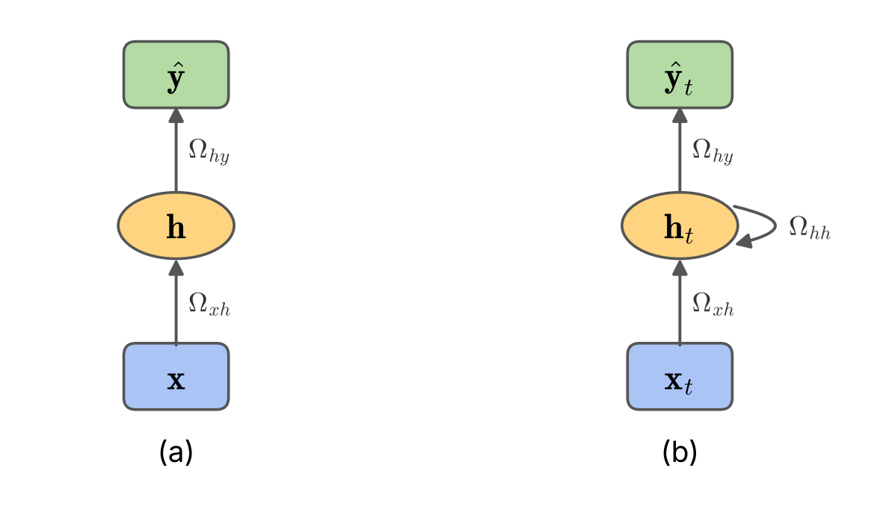
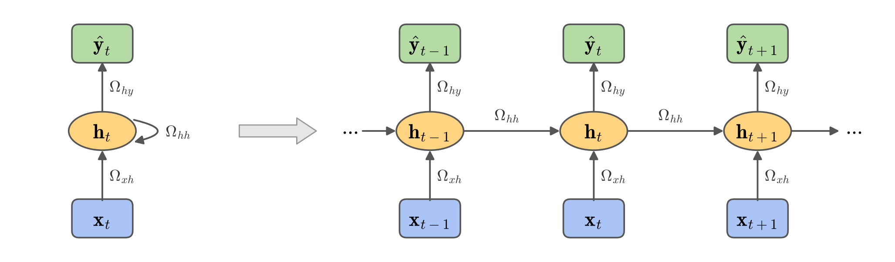
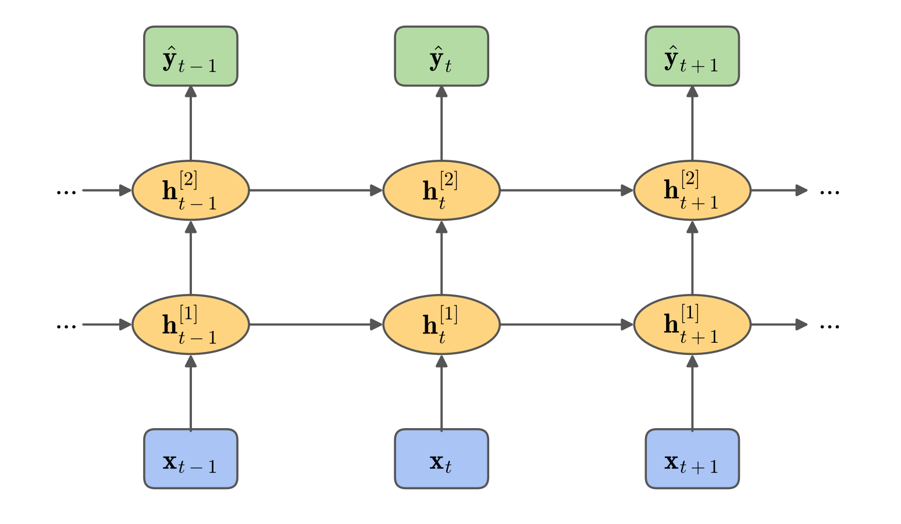

# شبکه‌های عصبی بازگشتی (Recurrent Neural Networks)
## جلسه 8
---

> [!abstract] طرح کلی جلسه
> این جلسه یک **مبحث تکمیلی** (خارج از کتاب درسی) و پیش‌زمینه‌ای برای فصل ۱۲، یعنی ترنسفورمرها، است: ابتدا می‌بینیم شبکه‌های بازگشتی چگونه داده‌های دنباله‌ای را پردازش می‌کنند، سپس محدودیت‌های آن‌ها را بررسی می‌کنیم؛ محدودیت‌هایی که انگیزهٔ اصلی **سازوکار توجه** (Attention) و ترنسفورمرها هستند.

---
## بخش اول: مقدمه‌ای بر داده‌های دنباله‌ای

در فصل‌های قبل بیشتر با **تصویر** کار کردیم: ورودی یک آرایهٔ با اندازهٔ ثابت بود (مثلاً $28\times28$) و ساختار مهم آن، **همسایگی مکانی** پیکسل‌ها بود. شبکه‌های کانولوشنی دقیقاً برای بهره‌گیری از همین ساختار طراحی شدند.

اما بخش بزرگی از داده‌های دنیای واقعی شکل دیگری دارند: آن‌ها **دنباله** (Sequence) هستند؛ یعنی مجموعه‌ای از عناصر که **ترتیب** آن‌ها معنا دارد.

---

### دادهٔ دنباله‌ای چیست؟

یک دنباله را با

$$
\mathbf{x}_1, \mathbf{x}_2, \dots, \mathbf{x}_T
$$

نشان می‌دهیم که در آن $\mathbf{x}_t$ عنصر **گام زمانی** (Time step) $t$ است و $T$ طول دنباله است. هر $\mathbf{x}_t$ می‌تواند یک عدد، یک بردار ویژگی یا بردار نمایش یک کلمه باشد.

چند نمونهٔ آشنا:

| نوع داده              | هر عنصر $\mathbf{x}_t$         | نمونهٔ کاربرد                      |
| --------------------- | ------------------------------ | --------------------------------- |
| متن                   | یک کلمه یا نشانه (Token)       | ترجمهٔ ماشینی، تحلیل احساسات       |
| گفتار                 | ویژگی‌های صوتی یک قاب کوتاه    | بازشناسی گفتار                     |
| سری زمانی             | مقدار یک کمیت در زمان $t$      | پیش‌بینی قیمت، پایش حسگرها         |
| ویدئو                 | یک قاب تصویر                   | بازشناسی فعالیت                    |
| دنبالهٔ زیستی          | یک نوکلئوتید یا آمینواسید      | پیش‌بینی ساختار پروتئین            |

> [!note] نکتهٔ کلیدی
> اندیس $t$ لزوماً «زمان» فیزیکی نیست؛ فقط **جایگاه** عنصر در دنباله را نشان می‌دهد. در متن، $t$ شمارهٔ کلمه در جمله است.

> [!note] نکتهٔ مهم: وابستگی درون نمونه یا بین نمونه‌ها؟
> وقتی می‌گوییم «دادهٔ دنباله‌ای»، منظور وابستگی **عناصر درون یک نمونه** است، نه وابستگی بین نمونه‌های آموزشی.
>
> **کل دنباله یک نمونه است.** برای مثال، یک پنجره از سیگنال یک **شتاب‌سنج سه‌محوره** با $T$ گام زمانی، یک ماتریس $T \times 3$ است:
>
> $$
> \mathbf{X}^{(i)} = \big[\mathbf{x}_1, \mathbf{x}_2, \dots, \mathbf{x}_T\big], \qquad \mathbf{x}_t = \big(a_x(t),\ a_y(t),\ a_z(t)\big)
> $$
>
> یعنی این مشاهده از $T$ سه‌تایی تشکیل شده که به **ترتیب زمانی** پشت سر هم آمده‌اند. درون این مشاهده دو نوع وابستگی وجود دارد:
>
> - **وابستگی زمانی (بین گام‌ها):** $\mathbf{x}_t$ به $\mathbf{x}_{t-1}, \mathbf{x}_{t-2}, \dots$ وابسته است و ترتیب گام‌ها معنا دارد. مدل‌های دنباله‌ای برای همین وابستگی ساخته شده‌اند.
> - **وابستگی بین محورها (درون هر گام):** سه مؤلفهٔ یک لحظه هم به هم وابسته‌اند، چون از یک ارتعاش فیزیکی می‌آیند؛ اما ترتیب محورها معنایی ندارد و نقش آن‌ها مثل ستون‌های یک جدول یا کانال‌های یک تصویر است.
>
> **بین نمونه‌ها** فرض می‌کنیم $\mathbf{X}^{(1)}, \dots, \mathbf{X}^{(N)}$ مستقل و هم‌توزیع (i.i.d.) هستند؛ تابع زیان کل هم بر همین اساس، جمع زیان تک‌تک نمونه‌هاست.
>
> این شبیه پیکسل‌های یک تصویر است: پیکسل‌ها **درون** یک تصویر ساختار مکانی و وابستگی دارند، اما تصاویر مختلف مستقل فرض می‌شوند. شبکهٔ CNN از ساختار مکانی بهره می‌برد و شبکهٔ RNN از ساختار زمانی.

> [!warning] فرض i.i.d. در عمل
> فرض استقلال نمونه‌ها یک **فرض مدل‌سازی** است. اگر پنجره‌ها از ثبت‌ها، ماشین‌ها یا آزمایش‌های **مستقل** آمده باشند، این فرض معقول است. اما پنجره‌هایی که از **یک ثبت** بریده شده‌اند به هم وابسته‌اند، حتی بدون هم‌پوشانی، چون از یک ماشین، یک شرایط کاری و یک حسگر آمده‌اند؛ هم‌پوشانی این وابستگی را شدیدتر می‌کند.
> پس در عمل **واحد مستقل، «ثبت» است نه «پنجره»**.

---

### ویژگی‌های اصلی داده‌های دنباله‌ای

#### ۱. ترتیب معنا را تعیین می‌کند

دو جملهٔ زیر دقیقاً از **همان کلمه‌ها** ساخته شده‌اند:

- «سگ مرد را گاز گرفت.»
- «مرد سگ را گاز گرفت.»

اما معنای آن‌ها کاملاً متفاوت است. پس مدلی که فقط «کدام عناصر وجود دارند» را ببیند و ترتیب را نادیده بگیرد، اطلاعات اساسی را از دست می‌دهد.

#### ۲. طول دنباله متغیر است

یک جمله ممکن است ۳ کلمه داشته باشد و جملهٔ دیگر ۴۰ کلمه. یک فایل صوتی ممکن است ۲ ثانیه یا ۲ دقیقه باشد. بنابراین مدل باید بتواند با ورودی‌هایی با **طول‌های مختلف** کار کند:

$$
T \in \{1, 2, 3, \dots\}
$$

#### ۳. وابستگی‌ها می‌توانند کوتاه یا بلندمدت باشند

- **وابستگی کوتاه‌مدت:** در عبارت «آسمان **آبی** است»، کلمهٔ «آبی» عمدتاً به کلمهٔ کناری‌اش وابسته است.
- **وابستگی بلندمدت:** در جملهٔ «**علی** که سال‌ها در خارج از کشور زندگی کرده بود و تازه به شهرش برگشته بود، از دیدن دوستان قدیمی‌**اش** خوشحال شد»، ضمیر «ـَش» به «علی» برمی‌گردد که چندین کلمه قبل‌تر آمده است.

> [!example] شهود
> خواندن یک رمان را تصور کنید. برای فهمیدن یک جمله در فصل دهم، گاهی باید اتفاقی را به یاد بیاورید که در فصل اول رخ داده است. مدل دنباله‌ای هم باید بتواند اطلاعات را در طول دنباله **به خاطر بسپارد**.

#### ۴. الگوها در جایگاه‌های مختلف تکرار می‌شوند

عبارت «یادگیری عمیق» چه در ابتدای جمله بیاید و چه در انتهای آن، همان معنا را دارد. این همان ایدهٔ **هم‌وردایی نسبت به انتقال** (Translation equivariance) است که در فصل ۱۰ دیدیم، این بار در بُعد زمان.

---


### از مدل چه می‌خواهیم؟

با توجه به آنچه گفتیم، یک مدل مناسب برای داده‌های دنباله‌ای باید:

1. دنباله‌هایی با **طول دلخواه** را پردازش کند.
2. **ترتیب** عناصر را در نظر بگیرد.
3. پارامترها را در **همهٔ گام‌های زمانی** به اشتراک بگذارد.
4. خلاصه‌ای از **گذشته** را نگه دارد تا بتواند وابستگی‌های بلندمدت را ثبت کند.

ایدهٔ اصلی شبکه‌های بازگشتی ساده است: دنباله را **عنصر به عنصر** بخوانیم و پس از هر گام، یک **حافظه** را به‌روز کنیم:

$$
\text{حافظهٔ جدید} = \text{تابع}\big(\text{حافظهٔ قبلی},\ \text{ورودی فعلی}\big)
$$

این حافظه همان **حالت پنهان** (Hidden state) است که در **بخش سوم** آن را دقیق تعریف می‌کنیم.


---
## بخش دوم: انواع مدل‌سازی دنباله‌ای

در بخش قبل دیدیم دادهٔ دنباله‌ای چیست. پیش از ساختن مدل، باید روشن کنیم **چه کاری** می‌خواهیم با آن انجام دهیم. پرسش اصلی این است:

> [!question] پرسش
> **ورودی مدل یک دنباله است یا یک مقدار تکی؟ خروجی چطور؟**

پاسخ این پرسش، مسئله‌های دنباله‌ای را به چند دستهٔ اصلی تقسیم می‌کند. این دسته‌بندی به **نوع مسئله** مربوط است، نه به معماری خاصی؛ همین دسته‌ها را بعداً برای ترنسفورمرها هم به کار می‌بریم.

در شکل زیر، مستطیل‌های آبی ورودی‌ها ($\mathbf{x}_t$)، بیضی‌های نارنجی حالت پنهان مدل در هر گام و مستطیل‌های سبز خروجی‌ها ($\hat{\mathbf{y}}_t$) هستند. پیکان‌های افقی نشان می‌دهند که اطلاعات از هر گام به گام بعد منتقل می‌شود.

---

### ۱. چندبه‌یک (Many-to-one)

(شکل، بالا سمت چپ) مدل **کل دنباله** را می‌خواند و در پایان **یک خروجی** تولید می‌کند. خروجی می‌تواند یک کلاس یا یک عدد باشد.

**مثال‌ها:**
- **تحلیل احساسات** (Sentiment analysis): یک نظر کاربر ← مثبت یا منفی.
- **طبقه‌بندی سری زمانی** (Time-series classification): دنباله‌ای از اندازه‌گیری‌های یک حسگر ← یک کلاس.

---

### ۲. یک‌به‌چند (One-to-many)

(شکل، بالا سمت راست) در این حالت **ورودی دنباله نیست** (مثلاً یک تصویر)، اما **خروجی یک دنباله** است. مدل **یک ورودی** را فقط در گام اول می‌گیرد و از روی آن یک **دنباله** تولید می‌کند.

**مثال‌ها:**
- **توصیف تصویر** (Image captioning): یک تصویر ← یک جمله.
- **تولید موسیقی** (Music generation): یک نت یا سبک اولیه ← دنباله‌ای از نت‌ها.

---

### ۳. چندبه‌چند هم‌زمان (Many-to-many, synchronized)

(شکل، پایین سمت چپ) به ازای **هر گام ورودی**، یک **خروجی** تولید می‌شود؛ پس طول ورودی و خروجی برابر است و خروجی‌ها با ورودی‌ها هم‌تراز (Aligned) هستند.

**مثال‌ها:**
- **برچسب‌گذاری اجزای کلام** (Part-of-speech tagging): برای هر کلمه، نقش دستوری آن.


> [!tip] ارتباط با فصل‌های قبل
> این حالت، همتای دنباله‌ای **قطعه‌بندی معنایی** (Semantic segmentation) در تصاویر است: آنجا برای هر پیکسل یک برچسب داشتیم، اینجا برای هر گام زمانی.

---

### ۴. چندبه‌چند با تأخیر (Many-to-many, encoder–decoder)

(شکل، پایین سمت راست) مدل ابتدا دنبالهٔ ورودی را می‌خواند و تولید خروجی **پس از رسیدن آخرین ورودی** شروع می‌شود. طول ورودی و خروجی می‌تواند **متفاوت** باشد و هیچ تناظر یک‌به‌یکی بین گام‌ها وجود ندارد.

**مثال‌ها:**
- **ترجمهٔ ماشینی** (Machine translation): یک جملهٔ ۵ کلمه‌ای فارسی ← یک جملهٔ ۷ کلمه‌ای انگلیسی.
- **بازشناسی گفتار** (Speech recognition): صدها قاب صوتی ← چند کلمه متن.
- **پیش‌بینی چندگامی سری زمانی** (Multi-step forecasting): با داشتن $W$ مقدار گذشته، $H$ مقدار آینده را پیش‌بینی می‌کنیم:

$$
[\mathbf{x}_{t-W+1}, \dots, \mathbf{x}_t] \;\longrightarrow\; [\mathbf{x}_{t+1}, \dots, \mathbf{x}_{t+H}]
$$

این ساختار را **رمزگذار–رمزگشا** (Encoder–decoder) یا **Seq2Seq** می‌نامند.

### جمع‌بندی دسته‌ها

| دسته               | ورودی  | خروجی               | مثال‌ها                                          |
| ------------------ | ------ | ------------------- | ------------------------------------------------ |
| چندبه‌یک           | دنباله | تکی                 | تحلیل احساسات، طبقه‌بندی سری زمانی                |
| یک‌به‌چند          | تکی    | دنباله              | توصیف تصویر، تولید موسیقی                        |
| چندبه‌چند هم‌زمان  | دنباله | دنباله (هم‌طول)     | برچسب‌گذاری اجزای کلام                            |
| چندبه‌چند با تأخیر | دنباله | دنباله (طول دلخواه) | ترجمهٔ ماشینی، بازشناسی گفتار، پیش‌بینی چندگامی |


---
## بخش سوم: شبکهٔ بازگشتی ساده (Vanilla RNN)

### از شبکهٔ پیش‌خور به شبکهٔ بازگشتی

در یک شبکهٔ **پیش‌خور** (Feedforward) مثل MLP، اطلاعات فقط در یک جهت جریان دارد: ورودی $\mathbf{x}$ به لایهٔ پنهان $\mathbf{h}$ و سپس به خروجی $\hat{\mathbf{y}}$ می‌رسد (شکل زیر، a). خروجی فقط به ورودی **همان لحظه** وابسته است و شبکه هیچ حافظه‌ای از ورودی‌های قبلی ندارد.

در یک **شبکهٔ عصبی بازگشتی** (Recurrent Neural Network)، لایهٔ پنهان در هر گام زمانی $t$ دو ورودی دارد (شکل زیر، b):

- ورودی فعلی $\mathbf{x}_t$،
- مقدار **خودش** در گام قبل، یعنی $\mathbf{h}_{t-1}$.

این وابستگی با یک **یال بازگشتی** (Recurrent edge) نشان داده شده است: پیکانی که از لایهٔ پنهان خارج می‌شود و دوباره به خودش برمی‌گردد.



به $\mathbf{h}_t$ **حالت پنهان** (Hidden state) می‌گوییم. حالت پنهان همان «حافظه»‌ای است که در بخش اول به دنبالش بودیم: خلاصه‌ای از همهٔ ورودی‌هایی که مدل تا گام $t$ دیده است.

---

### معادلات شبکهٔ بازگشتی

در هر گام زمانی $t = 1, 2, \dots, T$:

$$
\begin{aligned}
\mathbf{h}_t &= \mathbf{a}\Big[\boldsymbol{\beta}_h + \boldsymbol{\Omega}_{xh}\,\mathbf{x}_t + \boldsymbol{\Omega}_{hh}\,\mathbf{h}_{t-1}\Big] \\
\hat{\mathbf{y}}_t &= \boldsymbol{\beta}_y + \boldsymbol{\Omega}_{hy}\,\mathbf{h}_t
\end{aligned}
$$

که در آن:

- ماتریس $\boldsymbol{\Omega}_{xh}$ ورودی را به لایهٔ پنهان می‌برد.
- ماتریس $\boldsymbol{\Omega}_{hh}$ حالت پنهان قبلی را به حالت پنهان فعلی می‌برد (یال بازگشتی).
- ماتریس $\boldsymbol{\Omega}_{hy}$ حالت پنهان را به خروجی می‌برد.
- تابع $\mathbf{a}[\cdot]$ تابع فعال‌سازی است که در RNN معمولاً $\tanh$ است.
- حالت اولیه معمولاً صفر در نظر گرفته می‌شود: $\mathbf{h}_0 = \mathbf{0}$.

اگر $\mathbf{x}_t \in \mathbb{R}^{D}$، $\mathbf{h}_t \in \mathbb{R}^{H}$ و $\hat{\mathbf{y}}_t \in \mathbb{R}^{K}$ باشد، ابعاد ماتریس‌ها چنین است:

$$
\boldsymbol{\Omega}_{xh} \in \mathbb{R}^{H \times D}, \qquad
\boldsymbol{\Omega}_{hh} \in \mathbb{R}^{H \times H}, \qquad
\boldsymbol{\Omega}_{hy} \in \mathbb{R}^{K \times H}
$$

تنها تفاوت با یک لایهٔ پنهان معمولی، جملهٔ $\boldsymbol{\Omega}_{hh}\,\mathbf{h}_{t-1}$ است؛ همین جمله است که به شبکه حافظه می‌دهد.

> [!note] نماد‌ها: نمونه، گام زمانی، ویژگی
> معادلات بالا برای **یک نمونه** (یک دنباله) نوشته شده‌اند. اگر نمونهٔ $i$‌ام را $$\mathbf{X}^{(i)} = (\mathbf{x}^{(i)}_1, \dots, \mathbf{x}^{(i)}_T)$$ بنامیم، $\mathbf{x}_t$ در معادلات همان $\mathbf{x}^{(i)}_t$ است: بردار $D$ ویژگیِ **گام $t$** از این نمونه، نه یک نمونهٔ جداگانه. برای سادگی اندیس $i$ را حذف کرده‌ایم. به همین ترتیب $\hat{\mathbf{y}}_t$ خروجی مدل در گام $t$ برای **همان** نمونه است؛ کلاه نشان می‌دهد که این مقدار **پیش‌بینی** مدل است و مقدار واقعی متناظر با آن را $\mathbf{y}_t$ می‌نامیم. برای هر نمونهٔ جدید، حالت پنهان از $$\mathbf{h}_0 = \mathbf{0}$$ شروع می‌شود و همان وزن‌ها به کار می‌روند.
>
> توجه کنید که در فصل‌های قبل زیرنویس (مثل $\mathbf{x}_i$) شمارهٔ **نمونه** بود؛ در این جلسه زیرنویس $t$ شمارهٔ **گام زمانی** است.

> [!note] نکتهٔ کلیدی
> شبکه در هر گام یک خروجی $\hat{\mathbf{y}}_t$ محاسبه می‌کند، اما بسته به نوع مسئله (بخش دوم) فقط بعضی از آن‌ها استفاده می‌شوند. برای مثال در یک مسئلهٔ چندبه‌یک فقط خروجی گام آخر، $\hat{\mathbf{y}}_T$، به کار می‌رود.

---

### باز کردن شبکه در طول زمان (Unfolding)

نمایش حلقه‌ای فشرده است، اما برای تحلیل و آموزش، شبکه را در طول زمان **باز می‌کنیم**: به ازای هر گام زمانی یک نسخه از لایهٔ پنهان می‌کشیم و یال بازگشتی را به پیکانی افقی از گام $t-1$ به گام $t$ تبدیل می‌کنیم.



شبکهٔ بازشده یک **شبکهٔ پیش‌خور عمیق** است که به ازای هر گام زمانی یک لایه دارد. یک دنبالهٔ ۱۰۰ گامی، یک شبکهٔ ۱۰۰ لایه می‌سازد. این دید در بخش‌های پنجم و ششم برای فهم آموزش و مشکل گرادیان‌ها اهمیت زیادی دارد.

> [!note] اشتراک پارامتر در طول زمان
> همان‌طور که در شکل دیده می‌شود، در همهٔ گام‌های زمانی **همان** ماتریس‌های $\boldsymbol{\Omega}_{xh}$، $\boldsymbol{\Omega}_{hh}$ و $\boldsymbol{\Omega}_{hy}$ به کار می‌روند. بنابراین تعداد پارامترها به طول دنباله $T$ بستگی ندارد و شبکه می‌تواند دنباله‌هایی با هر طولی را پردازش کند. این همان ایدهٔ **اشتراک پارامتر** در CNN است (فصل ۱۰): آنجا یک هسته در همهٔ **مکان‌ها** به کار می‌رفت، اینجا یک سلول در همهٔ **زمان‌ها**.

---

### مثال عددی: حافظه در RNN

یک RNN اسکالر با $1=\omega_{xh}$، $0.5=\omega_{hh}$، بایاس صفر و تابع فعال‌سازی $\tanh$ را در نظر بگیرید. ورودی دنبالهٔ $1=x_1=1,\ 0=x_2,\ 0=x_3$ است:

$$
\begin{aligned}
h_1 &= \tanh(1 + 0.5 \times 0) = 0.762 \\
h_2 &= \tanh(0 + 0.5 \times 0.762) = 0.364 \\
h_3 &= \tanh(0 + 0.5 \times 0.364) = 0.180
\end{aligned}
$$

با اینکه ورودی بعد از گام اول صفر است، حالت پنهان هنوز اثری از $x_1$ را با خود دارد؛ این همان **حافظه** است. اما این اثر در هر گام تقریباً نصف می‌شود؛ حافظهٔ RNN ساده **به‌سرعت محو می‌شود**. این مشاهده مقدمهٔ بخش ششم و انگیزهٔ معرفی LSTM است.

---

### شبکهٔ بازگشتی چندلایه

مانند شبکه‌های پیش‌خور، می‌توان چند لایهٔ بازگشتی را روی هم قرار داد. در شکل زیر یک RNN دولایه را می‌بینیم: حالت پنهان لایهٔ اول در هر گام، $\mathbf{h}^{[1]}_t$، ورودی لایهٔ دوم در همان گام است و هر لایه یال بازگشتی و ماتریس‌های وزن **خودش** را دارد:

$$
\begin{aligned}
\mathbf{h}^{[1]}_t &= \mathbf{a}\Big[\boldsymbol{\beta}^{[1]}_h + \boldsymbol{\Omega}^{[1]}_{xh}\,\mathbf{x}_t + \boldsymbol{\Omega}^{[1]}_{hh}\,\mathbf{h}^{[1]}_{t-1}\Big] \\
\mathbf{h}^{[2]}_t &= \mathbf{a}\Big[\boldsymbol{\beta}^{[2]}_h + \boldsymbol{\Omega}^{[2]}_{xh}\,\mathbf{h}^{[1]}_t + \boldsymbol{\Omega}^{[2]}_{hh}\,\mathbf{h}^{[2]}_{t-1}\Big]
\end{aligned}
$$

ساختار دو معادله یکسان است: «ورودی فعلی» به‌علاوهٔ «حالت قبلی همان لایه». تنها تفاوت در **ورودی فعلی** است: برای لایهٔ اول داده $\mathbf{x}_t$ است و برای لایهٔ دوم، حالت پنهان لایهٔ اول **در همان گام**، یعنی $\mathbf{h}^{[1]}_t$. در شکل زیر، جملهٔ $$\boldsymbol{\Omega}^{[2]}_{xh}\,\mathbf{h}^{[1]}_t$$ همان پیکان **عمودی** بین دو لایه و جملهٔ $$\boldsymbol{\Omega}^{[2]}_{hh}\,\mathbf{h}^{[2]}_{t-1}$$ همان پیکان **افقی** لایهٔ دوم است.

بالانویس $[1]$ و $[2]$ نشان می‌دهد که هر لایه پارامترهای **جداگانهٔ** خودش را دارد؛ اشتراک پارامتر فقط در طول **زمان** است، نه بین لایه‌ها. همچنین در لایهٔ دوم، زیرنویس $x$ به معنای «ورودیِ این لایه» است، نه دادهٔ $\mathbf{x}_t$؛ به همین دلیل ابعاد ماتریس‌ها متفاوت است: $$\boldsymbol{\Omega}^{[1]}_{xh} \in \mathbb{R}^{H \times D}$$ و $$\boldsymbol{\Omega}^{[2]}_{xh} \in \mathbb{R}^{H \times H}$$

خروجی $\hat{\mathbf{y}}_t$ فقط از حالت پنهان لایهٔ آخر محاسبه می‌شود.



> [!example] مثال عددی
> مثال اسکالر بالا را با یک لایهٔ دوم ادامه می‌دهیم. لایهٔ اول همان است و
>  $$h^{[1]}_1 = 0.762$$، $$h^{[1]}_2 = 0.364$$ و $$h^{[1]}_3 = 0.180$$. برای لایهٔ دوم هم $$\omega^{[2]}_{xh} = 1$$، $$\omega^{[2]}_{hh} = 0.5$$ و بایاس صفر را در نظر می‌گیریم:
>
> $$
> \begin{aligned}
> h^{[2]}_1 &= \tanh(0.762 + 0.5 \times 0) = 0.642 \\
> h^{[2]}_2 &= \tanh(0.364 + 0.5 \times 0.642) = 0.595 \\
> h^{[2]}_3 &= \tanh(0.180 + 0.5 \times 0.595) = 0.444
> \end{aligned}
> $$
>
> در هر گام، عدد اول داخل پرانتز از پیکان عمودی ($h^{[1]}_t$) و عدد دوم از پیکان افقی ($h^{[2]}_{t-1}$) می‌آید. لایهٔ دوم هیچ‌گاه $x_t$ را مستقیماً نمی‌بیند و اطلاعات ورودی فقط از طریق لایهٔ اول به آن می‌رسد.

در RNN چندلایه، شبکه هم در **عمق** (لایه‌ها) و هم در **زمان** (گام‌ها) عمیق است.

---
## بخش چهارم: آموزش RNN و پیاده‌سازی با PyTorch

### تابع زیان برای دنباله‌ها

آموزش RNN مثل شبکه‌های قبلی است: یک تابع زیان تعریف می‌کنیم و آن را با گرادیان کاهشی کمینه می‌کنیم. تنها تفاوت این است که تابع زیان بسته به **نوع مسئله** (بخش دوم) روی خروجی‌های متفاوتی تعریف می‌شود. اگر خروجی مدل (پیش‌بینی) را $\hat{\mathbf{y}}_t$ و مقدار واقعی (برچسب) را $\mathbf{y}_t$ بنامیم:

- **چندبه‌یک:** فقط خروجی گام آخر در زیان شرکت می‌کند:

$$
L = \sum_{i=1}^{N} \ell\big[\hat{\mathbf{y}}^{(i)}_T,\ \mathbf{y}^{(i)}\big]
$$

- **چندبه‌چند هم‌زمان:** زیان همهٔ گام‌ها جمع می‌شود:

$$
L = \sum_{i=1}^{N} \sum_{t=1}^{T} \ell\big[\hat{\mathbf{y}}^{(i)}_t,\ \mathbf{y}^{(i)}_t\big]
$$

- **یک‌به‌چند و چندبه‌چند با تأخیر:** زیان روی گام‌هایی جمع می‌شود که خروجی تولید می‌کنند.

تابع $\ell$ همان توابع زیان فصل‌های قبل است: **آنتروپی متقاطع** (Cross-entropy) برای طبقه‌بندی و **خطای مربعی** برای رگرسیون.

گرادیان این زیان نسبت به پارامترها با پس‌انتشار روی **شبکهٔ بازشده** محاسبه می‌شود. این کار را **پس‌انتشار در طول زمان** می‌نامند و در بخش پنجم بررسی می‌کنیم. در PyTorch همین `()loss.backward` همیشگی آن را انجام می‌دهد.

---

### لایهٔ `nn.RNN` در PyTorch

لایهٔ `nn.RNN` همان معادلهٔ حالت پنهان در بخش سوم را پیاده‌سازی می‌کند. ورودی آن (با `batch_first=True`) یک تنسور با شکل `(B, T, D)` است: $B$ نمونه، هر کدام با $T$ گام زمانی و $D$ ویژگی در هر گام. این لایه دو خروجی برمی‌گرداند:

- خروجی `out` با شکل `(B, T, H)`: حالت پنهان $\mathbf{h}_t$ در **همهٔ** گام‌ها،
- خروجی `h_n` با شکل `(num_layers, B, H)`: فقط **آخرین** حالت پنهان، $\mathbf{h}_T$.

لایهٔ خروجی ($\boldsymbol{\Omega}_{hy}$ و $\boldsymbol{\beta}_y$) جزو `nn.RNN` نیست و باید جداگانه با یک `nn.Linear` اضافه شود.

کد زیر نشان می‌دهد که `nn.RNN` دقیقاً همان معادلات بخش سوم را محاسبه می‌کند:

```python
import torch
import torch.nn as nn

torch.manual_seed(0)

B, T, D, H = 4, 28, 28, 64          # batch, time steps, features per step, hidden units
rnn = nn.RNN(input_size=D, hidden_size=H, num_layers=1,
             nonlinearity="tanh", batch_first=True)

X = torch.randn(B, T, D)            # a mini-batch of 4 sequences
out, h_n = rnn(X)
print("out:", tuple(out.shape))     # h_t for every time step
print("h_n:", tuple(h_n.shape))     # last hidden state h_T

# The same computation, written with the equations of Section 3
Omega_xh, Omega_hh = rnn.weight_ih_l0, rnn.weight_hh_l0
beta_h = rnn.bias_ih_l0 + rnn.bias_hh_l0
h = torch.zeros(B, H)                                   # h_0 = 0
for t in range(T):
    h = torch.tanh(beta_h + X[:, t] @ Omega_xh.T + h @ Omega_hh.T)

print("same as nn.RNN:", torch.allclose(h, h_n[0], atol=1e-6))
```

```
out: (4, 28, 64)
h_n: (1, 4, 64)
same as nn.RNN: True
```

> [!note] نکتهٔ کلیدی
> در PyTorch ماتریس‌ها با نام‌های `weight_ih_l0` (همان $\boldsymbol{\Omega}_{xh}$) و `weight_hh_l0` (همان $\boldsymbol{\Omega}_{hh}$) ذخیره می‌شوند. PyTorch به‌جای یک بایاس $\boldsymbol{\beta}_h$ دو بایاس (`bias_ih_l0` و `bias_hh_l0`) دارد که فقط با هم جمع می‌شوند. برای RNN چندلایه (شکل بخش سوم) کافی است `num_layers` را بیشتر از ۱ بگذاریم.

> [!note] تفاوت `out` و `h_n`
> - خروجی `out` با شکل `(B, T, H)` حالت پنهان **همهٔ گام‌ها** (در لایهٔ آخر) را نگه می‌دارد: اندیس اول شمارهٔ **نمونه** و اندیس دوم شمارهٔ **گام زمانی** است.
> - خروجی `h_n` با شکل `(num_layers, B, H)` فقط **آخرین** حالت پنهان، $\mathbf{h}_T$، را برای هر لایه نگه می‌دارد: اندیس اول شمارهٔ **لایه** و اندیس دوم شمارهٔ **نمونه** است. گزینهٔ `batch_first=True` روی `h_n` اثری ندارد.
>
> بنابراین در یک RNN تک‌لایه، `h_n` همان گام آخرِ `out` است و اطلاعات تازه‌ای ندارد:
>
> ```python
> torch.allclose(h_n[0, 0, :], out[0, -1, :])   # True : both are h_T of sample 0
> torch.allclose(h_n[0, 0, :], out[0, 0, :])    # False: out[0, 0, :] is h_1
> ```

---

### مثال: طبقه‌بندی ارقام MNIST به‌صورت دنباله

یک مثال استاندارد برای RNN این است که هر تصویر $28\times28$ از MNIST را یک **دنباله** در نظر بگیریم: هر **سطر** تصویر یک گام زمانی است. پس $T = 28$ گام داریم و هر گام یک بردار با $D = 28$ ویژگی است. مدل سطرها را از بالا به پایین می‌خواند و پس از آخرین سطر، رقم را تشخیص می‌دهد. این یک مسئلهٔ **چندبه‌یک** است.

```python
import torch
import torch.nn as nn
from torch.utils.data import DataLoader
from torchvision import datasets, transforms

torch.manual_seed(0)

# ---------------------------------------------------------------
# Data: each 28x28 image is read as a sequence of T = 28 rows,
# each row is a feature vector with D = 28 values
# ---------------------------------------------------------------
tf = transforms.ToTensor()
train_set = datasets.MNIST("data", train=True, download=True, transform=tf)
test_set = datasets.MNIST("data", train=False, download=True, transform=tf)
train_loader = DataLoader(train_set, batch_size=128, shuffle=True)
test_loader = DataLoader(test_set, batch_size=1000)

# ---------------------------------------------------------------
# Many-to-one model: RNN + linear output layer on h_T
# ---------------------------------------------------------------
class RNNClassifier(nn.Module):
    def __init__(self, D=28, H=128, K=10):
        super().__init__()
        self.rnn = nn.RNN(D, H, batch_first=True)   # Omega_xh, Omega_hh, beta_h
        self.fc = nn.Linear(H, K)                   # Omega_hy, beta_y

    def forward(self, x):            # x: (B, T, D)
        out, h_n = self.rnn(x)       # out: (B, T, H)
        return self.fc(out[:, -1])   # use only the last time step -> y_hat_T

model = RNNClassifier()
loss_fn = nn.CrossEntropyLoss()
optimizer = torch.optim.Adam(model.parameters(), lr=1e-3)
print("parameters:", sum(p.numel() for p in model.parameters()))

def accuracy(loader):
    model.eval()
    correct = 0
    with torch.no_grad():
        for img, label in loader:
            pred = model(img.squeeze(1)).argmax(dim=1)
            correct += (pred == label).sum().item()
    return correct / len(loader.dataset)

# ---------------------------------------------------------------
# Training
# ---------------------------------------------------------------
for epoch in range(5):
    model.train()
    total = 0.0
    for img, label in train_loader:
        x = img.squeeze(1)                  # (B, 1, 28, 28) -> (B, 28, 28)
        loss = loss_fn(model(x), label)
        optimizer.zero_grad()
        loss.backward()                     # gradients through time (Section 5)
        optimizer.step()
        total += loss.item() * len(label)
    print(f"epoch {epoch + 1}  loss {total / len(train_set):.4f}  "
          f"test accuracy {accuracy(test_loader):.4f}")
```

```
parameters: 21514
epoch 1  loss 0.9031  test accuracy 0.8652
epoch 2  loss 0.3823  test accuracy 0.9214
epoch 3  loss 0.2671  test accuracy 0.9210
epoch 4  loss 0.2229  test accuracy 0.9447
epoch 5  loss 0.1957  test accuracy 0.9527
```

مدل با حدود ۲۱ هزار پارامتر پس از ۵ دوره به دقت حدود ۹۵٪ می‌رسد. تعداد پارامترها به طول دنباله بستگی ندارد:

$$
\underbrace{28 \times 128}_{\boldsymbol{\Omega}_{xh}} + \underbrace{128 \times 128}_{\boldsymbol{\Omega}_{hh}} + \underbrace{2 \times 128}_{\text{بایاس‌ها}} + \underbrace{128 \times 10 + 10}_{\boldsymbol{\Omega}_{hy},\ \boldsymbol{\beta}_y} = 21514
$$

هر دادهٔ دنباله‌ای دیگر، مثلاً دنبالهٔ اندازه‌گیری‌های یک حسگر، کافی است به همین شکل `(B, T, D)` درآید تا همین مدل روی آن قابل استفاده باشد.

> [!note] انتقال حالت پنهان به فراخوانی بعدی
> لایهٔ `nn.RNN` یک ورودی دوم و اختیاری هم دارد: حالت پنهان اولیه $\mathbf{h}_0$. اگر داده نشود، صفر در نظر گرفته می‌شود؛ در مثال بالا هم همین‌طور بود. برای **ادامه دادن** یک دنباله در فراخوانی بعدی، `h_n` فراخوانی قبلی را به‌عنوان حالت اولیه به لایه می‌دهیم:
>
> ```python    
>                out1, h = rnn(x_part1)        # h_0 = 0 by default
>     out2, h = rnn(x_part2, h)     # continue from the last state of part 1
> ```
>
> نتیجه دقیقاً مثل این است که کل دنباله یک‌جا به لایه داده شود. از این روش در BPTT بریده‌شده (بخش پنجم؛ همراه با متد `detach`)، در پردازش برخط یک جریان داده و در رمزگشای مدل‌های Seq2Seq استفاده می‌شود.

---
