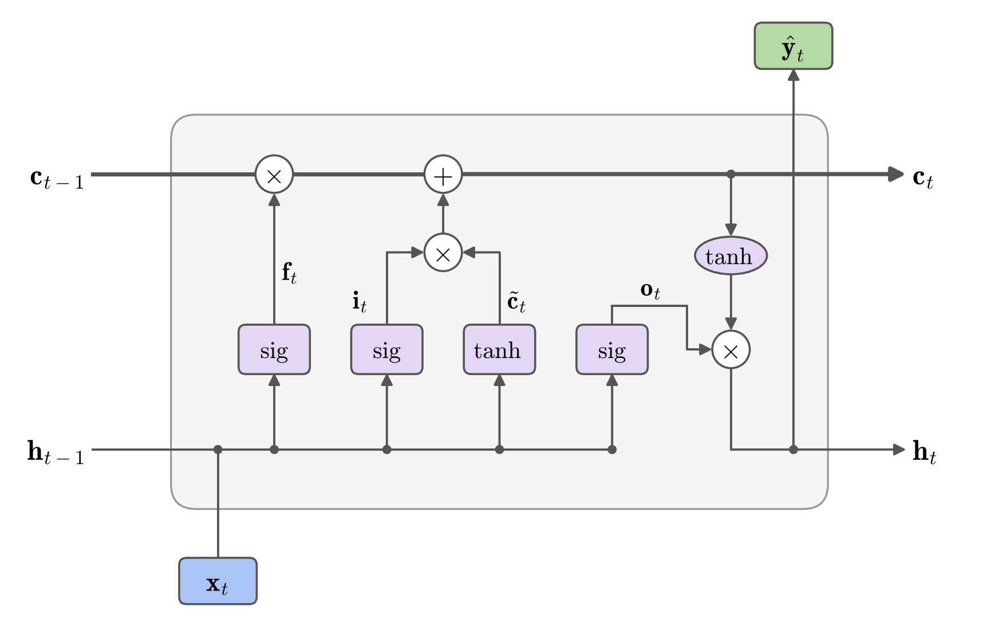
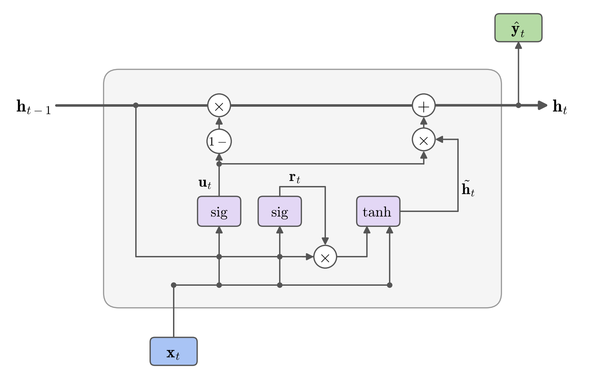

# شبکه‌های عصبی بازگشتی ( ادامه...)
## جلسه 9
---
## بخش پنجم: پس‌انتشار در طول زمان (BPTT)

در بخش سوم دیدیم که RNN بازشده یک **شبکهٔ پیش‌خور عمیق** است که در همهٔ لایه‌هایش از **وزن‌های مشترک** استفاده می‌کند. پس برای محاسبهٔ گرادیان به الگوریتم جدیدی نیاز نداریم: همان **پس‌انتشار** را روی شبکهٔ بازشده اجرا می‌کنیم. به این کار **پس‌انتشار در طول زمان** (Backpropagation Through Time, BPTT) می‌گویند.

الگوریتم دو مرحله دارد:

1. **گذر رو به جلو:** دنباله را از $1=t$ تا $T=t$ می‌خوانیم، حالت‌های پنهان $\mathbf{h}_1, \dots, \mathbf{h}_T$ و خروجی‌ها را محاسبه و **ذخیره** می‌کنیم و زیان را به دست می‌آوریم.
2. **گذر رو به عقب:** گرادیان را از $T=t$ به سمت $1=t$ برمی‌گردانیم.

---

### نمادها

ورودی تابع فعال‌سازی را $\mathbf{z}_t$ می‌نامیم. گذر رو به جلو در هر گام چنین است:

$$
\mathbf{z}_t = \boldsymbol{\beta}_h + \boldsymbol{\Omega}_{xh}\,\mathbf{x}_t + \boldsymbol{\Omega}_{hh}\,\mathbf{h}_{t-1}, \qquad
\mathbf{h}_t = \mathbf{a}[\mathbf{z}_t], \qquad
\hat{\mathbf{y}}_t = \boldsymbol{\beta}_y + \boldsymbol{\Omega}_{hy}\,\mathbf{h}_t
$$

زیان کل، جمع زیان گام‌هاست: $$L = \sum_{t} L_t$$ که در آن $$L_t = \ell\big[\hat{\mathbf{y}}_t,\ \mathbf{y}_t\big]$$ (در مسئلهٔ چندبه‌یک فقط $L_T$ وجود دارد).

هدف نهایی، گرادیان $L$ نسبت به پنج پارامتر مشترک است: $\boldsymbol{\Omega}_{hy}$، $\boldsymbol{\beta}_y$، $\boldsymbol{\Omega}_{hh}$، $\boldsymbol{\Omega}_{xh}$ و $\boldsymbol{\beta}_h$. برای رسیدن به آن، در گذر رو به عقب چهار قدم زیر را برمی‌داریم.

---

### قدم ۱: خطای خروجی در هر گام

از بالای شبکه شروع می‌کنیم. گرادیان زیان نسبت به خروجی هر گام را **خطای خروجی** می‌نامیم و با $\mathbf{e}_t$ نشان می‌دهیم.

**قاعده:** چون $$L = \sum_{s} L_s$$ و از میان جمله‌های این جمع فقط $L_t$ به $\hat{\mathbf{y}}_t$ وابسته است:

$$
\mathbf{e}_t = \frac{\partial L}{\partial \hat{\mathbf{y}}_t} = \frac{\partial L_t}{\partial \hat{\mathbf{y}}_t}
$$

**جایگذاری:** مقدار این مشتق به تابع زیان بستگی دارد:

- برای خطای مربعی، $$L_t = \tfrac{1}{2}\big\|\hat{\mathbf{y}}_t - \mathbf{y}_t\big\|^2$$ و در نتیجه $$\mathbf{e}_t = \hat{\mathbf{y}}_t - \mathbf{y}_t$$
- برای آنتروپی متقاطع (با softmax)، $$\mathbf{e}_t = \text{softmax}(\hat{\mathbf{y}}_t) - \mathbf{y}_t$$

اگر گام $t$ در زیان شرکت نداشته باشد (مثلاً گام‌های $t < T$ در مسئلهٔ چندبه‌یک)، $\mathbf{e}_t = \mathbf{0}$ است.

---

### قدم ۲: گرادیان حالت پنهان، از آخر به اول

حالت پنهان $\mathbf{h}_t$ از **دو مسیر** روی زیان اثر می‌گذارد:

- **مستقیم:** از طریق خروجی همان گام، $\hat{\mathbf{y}}_t$ (پیکان رو به بالا در شکل باز شدن شبکه)؛
- **از آینده:** از طریق حالت پنهان گام بعد، $\mathbf{h}_{t+1}$، و در نتیجه همهٔ گام‌های بعدی (پیکان افقی).

منظور از $\partial L / \partial \mathbf{h}_t$ اثر **کل** $\mathbf{h}_t$ روی زیان است، یعنی مجموع هر دو مسیر.

**الف) گام آخر.** حالت $\mathbf{h}_T$ فقط از مسیر مستقیم روی زیان اثر دارد.

**قاعده:**

$$
\frac{\partial L}{\partial \mathbf{h}_T} = \left(\frac{\partial \hat{\mathbf{y}}_T}{\partial \mathbf{h}_T}\right)^{\!\top} \frac{\partial L}{\partial \hat{\mathbf{y}}_T}
$$

**جایگذاری:** از رابطهٔ خطی $$\hat{\mathbf{y}}_T = \boldsymbol{\beta}_y + \boldsymbol{\Omega}_{hy}\,\mathbf{h}_T$$ داریم $$\frac{\partial \hat{\mathbf{y}}_T}{\partial \mathbf{h}_T} = \boldsymbol{\Omega}_{hy}$$ و از قدم ۱ داریم $$\frac{\partial L}{\partial \hat{\mathbf{y}}_T} = \mathbf{e}_T$$ پس:

$$
\frac{\partial L}{\partial \mathbf{h}_T} = \boldsymbol{\Omega}_{hy}^{\top}\, \mathbf{e}_T
$$

یعنی خطای خروجی از همان وزن‌های $\boldsymbol{\Omega}_{hy}$ به حالت پنهان برمی‌گردد، درست مانند آخرین لایهٔ پنهان یک MLP.

**ب) گام‌های قبلی،** $$t = T-1, \dots, 1$$

**قاعده:** این بار $\mathbf{h}_t$ هم از طریق $\hat{\mathbf{y}}_t$ و هم از طریق $\mathbf{h}_{t+1}$ روی زیان اثر دارد؛ پس سهم دو مسیر با هم جمع می‌شود:

$$
\frac{\partial L}{\partial \mathbf{h}_t} =
\underbrace{\left(\frac{\partial \hat{\mathbf{y}}_t}{\partial \mathbf{h}_t}\right)^{\!\top} \frac{\partial L}{\partial \hat{\mathbf{y}}_t}}_{\text{مسیر مستقیم}}
+
\underbrace{\left(\frac{\partial \mathbf{h}_{t+1}}{\partial \mathbf{h}_t}\right)^{\!\top} \frac{\partial L}{\partial \mathbf{h}_{t+1}}}_{\text{مسیر از آینده}}
$$

**جایگذاری:** جملهٔ اول مثل گام آخر برابر $\boldsymbol{\Omega}_{hy}^{\top}\mathbf{e}_t$ است. در جملهٔ دوم، مقدار $\partial L / \partial \mathbf{h}_{t+1}$ پیش‌تر محاسبه شده است (چون گذر رو به عقب از $T$ شروع شده، گام $t+1$ پیش از گام $t$ محاسبه می‌شود) و فقط ژاکوبی $\partial \mathbf{h}_{t+1} / \partial \mathbf{h}_t$ باقی می‌ماند. این ژاکوبی را $\mathbf{J}_{t+1}$ می‌نامیم. چون $\mathbf{h}_t$ از طریق $\mathbf{z}_{t+1}$ روی $\mathbf{h}_{t+1}$ اثر دارد، طبق قاعدهٔ زنجیره‌ای:

$$
\mathbf{J}_{t+1} = \frac{\partial \mathbf{h}_{t+1}}{\partial \mathbf{h}_t} = \frac{\partial \mathbf{h}_{t+1}}{\partial \mathbf{z}_{t+1}}\; \frac{\partial \mathbf{z}_{t+1}}{\partial \mathbf{h}_t}
$$

- از رابطهٔ $$\mathbf{z}_{t+1} = \boldsymbol{\beta}_h + \boldsymbol{\Omega}_{xh}\,\mathbf{x}_{t+1} + \boldsymbol{\Omega}_{hh}\,\mathbf{h}_t$$ داریم $$\frac{\partial \mathbf{z}_{t+1}}{\partial \mathbf{h}_t} = \boldsymbol{\Omega}_{hh}$$
- چون $$\mathbf{h}_{t+1} = \mathbf{a}[\mathbf{z}_{t+1}]$$ و تابع فعال‌سازی عنصربه‌عنصر اعمال می‌شود، هر مؤلفهٔ $\mathbf{h}_{t+1}$ فقط به مؤلفهٔ متناظر در $\mathbf{z}_{t+1}$ وابسته است و ژاکوبی آن **قطری** است: $$\frac{\partial \mathbf{h}_{t+1}}{\partial \mathbf{z}_{t+1}} = \text{diag}\big(\mathbf{a}'[\mathbf{z}_{t+1}]\big)$$ برای $\tanh$ داریم $$\tanh'(z) = 1 - \tanh^2(z)$$ پس $$\mathbf{a}'[\mathbf{z}_{t+1}] = 1 - \mathbf{h}_{t+1}^2$$ که از گذر رو به جلو در دسترس است.

بنابراین:

$$
\mathbf{J}_{t+1} = \text{diag}\big(\mathbf{a}'[\mathbf{z}_{t+1}]\big)\,\boldsymbol{\Omega}_{hh}
\qquad\Longrightarrow\qquad
\frac{\partial L}{\partial \mathbf{h}_t} = \underbrace{\boldsymbol{\Omega}_{hy}^{\top}\, \mathbf{e}_t}_{\text{مسیر مستقیم}} + \underbrace{\mathbf{J}_{t+1}^{\top}\, \frac{\partial L}{\partial \mathbf{h}_{t+1}}}_{\text{مسیر از آینده}}
$$

با این رابطه، همهٔ $\partial L / \partial \mathbf{h}_t$ ها یکی پس از دیگری از $$t = T-1$$ تا $$t = 1$$ محاسبه می‌شوند.

---

### قدم ۳: گرادیان ورودی تابع فعال‌سازی

گرادیان پارامترهای لایهٔ بازگشتی (قدم ۴) به $\partial L / \partial \mathbf{z}_t$ نیاز دارد، چون این پارامترها از طریق $\mathbf{z}_t$ روی زیان اثر می‌گذارند.

**قاعده:** متغیر $\mathbf{z}_t$ فقط از طریق $\mathbf{h}_t$ روی زیان اثر دارد:

$$
\frac{\partial L}{\partial \mathbf{z}_t} = \left(\frac{\partial \mathbf{h}_t}{\partial \mathbf{z}_t}\right)^{\!\top} \frac{\partial L}{\partial \mathbf{h}_t}
$$

**جایگذاری:** ژاکوبی $\partial \mathbf{h}_t / \partial \mathbf{z}_t$ همان ماتریس قطری $\text{diag}\big(\mathbf{a}'[\mathbf{z}_t]\big)$ است که در قدم ۲ دیدیم، و $\partial L / \partial \mathbf{h}_t$ از قدم ۲ در دسترس است. ضرب یک ماتریس قطری در یک بردار، همان ضرب عنصربه‌عنصر است؛ پس:

$$
\frac{\partial L}{\partial \mathbf{z}_t} = \mathbf{a}'[\mathbf{z}_t] \odot \frac{\partial L}{\partial \mathbf{h}_t}
$$

---

### قدم ۴: گرادیان پارامترها

**قاعده:** دو قاعده لازم داریم.

- **لایهٔ خطی:** برای رابطهٔ خطی $$\mathbf{u} = \boldsymbol{\beta} + \boldsymbol{\Omega}\,\mathbf{v}$$ (همان قاعدهٔ لایهٔ تمام‌متصل در MLP):

$$
\frac{\partial L}{\partial \boldsymbol{\Omega}} = \frac{\partial L}{\partial \mathbf{u}}\; \mathbf{v}^{\top},
\qquad
\frac{\partial L}{\partial \boldsymbol{\beta}} = \frac{\partial L}{\partial \mathbf{u}}
$$

- **پارامتر مشترک:** هر پارامتر در **همهٔ** گام‌ها به کار رفته است؛ پس گرادیان آن **جمع سهم همهٔ گام‌ها** است. در محاسبهٔ سهم گام $t$ فقط اثر **مستقیم** پارامتر در همان گام را در نظر می‌گیریم؛ اثر غیرمستقیم آن از طریق $\mathbf{h}_{t-1}$ در سهم گام‌های قبلی همین جمع آمده است.

**جایگذاری — لایهٔ بازگشتی:** در هر گام، $$\mathbf{z}_t = \boldsymbol{\beta}_h + \boldsymbol{\Omega}_{xh}\,\mathbf{x}_t + \boldsymbol{\Omega}_{hh}\,\mathbf{h}_{t-1}$$ یک رابطهٔ خطی است که در آن نقش $\mathbf{u}$ را $\mathbf{z}_t$ دارد و نقش $\mathbf{v}$ را $\mathbf{h}_{t-1}$ (برای $\boldsymbol{\Omega}_{hh}$) یا $\mathbf{x}_t$ (برای $\boldsymbol{\Omega}_{xh}$). با جمع روی گام‌ها:

$$
\frac{\partial L}{\partial \boldsymbol{\Omega}_{hh}} = \sum_{t=1}^{T} \frac{\partial L}{\partial \mathbf{z}_t}\, \mathbf{h}_{t-1}^{\top},
\qquad
\frac{\partial L}{\partial \boldsymbol{\Omega}_{xh}} = \sum_{t=1}^{T} \frac{\partial L}{\partial \mathbf{z}_t}\, \mathbf{x}_t^{\top},
\qquad
\frac{\partial L}{\partial \boldsymbol{\beta}_h} = \sum_{t=1}^{T} \frac{\partial L}{\partial \mathbf{z}_t}
$$

**جایگذاری — لایهٔ خروجی:** در هر گام، $$\hat{\mathbf{y}}_t = \boldsymbol{\beta}_y + \boldsymbol{\Omega}_{hy}\,\mathbf{h}_t$$ یک رابطهٔ خطی است که در آن نقش $\mathbf{u}$ را $\hat{\mathbf{y}}_t$ دارد (با $$\frac{\partial L}{\partial \hat{\mathbf{y}}_t} = \mathbf{e}_t$$ از قدم ۱) و نقش $\mathbf{v}$ را $\mathbf{h}_t$. با جمع روی گام‌ها:

$$
\frac{\partial L}{\partial \boldsymbol{\Omega}_{hy}} = \sum_{t=1}^{T} \mathbf{e}_t\, \mathbf{h}_t^{\top},
\qquad
\frac{\partial L}{\partial \boldsymbol{\beta}_y} = \sum_{t=1}^{T} \mathbf{e}_t
$$

> [!note] نکتهٔ کلیدی
> جمع شدن گرادیان روی گام‌های زمانی، نتیجهٔ مستقیم **اشتراک پارامتر** است. در CNN هم (فصل ۱۰) گرادیان یک هسته، جمع سهم آن در **همهٔ موقعیت‌های مکانی** بود؛ اینجا جمع سهم در **همهٔ گام‌های زمانی** است.

> [!example] مثال عددی: چهار قدم روی مثال بخش سوم
> در مثال اسکالر بخش سوم ($\omega_{xh} = 1$، $\omega_{hh} = 0.5$، ورودی $1, 0, 0$ و $h_1 = 0.762$، $h_2 = 0.364$، $h_3 = 0.180$) یک لایهٔ خروجی با $\omega_{hy} = 2$ و $\beta_y = 0$ اضافه می‌کنیم. مسئله چندبه‌یک است، زیان خطای مربعی و مقدار واقعی $y = 1$.
>
> **قدم ۱:**
>
> $$
> \hat{y}_3 = \omega_{hy}\, h_3 = 2 \times 0.180 = 0.36,
> \qquad
> e_3 = \hat{y}_3 - y = 0.36 - 1 = -0.64,
> \qquad
> e_1 = e_2 = 0
> $$
>
> **قدم ۲** (از $t = 3$ تا $t = 1$؛ چون $e_1 = e_2 = 0$، در گام‌های ۲ و ۱ فقط مسیر از آینده باقی می‌ماند):
>
> $$
> \begin{aligned}
> \frac{\partial L}{\partial h_3} &= \omega_{hy}\, e_3 = 2 \times (-0.64) = -1.28 \\
> J_3 &= (1 - h_3^2)\,\omega_{hh} = (1 - 0.180^2) \times 0.5 \approx 0.484,
> &\qquad
> \frac{\partial L}{\partial h_2} &= J_3\, \frac{\partial L}{\partial h_3} \approx 0.484 \times (-1.28) \approx -0.62 \\
> J_2 &= (1 - h_2^2)\,\omega_{hh} = (1 - 0.364^2) \times 0.5 \approx 0.434,
> &\qquad
> \frac{\partial L}{\partial h_1} &= J_2\, \frac{\partial L}{\partial h_2} \approx 0.434 \times (-0.62) \approx -0.27
> \end{aligned}
> $$
>
> **قدم ۳:**
>
> $$
> \begin{aligned}
> \frac{\partial L}{\partial z_3} &= (1 - h_3^2)\, \frac{\partial L}{\partial h_3} = (1 - 0.180^2) \times (-1.28) \approx -1.24 \\
> \frac{\partial L}{\partial z_2} &= (1 - h_2^2)\, \frac{\partial L}{\partial h_2} = (1 - 0.364^2) \times (-0.62) \approx -0.54 \\
> \frac{\partial L}{\partial z_1} &= (1 - h_1^2)\, \frac{\partial L}{\partial h_1} = (1 - 0.762^2) \times (-0.27) \approx -0.11
> \end{aligned}
> $$
>
> **قدم ۴** (با $h_0 = 0$ و ورودی $x_1 = 1$، $x_2 = x_3 = 0$):
>
> $$
> \begin{aligned}
> \frac{\partial L}{\partial \omega_{hy}} &= \sum_{t} e_t\, h_t = 0 + 0 + (-0.64)(0.180) \approx -0.12 \\
> \frac{\partial L}{\partial \omega_{hh}} &= \sum_{t} \frac{\partial L}{\partial z_t}\, h_{t-1} = (-0.11)(0) + (-0.54)(0.762) + (-1.24)(0.364) \approx -0.86 \\
> \frac{\partial L}{\partial \omega_{xh}} &= \sum_{t} \frac{\partial L}{\partial z_t}\, x_t = (-0.11)(1) + (-0.54)(0) + (-1.24)(0) \approx -0.11
> \end{aligned}
> $$
>
> همهٔ گرادیان‌ها منفی‌اند: بزرگ‌تر کردن این وزن‌ها پیش‌بینی ($0.36$) را به مقدار واقعی ($1$) نزدیک‌تر و زیان را کمتر می‌کند. همچنین $\omega_{xh}$ فقط از گام اول گرادیان می‌گیرد، چون فقط $x_1$ غیرصفر است؛ و این گرادیان پس از عبور از دو گام به عقب، از همه کوچک‌تر است.

---

### حاصل‌ضرب ژاکوبی‌ها

رابطهٔ بازگشتی قدم ۲ را می‌توان باز کرد تا ببینیم گرادیان یک گام دور چگونه ساخته می‌شود. در مسئلهٔ چندبه‌یک، برای $t < T$ داریم $\mathbf{e}_t = \mathbf{0}$ و فقط مسیر از آینده باقی می‌ماند؛ پس با تکرار رابطهٔ قدم ۲ از $T$ تا گام $k$:

$$
\frac{\partial L}{\partial \mathbf{h}_k} = \mathbf{J}_{k+1}^{\top}\, \mathbf{J}_{k+2}^{\top} \cdots \mathbf{J}_T^{\top}\, \frac{\partial L}{\partial \mathbf{h}_T} = \left(\frac{\partial \mathbf{h}_T}{\partial \mathbf{h}_k}\right)^{\!\top} \frac{\partial L}{\partial \mathbf{h}_T},
\qquad
\frac{\partial \mathbf{h}_T}{\partial \mathbf{h}_k} = \mathbf{J}_T\, \mathbf{J}_{T-1} \cdots \mathbf{J}_{k+1}
$$

یعنی اثر حالت پنهان گام $k$ روی حالت پنهان گام $T$ (و در نتیجه سهم آن از گرادیان) برابر **حاصل‌ضرب** ژاکوبی‌های همهٔ گام‌های میان آن‌هاست. هرچه فاصلهٔ $T-k$ بیشتر باشد، تعداد جمله‌های این حاصل‌ضرب بیشتر است. این همان ساختاری است که در فصل ۱۱ برای شبکه‌های عمیق دیدیم؛ با این تفاوت که اینجا **همان** ماتریس $\boldsymbol{\Omega}_{hh}$ در همهٔ جمله‌ها تکرار می‌شود.

در مثال عددی بالا، $$\frac{\partial h_3}{\partial h_1} = J_3\, J_2 \approx 0.484 \times 0.434 \approx 0.21$$ یعنی پس از تنها دو گام، گرادیان به حدود یک‌پنجم کاهش یافته است ($-1.28$ در گام ۳ و $-0.27$ در گام ۱). در بخش بعد می‌بینیم که این حاصل‌ضرب برای دنباله‌های بلند چه مشکلی ایجاد می‌کند.

---
## بخش ششم: گرادیان‌های محوشونده و انفجاری در RNN

### ریشهٔ مشکل: ضرب مکرر یک ماتریس

در بخش پنجم دیدیم که اثر حالت پنهان گام $k$ روی حالت پنهان گام $T$، حاصل‌ضرب $T-k$ ژاکوبی است: $$\frac{\partial \mathbf{h}_T}{\partial \mathbf{h}_k} = \mathbf{J}_T \cdots \mathbf{J}_{k+1}$$ که در آن هر ژاکوبی به شکل $$\mathbf{J}_t = \text{diag}\big(\mathbf{a}'[\mathbf{z}_t]\big)\,\boldsymbol{\Omega}_{hh}$$ است.

در فصل ۱۱ با همین ساختار برای شبکه‌های عمیق آشنا شدیم: ضرب تعداد زیادی جمله در هم ناپایدار است. با همان تشبیه اسکالر:

$$
0.9^{50} \approx 0.005 \qquad \qquad 1.1^{50} \approx 117
$$

اما در RNN وضعیت حادتر است: در یک شبکهٔ پیش‌خور عمیق هر لایه ماتریس وزن **خودش** را دارد، ولی در RNN **همان** ماتریس $\boldsymbol{\Omega}_{hh}$ در هر گام دوباره ضرب می‌شود. بنابراین اندازهٔ این حاصل‌ضرب عمدتاً به **بزرگ‌ترین مقدار تکین** (Largest singular value) ماتریس $\boldsymbol{\Omega}_{hh}$، یعنی $\sigma_{\max}$، بستگی دارد. از آنجا که برای $\tanh$ هیچ مؤلفه‌ای از $\mathbf{a}'[\mathbf{z}_t]$ از ۱ بیشتر نیست، نُرم هر ژاکوبی $\mathbf{J}_t$ حداکثر $\sigma_{\max}$ است و:

$$
\left\| \frac{\partial \mathbf{h}_T}{\partial \mathbf{h}_k} \right\| \;\le\; \big(\sigma_{\max}(\boldsymbol{\Omega}_{hh})\big)^{T-k}
$$

- اگر $\sigma_{\max} < 1$ باشد، گرادیان با افزایش فاصلهٔ $T-k$ به‌صورت **نمایی** کوچک می‌شود: **گرادیان محوشونده** (Vanishing gradient).
- اگر $\sigma_{\max} > 1$ باشد، گرادیان **ممکن است** به‌صورت نمایی بزرگ شود: **گرادیان انفجاری** (Exploding gradient).

> [!note] نکتهٔ کلیدی
> اشباع تابع $\tanh$ مشکل محوشدگی را شدیدتر می‌کند: وقتی مؤلفه‌ای از $\mathbf{z}_t$ از نظر قدرمطلق بزرگ است، مؤلفهٔ متناظر در $\mathbf{a}'[\mathbf{z}_t]$ نزدیک صفر است و ژاکوبی $\mathbf{J}_t$ در آن راستا تقریباً صفر می‌شود. در مثال عددی بخش پنجم، هر ژاکوبی کمتر از $0.5$ بود و گرادیان پس از تنها دو گام به حدود $0.21$ رسید؛ پس از ۲۰ گام با همین نرخ، کمتر از یک‌میلیونیم باقی می‌ماند.

---

### پیامد: وابستگی‌های بلندمدت یاد گرفته نمی‌شوند

در بخش پنجم (قدم ۴) دیدیم که گرادیان نسبت به وزن‌های مشترک، **جمع** سهم همهٔ گام‌هاست. وقتی گرادیان محو می‌شود، سهم گام‌های **دور** در این جمع تقریباً صفر است و جمع تقریباً فقط از گام‌های **نزدیک** ساخته می‌شود. نتیجه این است که وزن‌ها طوری به‌روز می‌شوند که مدل وابستگی‌های **کوتاه‌مدت** را یاد بگیرد و وابستگی‌های **بلندمدت** عملاً در آموزش دیده نمی‌شوند.

> [!example] شهود
> در جملهٔ بخش اول («**علی** که سال‌ها در خارج از کشور زندگی کرده بود و تازه به شهرش برگشته بود، از دیدن دوستان قدیمی‌**اش** خوشحال شد»)، برای اینکه مدل یاد بگیرد «ـَش» به «علی» برمی‌گردد، خطای پیش‌بینی در انتهای جمله باید از روی ده‌ها گام به عقب برسد. با گرادیان محوشونده، این سیگنال پیش از رسیدن به «علی» تقریباً از بین رفته است.

---

### راه‌حل گرادیان انفجاری: برش گرادیان

گرادیان انفجاری معمولاً به‌صورت **ناگهانی** رخ می‌دهد: زیان در طول آموزش ناگهان جهش می‌کند یا به `nan` می‌رسد. راه‌حل ساده و رایج آن **برش گرادیان** (Gradient clipping) است. اگر نُرم بردار گرادیان $\mathbf{g}$ (شامل همهٔ پارامترها) از یک آستانهٔ $\tau$ بیشتر شود، آن را کوچک می‌کنیم:

$$
\mathbf{g} \;\leftarrow\; \begin{cases} \mathbf{g} & \|\mathbf{g}\| \le \tau \\[4pt] \tau\,\dfrac{\mathbf{g}}{\|\mathbf{g}\|} & \|\mathbf{g}\| > \tau \end{cases}
$$

جهت گرادیان تغییر نمی‌کند و فقط **اندازهٔ گام** محدود می‌شود. در PyTorch این کار بین محاسبهٔ گرادیان و به‌روزرسانی وزن‌ها انجام می‌شود:

```python
loss.backward()
torch.nn.utils.clip_grad_norm_(model.parameters(), max_norm=1.0)
optimizer.step()
```

---

### راه‌حل گرادیان محوشونده

برش گرادیان فقط گرادیان‌های **بزرگ** را کوچک می‌کند و برای گرادیان محوشونده کاری انجام نمی‌دهد. راه‌حل‌های جزئی مانند مقداردهی اولیهٔ دقیق $\boldsymbol{\Omega}_{hh}$ (مثلاً با یک ماتریس متعامد) کمک می‌کنند، اما مشکل را حل نمی‌کنند.

راه‌حل اصلی، تغییر **معماری** است؛ همان ایده‌ای که در فصل ۱۱ مشکل شبکه‌های عمیق را حل کرد. در شبکه‌های باقیمانده دیدیم:

$$
\frac{\partial \mathbf{h}_k}{\partial \mathbf{h}_{k-1}} = \mathbf{I} + \frac{\partial \mathbf{f}_k}{\partial \mathbf{h}_{k-1}}
$$

جملهٔ همانی $\mathbf{I}$ یک «بزرگراه» برای عبور گرادیان می‌ساخت. شبکه‌های **LSTM** و **GRU** (بخش‌های هفتم و هشتم) همین ایده را در طول **زمان** پیاده می‌کنند: به‌جای اینکه حالت پنهان در هر گام کاملاً بازنویسی شود، حافظه با یک **به‌روزرسانی جمعی** از گامی به گام بعد منتقل می‌شود و گرادیان می‌تواند بدون ضرب مکرر در $\boldsymbol{\Omega}_{hh}$ به گام‌های دور برسد.

---
## بخش هفتم: حافظهٔ کوتاه‌مدت طولانی (LSTM)

در بخش ششم دیدیم که مشکل RNN ساده این است که حالت پنهان در **هر گام کاملاً بازنویسی** می‌شود و گرادیان برای رسیدن به گام‌های دور باید بارها در ژاکوبی $\mathbf{J}_t$ (بخش پنجم) ضرب شود. شبکهٔ **حافظهٔ کوتاه‌مدت طولانی** (Long Short-Term Memory, LSTM) این مشکل را با دو ایده حل می‌کند:

- یک حافظهٔ جداگانه به نام **حالت سلول** (Cell state) $\mathbf{c}_t$ که به‌صورت **جمعی** به‌روز می‌شود، نه با بازنویسی کامل.
- سه **دروازه** (Gate) که یاد می‌گیرند در هر گام چه چیزی از حافظه پاک شود، چه چیزی به آن اضافه شود و چه چیزی از آن خوانده شود.

مدل LSTM نخستین بار در سال ۱۹۹۷ توسط هوخرایتر و اشمیدهوبر (Hochreiter & Schmidhuber) معرفی شد. نکتهٔ جالب این است که نسخهٔ اولیه فقط دروازه‌های ورودی و خروجی را داشت و حافظه هرگز پاک نمی‌شد؛ در نتیجه در دنباله‌های طولانی، حالت سلول به‌تدریج بزرگ و اشباع می‌شد. **دروازهٔ فراموشی** چند سال بعد (Gers و همکاران، ۲۰۰۰) اضافه شد و نسخه‌ای که امروز «LSTM استاندارد» می‌نامیم، همین نسخهٔ سه‌دروازه‌ای است.

---

### دروازه‌ها

هر دروازه برداری با مقادیر بین ۰ و ۱ است که از ورودی فعلی و حالت پنهان قبلی ساخته می‌شود. برای این کار از تابع **سیگموید** $\text{sig}[\cdot]$ استفاده می‌کنیم که خروجی آن همیشه در بازهٔ $(0, 1)$ است:

$$
\begin{aligned}
\mathbf{f}_t &= \text{sig}\Big[\boldsymbol{\beta}_f + \boldsymbol{\Omega}_{xf}\,\mathbf{x}_t + \boldsymbol{\Omega}_{hf}\,\mathbf{h}_{t-1}\Big] && \text{دروازهٔ فراموشی (Forget gate)} \\
\mathbf{i}_t &= \text{sig}\Big[\boldsymbol{\beta}_i + \boldsymbol{\Omega}_{xi}\,\mathbf{x}_t + \boldsymbol{\Omega}_{hi}\,\mathbf{h}_{t-1}\Big] && \text{دروازهٔ ورودی (Input gate)} \\
\mathbf{o}_t &= \text{sig}\Big[\boldsymbol{\beta}_o + \boldsymbol{\Omega}_{xo}\,\mathbf{x}_t + \boldsymbol{\Omega}_{ho}\,\mathbf{h}_{t-1}\Big] && \text{دروازهٔ خروجی (Output gate)}
\end{aligned}
$$

دروازه‌ها به‌صورت **عنصربه‌عنصر** ($\odot$) در بردارهای دیگر ضرب می‌شوند: مقدار نزدیک ۱ یعنی «عبور کامل» و مقدار نزدیک ۰ یعنی «مسدود».

---

### به‌روزرسانی حافظه

ابتدا یک **محتوای پیشنهادی** (Candidate) برای افزودن به حافظه ساخته می‌شود؛ این همان محاسبهٔ RNN ساده است:

$$
\tilde{\mathbf{c}}_t = \tanh\Big[\boldsymbol{\beta}_c + \boldsymbol{\Omega}_{xc}\,\mathbf{x}_t + \boldsymbol{\Omega}_{hc}\,\mathbf{h}_{t-1}\Big]
$$

سپس حالت سلول و حالت پنهان به‌روز می‌شوند:

$$
\begin{aligned}
\mathbf{c}_t &= \mathbf{f}_t \odot \mathbf{c}_{t-1} \;+\; \mathbf{i}_t \odot \tilde{\mathbf{c}}_t \\
\mathbf{h}_t &= \mathbf{o}_t \odot \tanh\big[\mathbf{c}_t\big]
\end{aligned}
$$

- دروازهٔ **فراموشی** تعیین می‌کند چه بخشی از حافظهٔ قبلی $\mathbf{c}_{t-1}$ **نگه داشته** شود. مثلاً وقتی جملهٔ جدیدی با فاعل تازه شروع می‌شود، اطلاعات فاعل قبلی دیگر لازم نیست و باید پاک شود.
- دروازهٔ **ورودی** تعیین می‌کند چه بخشی از محتوای جدید $\tilde{\mathbf{c}}_t$ به حافظه **اضافه** شود. این دو نقش از هم جدا شده‌اند: $\tilde{\mathbf{c}}_t$ می‌گوید **چه چیزی** نوشته شود و $\mathbf{i}_t$ می‌گوید **چه مقدار** از آن نوشته شود.
- دروازهٔ **خروجی** تعیین می‌کند چه بخشی از حافظه در حالت پنهان $\mathbf{h}_t$ **ظاهر** شود. اطلاعاتی ممکن است برای آینده در حافظه لازم باشد ولی در گام فعلی به کار نیاید؛ دروازهٔ خروجی اجازه می‌دهد این اطلاعات در $\mathbf{c}_t$ بماند، بدون اینکه روی خروجی فعلی اثر بگذارد.

دقت کنید که دروازه‌ها **ثابت نیستند**: در هر گام زمانی و برای هر مؤلفهٔ حافظه، از روی $\mathbf{x}_t$ و $\mathbf{h}_{t-1}$ دوباره محاسبه می‌شوند. پس مدل یاد می‌گیرد **کِی** و **کدام** اطلاعات را بنویسد، نگه دارد یا بخواند.

شکل زیر یک سلول LSTM را نشان می‌دهد. خط پررنگ بالایی مسیر **حالت سلول** است: از $\mathbf{c}_{t-1}$ تا $\mathbf{c}_t$ فقط یک ضرب در دروازهٔ فراموشی و یک جمع با محتوای جدید روی آن انجام می‌شود. جعبه‌های بنفش سه دروازه و محتوای پیشنهادی هستند که همگی از $\mathbf{h}_{t-1}$ و $\mathbf{x}_t$ ساخته می‌شوند.



خروجی مدل مثل قبل از حالت پنهان محاسبه می‌شود: $$\hat{\mathbf{y}}_t = \boldsymbol{\beta}_y + \boldsymbol{\Omega}_{hy}\,\mathbf{h}_t$$ و حالت‌های اولیه صفر در نظر گرفته می‌شوند: $$\mathbf{h}_0 = \mathbf{c}_0 = \mathbf{0}$$

> [!example] شهود
> در جملهٔ «**علی** که سال‌ها در خارج از کشور زندگی کرده بود ... از دیدن دوستان قدیمی‌**اش** خوشحال شد»، مدل می‌تواند با دیدن «علی» اطلاعات «فاعل جمله مفرد و مذکر است» را در یکی از مؤلفه‌های $\mathbf{c}_t$ بنویسد (دروازهٔ ورودی باز)، در طول جملهٔ میانی آن را دست‌نخورده نگه دارد (دروازهٔ فراموشی نزدیک ۱ و دروازهٔ ورودی نزدیک ۰) و در انتهای جمله آن را بخواند (دروازهٔ خروجی باز).

---

### چرا گرادیان محو نمی‌شود؟

مسیر اصلی حافظه از $\mathbf{c}_{t-1}$ به $\mathbf{c}_t$ فقط یک ضرب عنصربه‌عنصر در دروازهٔ فراموشی است. اگر فقط همین مسیر مستقیم را در نظر بگیریم:

$$
\frac{\partial \mathbf{c}_t}{\partial \mathbf{c}_{t-1}} = \text{diag}\big(\mathbf{f}_t\big)
\qquad \Longrightarrow \qquad
\frac{\partial \mathbf{c}_T}{\partial \mathbf{c}_k} = \prod_{t=k+1}^{T} \text{diag}\big(\mathbf{f}_t\big)
$$

این را با RNN ساده (بخش ششم) مقایسه کنید:

- در این مسیر **هیچ ضربی در ماتریس وزن** $\boldsymbol{\Omega}_{hh}$ وجود ندارد.
- در این مسیر **هیچ مشتق تابع فعال‌سازی** $\mathbf{a}'[.]$ (و در نتیجه هیچ اشباعی) وجود ندارد.
- مقدار $\mathbf{f}_t$ **یاد گرفته می‌شود**: اگر نگه داشتن یک اطلاعات برای مسئله مفید باشد، مدل یاد می‌گیرد دروازهٔ فراموشی آن مؤلفه را نزدیک ۱ نگه دارد و گرادیان تقریباً بدون تضعیف از روی ده‌ها گام عبور می‌کند.

به همین دلیل در عمل معمولاً بایاس دروازهٔ فراموشی $\boldsymbol{\beta}_f$ را با مقدار مثبت (مثلاً ۱) مقداردهی اولیه می‌کنند تا $\mathbf{f}_t$ در شروع آموزش نزدیک ۱ باشد و مدل به‌طور پیش‌فرض اطلاعات را **به خاطر بسپارد** (مقداردهی پیش‌فرض PyTorch چنین نیست).

> [!note] ارتباط با شبکه‌های باقیمانده
> اگر $\mathbf{f}_t = \mathbf{1}$ باشد، به‌روزرسانی حافظه به شکل $$\mathbf{c}_t = \mathbf{c}_{t-1} + \mathbf{i}_t \odot \tilde{\mathbf{c}}_t$$ درمی‌آید که دقیقاً ساختار **اتصال باقیمانده** در فصل ۱۱ است ($$\mathbf{h}_k = \mathbf{h}_{k-1} + \mathbf{f}_k[\mathbf{h}_{k-1}]$$؛ در آنجا $\mathbf{f}_k$ نماد بلوک باقیمانده بود، نه دروازهٔ فراموشی)، با این تفاوت که این بار در بُعد **زمان** است، نه عمق. دروازهٔ فراموشی این اتصال را **قابل‌یادگیری** می‌کند: مدل می‌تواند هر جا که لازم است حافظه را پاک کند.

---

### هزینهٔ LSTM

یک LSTM به‌جای یک تبدیل خطی، **چهار** تبدیل خطی دارد (سه دروازه و محتوای پیشنهادی)؛ پس تعداد پارامترهای آن تقریباً **چهار برابر** RNN ساده با همان اندازهٔ حالت پنهان است. برای مثال MNIST بخش چهارم ($D = 28$ و $H = 128$):

| لایه        | تعداد پارامترها |
| ----------- | --------------- |
| `nn.RNN`    | 20,224          |
| `nn.LSTM`   | 80,896          |

---

### LSTM در PyTorch

استفاده از LSTM در PyTorch تقریباً مثل `nn.RNN` است؛ تنها تفاوت این است که خروجی دوم به‌جای `h_n` یک زوج شامل آخرین حالت پنهان و آخرین حالت سلول است. در مدل بخش چهارم کافی است دو خط عوض شود:

```python
self.rnn = nn.LSTM(D, H, batch_first=True)   # instead of nn.RNN

out, (h_n, c_n) = self.rnn(x)                # h_n: last hidden state, c_n: last cell state
```

> [!note] نکتهٔ کلیدی
> برای ادامه دادن یک دنباله در فراخوانی بعدی (بخش چهارم)، در LSTM باید **هر دو** حالت را منتقل کرد: حالت پنهان $\mathbf{h}$ و حالت سلول $\mathbf{c}$. حافظهٔ بلندمدت در $\mathbf{c}$ نگه داشته می‌شود.

---
## بخش هشتم: واحد بازگشتی دروازه‌دار (GRU)

شبکهٔ **واحد بازگشتی دروازه‌دار** (Gated Recurrent Unit, GRU) نسخهٔ ساده‌شدهٔ LSTM است. همان ایدهٔ اصلی، یعنی **به‌روزرسانی جمعی** حافظه و کنترل آن با دروازه‌ها، را نگه می‌دارد، اما:

- حالت سلول جداگانه ندارد؛ حافظه همان حالت پنهان $\mathbf{h}_t$ است.
- به‌جای سه دروازه، **دو** دروازه دارد: دروازهٔ **به‌روزرسانی** (Update gate) و دروازهٔ **بازنشانی** (Reset gate).

---

### دروازه‌ها

$$
\begin{aligned}
\mathbf{u}_t &= \text{sig}\Big[\boldsymbol{\beta}_u + \boldsymbol{\Omega}_{xu}\,\mathbf{x}_t + \boldsymbol{\Omega}_{hu}\,\mathbf{h}_{t-1}\Big] && \text{دروازهٔ به‌روزرسانی} \\
\mathbf{r}_t &= \text{sig}\Big[\boldsymbol{\beta}_r + \boldsymbol{\Omega}_{xr}\,\mathbf{x}_t + \boldsymbol{\Omega}_{hr}\,\mathbf{h}_{t-1}\Big] && \text{دروازهٔ بازنشانی}
\end{aligned}
$$

> [!note] نکتهٔ نمادگذاری
> در بسیاری از منابع دروازهٔ به‌روزرسانی را با $\mathbf{z}_t$ نشان می‌دهند. ما از $\mathbf{u}_t$ استفاده می‌کنیم، چون $\mathbf{z}_t$ را در بخش پنجم برای ورودی تابع فعال‌سازی به کار بردیم.

---

### به‌روزرسانی حالت پنهان

ابتدا یک **حالت پنهان پیشنهادی** $\tilde{\mathbf{h}}_t$ ساخته می‌شود. این دقیقاً معادلهٔ RNN ساده در بخش سوم است، با این تفاوت که حالت قبلی ابتدا در دروازهٔ بازنشانی ضرب می‌شود:

$$
\tilde{\mathbf{h}}_t = \tanh\Big[\boldsymbol{\beta}_h + \boldsymbol{\Omega}_{xh}\,\mathbf{x}_t + \boldsymbol{\Omega}_{hh}\,\big(\mathbf{r}_t \odot \mathbf{h}_{t-1}\big)\Big]
$$

سپس حالت پنهان جدید، **میانگین وزنی** حالت قبلی و حالت پیشنهادی است:

$$
\mathbf{h}_t = (\mathbf{1} - \mathbf{u}_t) \odot \mathbf{h}_{t-1} \;+\; \mathbf{u}_t \odot \tilde{\mathbf{h}}_t
$$

- دروازهٔ **به‌روزرسانی** تعیین می‌کند چه مقدار از حافظه **بازنویسی** شود: اگر $\mathbf{u}_t \approx \mathbf{0}$ باشد، حالت قبلی بدون تغییر کپی می‌شود؛ اگر $\mathbf{u}_t \approx \mathbf{1}$ باشد، حالت پیشنهادی جایگزین آن می‌شود.
- دروازهٔ **بازنشانی** تعیین می‌کند گذشته در ساختن حالت پیشنهادی چقدر **نادیده گرفته** شود: اگر $\mathbf{r}_t \approx \mathbf{0}$ باشد، $\tilde{\mathbf{h}}_t$ فقط از ورودی فعلی ساخته می‌شود؛ مثلاً در شروع یک جملهٔ تازه.

شکل زیر یک سلول GRU را نشان می‌دهد. خط پررنگ بالایی مسیر حافظه از $\mathbf{h}_{t-1}$ تا $\mathbf{h}_t$ است: یک ضرب در $\mathbf{1} - \mathbf{u}_t$ و یک جمع با سهم حالت پیشنهادی.



> [!note] ارتباط با LSTM و شبکه‌های باقیمانده
> مسیر مستقیم حافظه در GRU مانند LSTM است: در این مسیر، مشتق $\mathbf{h}_t$ نسبت به $\mathbf{h}_{t-1}$ برابر $$\text{diag}\big(\mathbf{1} - \mathbf{u}_t\big)$$ است و هیچ ضربی در $\boldsymbol{\Omega}_{hh}$ یا مشتق تابع فعال‌سازی $\mathbf{a}'[\cdot]$ ندارد. در واقع $\mathbf{1} - \mathbf{u}_t$ نقش دروازهٔ فراموشی و $\mathbf{u}_t$ نقش دروازهٔ ورودی LSTM را دارد، با این قید که این دو **به هم وابسته‌اند**: هرچه بیشتر اضافه شود، همان‌قدر بیشتر فراموش می‌شود.

---

### مقایسهٔ LSTM و GRU

| ویژگی                          | LSTM                                   | GRU                                    |
| ------------------------------ | -------------------------------------- | -------------------------------------- |
| تعداد دروازه‌ها                 | ۳ (فراموشی، ورودی، خروجی)              | ۲ (به‌روزرسانی، بازنشانی)               |
| حالت‌ها                         | $\mathbf{h}_t$ و $\mathbf{c}_t$        | فقط $\mathbf{h}_t$                     |
| تعداد تبدیل‌های خطی             | ۴                                      | ۳                                      |
| پارامترهای لایه ($D = 28$، $H = 128$) | 80,896                                 | 60,672                                 |

در عمل دقت این دو مدل معمولاً نزدیک به هم است و هیچ‌کدام همیشه برتر نیست. GRU پارامتر کمتری دارد و کمی سریع‌تر است؛ LSTM به‌دلیل حافظهٔ جداگانه گاهی در دنباله‌های بسیار بلند بهتر عمل می‌کند.

> [!warning] تفاوت قرارداد در PyTorch
> در مستندات PyTorch برای `nn.GRU`، نماد $z$ برای دروازه‌ای به کار رفته که سهم **حالت قبلی** را تعیین می‌کند، یعنی همان $\mathbf{1} - \mathbf{u}_t$ در نماد ما. همچنین در پیاده‌سازی PyTorch دروازهٔ بازنشانی **بعد** از ضرب ماتریسی اعمال می‌شود. این دو تفاوت فقط در نحوهٔ نوشتن است و ایدهٔ مدل را تغییر نمی‌دهد.

---

### مثال: مقایسهٔ RNN، LSTM و GRU

مدل چندبه‌یک بخش چهارم را با هر سه نوع لایهٔ بازگشتی، با تنظیمات یکسان ($H = 128$، ۵ دوره، بهینه‌ساز Adam)، روی MNIST سطربه‌سطر آموزش می‌دهیم:

```python
import torch
import torch.nn as nn
from torch.utils.data import DataLoader
from torchvision import datasets, transforms

tf = transforms.ToTensor()
train_set = datasets.MNIST("data", train=True, download=True, transform=tf)
test_set = datasets.MNIST("data", train=False, download=True, transform=tf)
test_loader = DataLoader(test_set, batch_size=1000)

# ---------------------------------------------------------------
# Same many-to-one model as Section 4, with a choice of recurrent layer
# ---------------------------------------------------------------
class SeqClassifier(nn.Module):
    def __init__(self, cell, D=28, H=128, K=10):
        super().__init__()
        self.rnn = cell(D, H, batch_first=True)   # nn.RNN, nn.LSTM or nn.GRU
        self.fc = nn.Linear(H, K)

    def forward(self, x):
        out, _ = self.rnn(x)
        return self.fc(out[:, -1])

def accuracy(model, loader):
    model.eval()
    correct = 0
    with torch.no_grad():
        for img, label in loader:
            correct += (model(img.squeeze(1)).argmax(1) == label).sum().item()
    return correct / len(loader.dataset)

for name, cell in [("RNN", nn.RNN), ("LSTM", nn.LSTM), ("GRU", nn.GRU)]:
    torch.manual_seed(0)
    train_loader = DataLoader(train_set, batch_size=128, shuffle=True)
    model = SeqClassifier(cell)
    optimizer = torch.optim.Adam(model.parameters(), lr=1e-3)
    loss_fn = nn.CrossEntropyLoss()
    for epoch in range(5):
        model.train()
        for img, label in train_loader:
            loss = loss_fn(model(img.squeeze(1)), label)
            optimizer.zero_grad()
            loss.backward()
            optimizer.step()
    n_params = sum(p.numel() for p in model.parameters())
    print(f"{name:5s} parameters {n_params:6d}  test accuracy {accuracy(model, test_loader):.4f}")
```

```
RNN   parameters  21514  test accuracy 0.9471
LSTM  parameters  82186  test accuracy 0.9779
GRU   parameters  61962  test accuracy 0.9766
```

شبکه‌های دروازه‌دار با تنظیمات یکسان حدود ۳ درصد دقیق‌ترند و LSTM و GRU نتیجهٔ تقریباً یکسانی دارند. حتی در این دنبالهٔ کوتاه ($T = 28$)، RNN ساده برای استفاده از اطلاعات سطرهای بالای تصویر مشکل دارد. دقت RNN کمی با بخش چهارم فرق دارد، چون ترتیب تولید اعداد تصادفی در این کد متفاوت است.

---
## بخش نهم: شبکه‌های بازگشتی دوطرفه

یک RNN معمولی دنباله را فقط از ابتدا به انتها می‌خواند؛ پس $\mathbf{h}_t$ فقط از $\mathbf{x}_1, \dots, \mathbf{x}_t$ خبر دارد. اما در بسیاری از مسائل معنای یک گام به گام‌های **بعدی** هم بستگی دارد؛ مثلاً در جملهٔ «شیر را از یخچال برداشت» معنای «شیر» فقط با دیدن کلمه‌های بعدی روشن می‌شود.

---

### معادلات

یک شبکهٔ **دوطرفه** (Bidirectional) دو شبکهٔ بازگشتی مستقل با **پارامترهای جداگانه** دارد:

$$
\begin{aligned}
\overrightarrow{\mathbf{h}}_t &= \text{RNN}_{\rightarrow}\big[\mathbf{x}_t,\ \overrightarrow{\mathbf{h}}_{t-1}\big] && t = 1, \dots, T \\
\overleftarrow{\mathbf{h}}_t &= \text{RNN}_{\leftarrow}\big[\mathbf{x}_t,\ \overleftarrow{\mathbf{h}}_{t+1}\big] && t = T, \dots, 1 \\
\mathbf{h}_t &= \big[\overrightarrow{\mathbf{h}}_t \,;\, \overleftarrow{\mathbf{h}}_t\big]
\end{aligned}
$$

که در آن $\overrightarrow{\mathbf{h}}_0 = \overleftarrow{\mathbf{h}}_{T+1} = \mathbf{0}$ و $[\,\cdot\,;\,\cdot\,]$ الحاق دو بردار است. پس $\mathbf{h}_t$ برداری با طول $2H$ است که خلاصه‌ای از **کل دنباله** با تمرکز روی گام $t$ به دست می‌دهد. «RNN» در این معادلات می‌تواند سلول ساده، LSTM یا GRU باشد؛ سازوکار دوطرفه برای هر سه یکسان است.

- **چندلایه:** ورودی لایهٔ دوم، حالت الحاق‌شدهٔ $\mathbf{h}_t$ لایهٔ اول (با طول $2H$) است؛ پس هر جهت در لایهٔ دوم از کل دنباله خبر دارد.
- **هزینه:** تعداد پارامترها و محاسبات دو برابر می‌شود. برای مثال MNIST بخش چهارم، یک لایهٔ `nn.LSTM` دوطرفه $161{,}792$ پارامتر دارد (دو برابر $80{,}896$).
- **محدودیت:** کل دنباله باید از قبل در دسترس باشد. پس برای طبقه‌بندی متن، برچسب‌گذاری اجزای کلام و رمزگذار در ترجمه مناسب است، اما برای مدل زبانی، تولید متن و پیش‌بینی سری زمانی قابل استفاده نیست.

ایدهٔ RNN دوطرفه در سال ۱۹۹۷ توسط Schuster و Paliwal معرفی شد و نسخهٔ دوطرفهٔ LSTM با کار Graves و Schmidhuber (۲۰۰۵) در تشخیص گفتار رایج شد.

---

### خروجی‌ها در PyTorch

با آرگومان `bidirectional=True` شکل خروجی‌ها تغییر می‌کند (برای $L$ لایه):

| خروجی   | شکل           | محتوا                                                                 |
| ------- | ------------- | --------------------------------------------------------------------- |
| `out`   | `(B, T, 2H)`  | لایهٔ آخر در همهٔ گام‌ها؛ $H$ مؤلفهٔ اول جهت رو به جلو و $H$ مؤلفهٔ دوم جهت معکوس |
| `h_n`   | `(2L, B, H)`  | گام نهایی هر جهت در هر لایه؛ به ترتیب «لایهٔ ۱ جلو، لایهٔ ۱ عقب، لایهٔ ۲ جلو، …» |

> [!warning] خطای رایج
> در مدل یک‌طرفه `out[:, -1]` همان آخرین حالت پنهان لایهٔ آخر بود. در مدل دوطرفه این درست **نیست**: نیمهٔ دوم `out[:, -1]` برابر $\overleftarrow{\mathbf{h}}_T$ است، یعنی حالت جهت معکوس پس از دیدن **فقط یک** گام. حالت نهایی جهت معکوس $\overleftarrow{\mathbf{h}}_1$ است که در نیمهٔ دوم `out[:, 0]` قرار دارد. به همین دلیل در مدل کامل بخش دهم از `h_n` استفاده می‌کنیم.

رابطهٔ دقیق بین این خروجی‌ها (با $H$ = `hidden`):

```python
out, h_n = rnn(x)                      # for LSTM: out, (h_n, c_n) = rnn(x)
# out[:, -1, :H]  ==  h_n[-2]          # forward direction, after step T
# out[:, 0, H:]   ==  h_n[-1]          # backward direction, after step 1
h_last = torch.cat([h_n[-2], h_n[-1]], dim=1)   # (B, 2H)
```

---
## بخش دهم: یک مدل کامل LSTM و GRU در PyTorch

در عمل یک لایهٔ بازگشتی به‌تنهایی به کار نمی‌رود و بخشی از یک شبکهٔ بزرگ‌تر است. در این بخش یک معماری استاندارد برای **طبقه‌بندی متن** (مثلاً تحلیل احساسات؛ یک مسئلهٔ چندبه‌یک) را می‌سازیم که اجزای اصلی آن در بیشتر مدل‌های بازگشتی تکرار می‌شوند:

1. **لایهٔ نهفته‌سازی** (Embedding): هر کلمه با یک شمارهٔ صحیح (Token id) مشخص است؛ لایهٔ `nn.Embedding` هر شماره را به یک بردار ویژگی قابل‌یادگیری با $D$ بعد تبدیل می‌کند. این بردارها همان $\mathbf{x}_t$ هستند.
2. **چند لایهٔ بازگشتی روی هم** (شکل RNN چندلایه در بخش سوم) با حذف تصادفی (Dropout) بین لایه‌ها.
3. **پردازش دوطرفه** (Bidirectional؛ بخش نهم).
4. **دنباله‌های با طول متفاوت**: جمله‌های یک دسته طول‌های متفاوتی دارند و با صفر لایه‌گذاری (Padding) می‌شوند. با تابع `pack_padded_sequence` لایهٔ بازگشتی گام‌های لایه‌گذاری را پردازش نمی‌کند و `h_n` آخرین گام **واقعی** هر جمله را برمی‌گرداند.
5. **لایهٔ خروجی**: آخرین حالت پنهان لایهٔ آخر (در هر دو جهت) به یک لایهٔ تمام‌متصل داده می‌شود.

### از متن به ورودی شبکه

تا اینجا ورودی‌ها از قبل عددی بودند (مثل سطرهای تصویر در MNIST). اما یک جمله دنباله‌ای از **کلمه‌ها** است و پیش از ورود به شبکه باید به دنباله‌ای از بردارهای $\mathbf{x}_t$ تبدیل شود. این کار در سه قدم انجام می‌شود.

**قدم ۱: واژه‌نامه و شمارهٔ کلمه‌ها.** هر جمله به **توکن‌ها** (Token) شکسته می‌شود؛ در ساده‌ترین حالت، هر کلمه یک توکن است. سپس از روی داده‌های آموزشی یک **واژه‌نامه** (Vocabulary) ساخته می‌شود که به هر کلمه یک شمارهٔ صحیح می‌دهد. دو شمارهٔ ویژه هم کنار گذاشته می‌شوند: `<pad>` (شمارهٔ ۰) برای لایه‌گذاری و `<unk>` (شمارهٔ ۱) برای کلمه‌هایی که در داده‌های آموزشی دیده نشده‌اند.

```python
import torch
import torch.nn as nn
from torch.nn.utils.rnn import pad_sequence

# Vocabulary from a tiny training set
train_sentences = ["the movie was great",
                   "boring movie",
                   "the acting was not good"]
vocab = {"<pad>": 0, "<unk>": 1}
for s in train_sentences:
    for word in s.split():
        if word not in vocab:
            vocab[word] = len(vocab)
print(vocab)

# Sentences -> token ids
def encode(sentence):
    return [vocab.get(word, vocab["<unk>"]) for word in sentence.split()]

batch = ["the movie was great", "boring movie", "the film was not good"]
ids = [torch.tensor(encode(s)) for s in batch]
print(ids)
```

```
{'<pad>': 0, '<unk>': 1, 'the': 2, 'movie': 3, 'was': 4, 'great': 5, 'boring': 6, 'acting': 7, 'not': 8, 'good': 9}
[tensor([2, 3, 4, 5]), tensor([6, 3]), tensor([2, 1, 4, 8, 9])]
```

کلمهٔ `film` در واژه‌نامه نیست و به `<unk>` تبدیل شده است. در عمل واژه‌نامه از ده‌ها هزار کلمهٔ پرتکرار داده‌های آموزشی ساخته می‌شود.

**قدم ۲: لایه‌گذاری.** جمله‌های یک دسته طول‌های متفاوتی دارند، اما یک تانسور باید مستطیلی باشد. پس جمله‌های کوتاه‌تر با شمارهٔ ۰ تا طول بلندترین جمله پر می‌شوند و طول واقعی هر جمله جداگانه نگه داشته می‌شود:

```python
tokens = pad_sequence(ids, batch_first=True, padding_value=0)
lengths = torch.tensor([len(t) for t in ids])
print(tokens)
print(lengths)
```

```
tensor([[2, 3, 4, 5, 0],
        [6, 3, 0, 0, 0],
        [2, 1, 4, 8, 9]])
tensor([4, 2, 5])
```

**قدم ۳: نهفته‌سازی.** شمارهٔ کلمه‌ها را نمی‌توان مستقیماً به شبکه داد، چون این شماره‌ها فقط برچسب‌اند: شمارهٔ ۹ (`good`) به‌معنای «بزرگ‌تر» از شمارهٔ ۵ (`great`) نیست. یک راه این است که هر کلمه با یک **بردار یک‌داغ** (One-hot) $\mathbf{o}_t$ به طول $V$ (اندازهٔ واژه‌نامه) نمایش داده شود که فقط مؤلفهٔ مربوط به آن کلمه برابر ۱ است. اما این بردارها بسیار بلندند و همهٔ کلمه‌ها در آن‌ها به یک اندازه از هم فاصله دارند: `great` و `good` همان‌قدر متفاوت‌اند که `great` و `boring`.

**لایهٔ نهفته‌سازی** (Embedding) هر کلمه را به یک بردار کوتاه و **قابل‌یادگیری** با $D$ بعد نگاشت می‌کند:

$$
\mathbf{x}_t = \boldsymbol{\Omega}_e\,\mathbf{o}_t
$$

که در آن $\boldsymbol{\Omega}_e$ یک ماتریس $D \times V$ است. ضرب در یک بردار یک‌داغ فقط یک ستون ماتریس را انتخاب می‌کند؛ پس ستون $k$ام $\boldsymbol{\Omega}_e$ همان بردار کلمهٔ شمارهٔ $k$ است. به بیان دیگر، لایهٔ نهفته‌سازی یک لایهٔ خطی بدون بایاس روی ورودی یک‌داغ است که در عمل به‌جای ضرب ماتریس، مستقیماً ستون موردنظر را از یک **جدول** برمی‌دارد:

```python
torch.manual_seed(0)
emb = nn.Embedding(num_embeddings=len(vocab), embedding_dim=4, padding_idx=0)
x = emb(tokens)
print(x.shape)
print(x[1])          # second sentence: "boring movie" + 3 padding steps
```

```
torch.Size([3, 5, 4])
tensor([[-0.2159, -0.7425,  0.5627,  0.2596],
        [ 0.1198,  1.2377,  1.1168, -0.2473],
        [ 0.0000,  0.0000,  0.0000,  0.0000],
        [ 0.0000,  0.0000,  0.0000,  0.0000],
        [ 0.0000,  0.0000,  0.0000,  0.0000]], grad_fn=<SelectBackward0>)
```

- خروجی شکل `(B, T, D)` دارد؛ یعنی دقیقاً همان شکل ورودی لایهٔ بازگشتی در بخش چهارم.
- با `padding_idx=0` بردار `<pad>` صفر است و در آموزش به‌روز نمی‌شود (سه سطر آخر).
- ماتریس $\boldsymbol{\Omega}_e$ مانند بقیهٔ پارامترها با پس‌انتشار و همراه با کل مدل آموزش داده می‌شود. در ابتدا تصادفی است، اما پس از آموزش برای تحلیل احساسات، کلمه‌هایی که نقش مشابهی در تشخیص احساس دارند (مثل `great` و `good`) بردارهای نزدیک به هم پیدا می‌کنند.

در ادامه، با تابع `pack_padded_sequence` و طول‌های `lengths` به لایهٔ بازگشتی می‌گوییم گام‌های لایه‌گذاری را پردازش نکند.

### تعریف مدل

با یک آرگومان می‌توان بین LSTM و GRU جابه‌جا شد:

```python
import torch
import torch.nn as nn
from torch.nn.utils.rnn import pack_padded_sequence

class TextClassifier(nn.Module):
    """Embedding -> 2-layer bidirectional LSTM/GRU -> dropout -> linear."""
    def __init__(self, vocab_size, num_classes, cell="lstm",
                 emb_dim=100, hidden=128, num_layers=2, dropout=0.3):
        super().__init__()
        self.cell = cell
        self.embedding = nn.Embedding(vocab_size, emb_dim, padding_idx=0)
        rnn = nn.LSTM if cell == "lstm" else nn.GRU
        self.rnn = rnn(emb_dim, hidden, num_layers=num_layers, batch_first=True,
                       bidirectional=True, dropout=dropout)
        self.dropout = nn.Dropout(dropout)
        self.fc = nn.Linear(2 * hidden, num_classes)

    def forward(self, tokens, lengths):
        x = self.embedding(tokens)                          # (B, T, emb_dim)
        packed = pack_padded_sequence(x, lengths.cpu(), batch_first=True,
                                      enforce_sorted=False)
        _, h_n = self.rnn(packed)
        if self.cell == "lstm":
            h_n = h_n[0]                                    # (h_n, c_n) -> h_n
        # h_n: (num_layers * 2, B, hidden); last layer = forward [-2], backward [-1]
        h_last = torch.cat([h_n[-2], h_n[-1]], dim=1)       # (B, 2 * hidden)
        return self.fc(self.dropout(h_last))
```

> [!note] نکتهٔ کلیدی
> در یک مدل دوطرفهٔ چندلایه، شکل `h_n` برابر `(num_layers * 2, B, hidden)` است و حالت‌های هر لایه به ترتیب «جهت رو به جلو، جهت معکوس» پشت سر هم قرار دارند. بنابراین دو سطر آخر آن، حالت نهایی **لایهٔ آخر** در دو جهت است. در LSTM خروجی دوم یک زوج `(h_n, c_n)` است و فقط `h_n` را برمی‌داریم.

### به‌کارگیری مدل

یک دسته با سه جملهٔ کوتاه (شمارهٔ کلمه‌ها؛ صفر برای لایه‌گذاری) به هر دو مدل داده می‌شود:

```python
torch.manual_seed(0)

# A mini-batch of 3 sentences (token ids); 0 = padding
tokens = torch.tensor([[12, 45,  7, 89, 3],
                       [ 5, 61,  0,  0, 0],
                       [33,  2, 98,  0, 0]])
lengths = torch.tensor([5, 2, 3])

for cell in ["lstm", "gru"]:
    model = TextClassifier(vocab_size=10000, num_classes=2, cell=cell)
    logits = model(tokens, lengths)
    n_params = sum(p.numel() for p in model.parameters())
    print(f"{cell}: logits {tuple(logits.shape)}  parameters {n_params:,}")
```

```
lstm: logits (3, 2)  parameters 1,631,298
gru: logits (3, 2)  parameters 1,473,602
```

حدود یک میلیون پارامتر از این تعداد مربوط به لایهٔ نهفته‌سازی است ($10000 \times 100$).

آموزش این مدل دقیقاً مانند بخش چهارم است؛ تنها تفاوت، استفاده از برش گرادیان (بخش ششم) است که برای مدل‌های بازگشتی یک روال استاندارد به شمار می‌رود:

```python
model = TextClassifier(vocab_size=10000, num_classes=2, cell="gru")
optimizer = torch.optim.Adam(model.parameters(), lr=1e-3)
loss_fn = nn.CrossEntropyLoss()

for tokens, lengths, labels in train_loader:
    loss = loss_fn(model(tokens, lengths), labels)
    optimizer.zero_grad()
    loss.backward()
    torch.nn.utils.clip_grad_norm_(model.parameters(), max_norm=1.0)   # Section 6
    optimizer.step()
```

برای دنباله‌های عددی (مثل سیگنال‌ها یا سری‌های زمانی) لایهٔ نهفته‌سازی لازم نیست: ورودی با شکل `(B, T, D)` مستقیماً به لایهٔ بازگشتی داده می‌شود و بقیهٔ مدل تغییری نمی‌کند.

---
