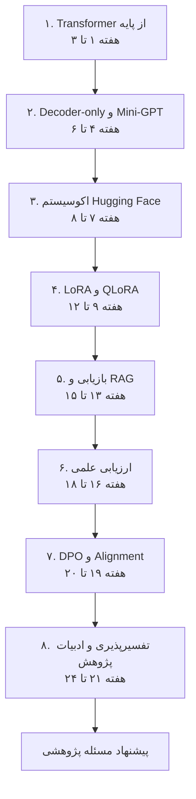
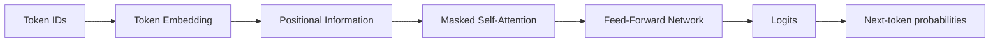

> [!abstract] نمای کلی پروژه
> این سند یک برنامه‌ی مرحله‌ای ۲۴ هفته‌ای برای تبدیل دانش نظری یادگیری عمیق به توانایی طراحی، پیاده‌سازی و ارزیابی آزمایش‌های پژوهشی در حوزه‌ی مدل‌های زبانی بزرگ است.
>
> **مسیر اصلی:** مبانی Transformer ← ساخت Mini-GPT ← کار با مدل‌های آماده ← Fine-tuning کارآمد ← RAG و ارزیابی ← هم‌ترازی ← تفسیرپذیری و تعریف مسئله پژوهشی

## راهنمای استفاده از این سند

- هر مرحله را به‌عنوان یک بسته‌ی یادگیری و پیاده‌سازی مستقل دنبال کن.
- مقاله‌ی اصلی هر مرحله را پیش از شروع کدنویسی مطالعه کن.
- کدها، نتایج و تصمیم‌های آزمایشی را در مخزن پروژه نگه دار.
- در پایان هر مرحله، خروجی تعریف‌شده را تحویل بده؛ صرفاً مطالعه‌ی منابع به‌معنای اتمام مرحله نیست.

> [!tip] پیشنهاد برای کار در Obsidian
> از پنل Outline برای جابه‌جایی بین مرحله‌ها استفاده کن. چک‌لیست‌های انتهای هر مرحله را پس از انجام واقعی فعالیت‌ها علامت بزن و لینک مقاله‌ها را مستقیماً از همین سند باز کن.

## نقشه‌ی مسیر شش‌ماهه



---

# برنامه پروژه تحقیقاتی شش‌ماهه در حوزه مدل‌های زبانی بزرگ (LLM)

**مخاطب:** دانشجوی پژوهشگر علوم داده و یادگیری عمیق
**مدت:** ۶ ماه (۲۴ هفته)
**ساختار:** مطالعه مقالات بنیادی، استخراج مبانی ریاضی، پیاده‌سازی با PyTorch و کتابخانه‌های تخصصی، و اجرای آزمایش‌های پژوهشی

## هدف پروژه

در پایان این دوره باید بتوانی معماری Transformer را از پایه درک و
پیاده‌سازی کنی، یک مدل زبانی Decoder-only کوچک بسازی، با مدل‌های زبانی از
پیش‌آموزش‌دیده کار کنی و روش‌های سازگارسازی، بازیابی اطلاعات، ارزیابی،
هم‌ترازی و تفسیرپذیری LLMها را به‌صورت عملی بررسی کنی.

خروجی‌های مورد انتظار:

-   تسلط مفهومی و ریاضی بر معماری Transformer و مدل‌های زبانی خودبازگشتی.
-   پیاده‌سازی یک Mini-GPT با PyTorch از ابتدا.
-   کار با مدل‌های واقعی در اکوسیستم Hugging Face.
-   اجرای آزمایش‌های LoRA و QLoRA.
-   ساخت یک سیستم RAG.
-   طراحی چارچوب ارزیابی کمی و کیفی.
-   آشنایی عملی با DPO.
-   اجرای حداقل یک آزمایش تفسیرپذیری روی یک Transformer.
-   تهیه گزارش پژوهشی و پیشنهاد یک مسئله برای ادامه تحقیق.

## تقسیم‌بندی زمانی

| مرحله | موضوع | بازه‌ی زمانی | مدت |
|---:|---|---:|---:|
| ۱ | Transformer از مبانی ریاضی | هفته‌های ۱ تا ۳ | ۳ هفته |
| ۲ | Decoder-only LLM | هفته‌های ۴ تا ۶ | ۳ هفته |
| ۳ | اکوسیستم Hugging Face | هفته‌های ۷ تا ۸ | ۲ هفته |
| ۴ | LoRA و QLoRA | هفته‌های ۹ تا ۱۲ | ۴ هفته |
| ۵ | Retrieval-Augmented Generation | هفته‌های ۱۳ تا ۱۵ | ۳ هفته |
| ۶ | ارزیابی مدل‌های زبانی | هفته‌های ۱۶ تا ۱۸ | ۳ هفته |
| ۷ | DPO و Alignment | هفته‌های ۱۹ تا ۲۰ | ۲ هفته |
| ۸ | Interpretability و مقالات جدید | هفته‌های ۲۱ تا ۲۴ | ۴ هفته |

------- -------------------------------- ---------- --------
  ۱       Transformer از مبانی ریاضی           ۱ تا ۳   ۳ هفته
  ۲       Decoder-only LLM                     ۴ تا ۶   ۳ هفته
  ۳       اکوسیستم Hugging Face                ۷ تا ۸   ۲ هفته
  ۴       LoRA و QLoRA                        ۹ تا ۱۲   ۴ هفته
  ۵       Retrieval-Augmented Generation     ۱۳ تا ۱۵   ۳ هفته
  ۶       ارزیابی مدل‌های زبانی               ۱۶ تا ۱۸   ۳ هفته
  ۷       DPO و Alignment                    ۱۹ تا ۲۰   ۲ هفته
  ۸       Interpretability و مقالات جدید     ۲۱ تا ۲۴   ۴ هفته

---

## مرحله 1 --- Transformer from First Principles

**زمان: هفته‌های ۱ تا ۳**

### هدف این مرحله

در این مرحله باید معماری Transformer را از روی معادلات ریاضی درک کنی و
اجزای اصلی آن را با PyTorch پیاده‌سازی کنی؛ نه اینکه صرفاً از کلاس‌های
آماده استفاده کنی.

### هفته اول: Attention Mechanism

**مقاله اصلی**

-   Vaswani et al. (2017), [Attention Is All You
    Need](https://arxiv.org/abs/1706.03762)

بخش‌های مهم مقاله:

-   Scaled Dot-Product Attention
-   Multi-Head Attention
-   Positional Encoding
-   Position-wise Feed-Forward Networks

مفاهیم ریاضی:

-   نمایش برداری و ماتریسی داده‌های متنی
-   Embedding
-   Query, Key, Value
-   Dot Product و مفهوم شباهت
-   Softmax
-   Scaled Dot-Product Attention

معادلات اصلی:

$$Q=XW_Q,\quad K=XW_K,\quad V=XW_V$$

$$Attention(Q,K,V)=Softmax\left(\frac{QK^T}{\sqrt{d_k}}\right)V$$

> [!note] نکته‌ی مفهومی
> در Attention، هر Query مشخص می‌کند یک موقعیت متنی باید به کدام Keyها توجه کند؛ وزن‌های حاصل از Softmax نیز برای ترکیب Valueها به کار می‌روند.

**تمرین پیاده‌سازی**

یک Notebook با نام `01_attention_from_scratch.ipynb` ایجاد کن.

توابع زیر را بدون استفاده از لایه Attention آماده PyTorch پیاده‌سازی کن:

1.  محاسبه ماتریس Query، Key و Value
2.  محاسبه ماتریس شباهت
3.  اعمال Scaling
4.  محاسبه Softmax
5.  محاسبه خروجی Attention

در یک مثال کوچک با ابعاد مشخص، مقادیر میانی را چاپ و بررسی کن.

### هفته دوم: Multi-Head Attention و Masking

**مباحث نظری**

-   تفاوت Self-Attention و Cross-Attention
-   Multi-Head Attention
-   تفاوت توجه تک‌سری و چندسری
-   Causal Mask
-   Padding Mask
-   تفاوت Attention در Encoder و Decoder

معادله Multi-Head Attention:

$$MHA(Q,K,V)=Concat(head_1,\ldots,head_h)W_O$$

برای Causal Mask:

$$M_{ij}=
\begin{cases}
0 & j\leq i\\
-\infty & j>i
\end{cases}$$

**تمرین پیاده‌سازی**

در فایل `02_multihead_attention.ipynb`:

-   کلاس `SelfAttention` را بنویس.
-   کلاس `MultiHeadAttention` را پیاده‌سازی کن.
-   Causal Mask را اعمال کن.
-   خروجی Attention را برای چند Sequence مختلف بررسی کن.
-   ابعاد تمام Tensorها را در هر مرحله کنترل کن.

> [!example] آزمایش کنترل نشت اطلاعات آینده
> یک دنباله‌ی ورودی را انتخاب کن. سپس فقط یکی از توکن‌های بعد از موقعیت $t$ را تغییر بده. اگر Causal Mask درست اعمال شده باشد، خروجی موقعیت $t$ نباید تغییر کند.

### هفته سوم: Transformer Block

**مباحث نظری**

-   Residual Connection
-   Layer Normalization
-   Feed Forward Network
-   GELU
-   Positional Encoding
-   Encoder و Decoder
-   تفاوت Post-LayerNorm و Pre-LayerNorm

معادله شبکه Feed Forward:

$$FFN(x)=W_2 GELU(W_1x+b_1)+b_2$$

**منبع تکمیلی**

-   [The Annotated Transformer --- Harvard
    NLP](https://nlp.seas.harvard.edu/annotated-transformer/)

**تمرین پیاده‌سازی**

در فایل `03_transformer_block.ipynb` کلاس‌های زیر را تکمیل کن:

-   `PositionalEncoding`
-   `FeedForward`
-   `TransformerBlock`
-   `MultiHeadAttention`

در پایان، یک مدل Encoder-Decoder کوچک بساز تا با ساختار کلی مقاله اصلی
آشنا شوی. لازم نیست در این مرحله مدل را روی یک مسئله بزرگ آموزش دهی.

**خروجی مرحله اول:** پیاده‌سازی PyTorch از اجزای اصلی Transformer، همراه
با تست ابعاد Tensorها و گزارش ریاضی عملکرد هر بخش.

---

## مرحله 2 --- Decoder-only LLM

**زمان: هفته‌های ۴ تا ۶**

### هدف این مرحله

در این مرحله باید بفهمی چگونه Transformer به یک مدل زبانی خودبازگشتی
تبدیل می‌شود و چگونه از روی توکن‌های قبلی، توکن بعدی را پیش‌بینی می‌کند.

### هفته چهارم: Autoregressive Language Modeling

**مباحث نظری**

-   Language Modeling
-   Autoregressive Modeling
-   Tokenization
-   Vocabulary
-   BPE Tokenization
-   Context Window
-   Next Token Prediction

معادله اصلی:

$$P(x_1,\ldots,x_T)=\prod_{t=1}^{T}P(x_t|x_{<t})$$

تابع هزینه:

$$\mathcal L(\theta)=-\frac{1}{T}\sum_{t=1}^{T}\log P_\theta(x_t|x_{<t})$$

**مقاله مهم**

-   Radford et al. (2019), [Language Models are Unsupervised Multitask
    Learners
    (GPT-2)](https://cdn.openai.com/better-language-models/language_models_are_unsupervised_multitask_learners.pdf)

در مطالعه مقاله روی این موارد تمرکز کن:

-   Decoder-only Transformer
-   Next-token Prediction
-   Zero-shot Learning
-   اثر افزایش ظرفیت مدل

**تمرین پیاده‌سازی**

-   ساخت یک Tokenizer ساده
-   پیاده‌سازی BPE با استفاده از کتابخانه مربوطه
-   ساخت دیتاست متنی
-   تولید نمونه‌های ورودی و هدف با روش Shifted Sequences
-   ایجاد DataLoader برای Language Modeling

### هفته پنجم: ساخت GPT کوچک

**مباحث نظری**

ساختار Decoder-only:



`Embedding → Masked Self-Attention → FFN → Logits`

معادلات:

$$P(x_t|x_{<t})=Softmax(z_t)$$

تفاوت معماری Encoder-Decoder و Decoder-only را بررسی کن.

**تمرین پیاده‌سازی**

یک Mini-GPT با PyTorch بساز.

اجزای پیشنهادی:

```text
MiniGPT
 ├── TokenEmbedding
 ├── PositionalEmbedding
 ├── TransformerBlock
 │    ├── CausalSelfAttention
 │    ├── FeedForward
 │    ├── ResidualConnection
 │    └── LayerNorm
 └── LanguageModelHead
```

تمام اجزا باید از کد مرحله اول استفاده کنند.

برای مقایسه با یک پیاده‌سازی آموزشی آماده می‌توانی از مخزن زیر استفاده
کنی:

-   [nanoGPT --- Andrej Karpathy](https://github.com/karpathy/nanoGPT)

### هفته ششم: آموزش و تولید متن

**مباحث نظری**

-   Training Loop
-   Optimizer
-   Learning Rate Scheduling
-   Gradient Clipping
-   Checkpointing
-   Temperature
-   Top-k Sampling
-   Top-p Sampling
-   Perplexity

معیار Perplexity:

$$PPL=\exp(\mathcal L)$$

**تمرین پیاده‌سازی**

مدل Mini-GPT را روی یک مجموعه متنی کوچک آموزش بده.

آزمایش‌های زیر را انجام بده:

1.  اثر اندازه Context Window
2.  اثر تعداد لایه‌های Transformer
3.  اثر Hidden Dimension
4.  مقایسه Temperatureهای مختلف در تولید متن
5.  مقایسه Top-k و Top-p Sampling

برای هر آزمایش Loss و Perplexity را ثبت کن.

> [!success] معیار پایان مرحله
> باید بتوانی مسیر داده را از توکن‌های ورودی تا Logits و محاسبه‌ی Loss توضیح بدهی و نشان دهی تولید متن چگونه به‌صورت خودبازگشتی انجام می‌شود.
>
> **خروجی مرحله دوم:** یک مدل GPT کوچک که از ابتدا با PyTorch ساخته و آموزش داده شده است، به همراه منحنی Loss و چند نمونه تولید متن.

---

## مرحله 3 --- Hugging Face Ecosystem

**زمان: هفته‌های ۷ و ۸**

### هدف این مرحله

در این مرحله از پیاده‌سازی مدل‌های کوچک به استفاده از مدل‌های زبانی از
پیش‌آموزش‌دیده منتقل می‌شوی. باید بتوانی معماری و وزن‌های مدل‌های آماده را در
سطح نرم‌افزاری بررسی و استفاده کنی.

### هفته هفتم: آشنایی با کتابخانه‌های Hugging Face

کتابخانه‌های اصلی:

| کتابخانه | کاربرد |
|---|---|
| `Transformers` | بارگذاری و اجرای مدل‌های زبانی |
| `Tokenizers` | پردازش و توکن‌سازی |
| `Datasets` | بارگذاری و آماده‌سازی داده |
| `Accelerate` | مدیریت اجرای آموزش روی سخت‌افزار |
| `Hub` | دسترسی به مدل‌ها و دیتاست‌ها |

**منابع مطالعه**

-   [Hugging Face
    Transformers](https://huggingface.co/docs/transformers/index)
-   [Causal Language Modeling
    Tutorial](https://huggingface.co/docs/transformers/tasks/language_modeling)
-   [Hugging Face Course](https://huggingface.co/learn)

**تمرین پیاده‌سازی**

یک Notebook با نام `04_hf_basics.ipynb` بساز.

موارد زیر را انجام بده:

-   بارگذاری Tokenizer
-   بارگذاری یک مدل Decoder-only
-   مشاهده تعداد پارامترهای مدل
-   بررسی Embeddingها
-   تولید متن
-   آزمایش Temperature و Top-p
-   مشاهده خروجی مدل در سطح Logits
-   بررسی Chat Template در مدل‌های Instruct

### هفته هشتم: آموزش و تنظیم مدل با Hugging Face

**مباحث**

-   AutoModelForCausalLM
-   AutoTokenizer
-   Dataset Preparation
-   Data Collator
-   Trainer
-   TrainingArguments
-   Evaluation
-   Model Saving and Loading

**تمرین پیاده‌سازی**

یک مدل آماده کوچک را با یک مجموعه داده آموزشی برای یک وظیفه زبانی مشخص
تنظیم کن.

دو مسیر را بررسی کن:

-   آموزش با `Trainer`
-   آموزش با حلقه اختصاصی PyTorch

در این مرحله یک Baseline بساز که بعداً بتوانی نتایج LoRA و QLoRA را با آن
مقایسه کنی.

**خروجی مرحله سوم:** یک Pipeline کامل برای بارگذاری، پردازش داده، اجرای
مدل، آموزش و ارزیابی با استفاده از Hugging Face.

---

## مرحله 4 --- LoRA / QLoRA

**زمان: هفته‌های ۹ تا ۱۲**

### هدف این مرحله

در این مرحله باید روش‌های Parameter-Efficient Fine-Tuning را از نظر ریاضی
درک و پیاده‌سازی کنی.

### هفته نهم: LoRA از دیدگاه ریاضی

**مقاله اصلی**

-   Hu et al. (2021), [LoRA: Low-Rank Adaptation of Large Language
    Models](https://arxiv.org/abs/2106.09685)

در Fine-Tuning معمولی، ماتریس وزن تغییر می‌کند:

$$W'=W+\Delta W$$

در LoRA فرض می‌شود تغییر وزن را می‌توان با یک ماتریس کم‌رتبه تقریب زد:

$$\Delta W=BA$$

که در آن:

$$B\in\mathbb R^{d\times r},\quad A\in\mathbb R^{r\times k}$$

و:

$$r\ll \min(d,k)$$

> [!note] ایده‌ی اصلی LoRA
> وزن‌های اصلی مدل ثابت می‌مانند و تنها دو ماتریس کوچک‌تر آموزش داده می‌شوند. بنابراین تعداد پارامترهای قابل‌آموزش، در مقایسه با Fine-Tuning کامل، کاهش می‌یابد.
>
> در پیاده‌سازی متداول LoRA:
>
> $$W'=W+\frac{\alpha}{r}BA$$

مباحث مورد مطالعه:

-   Low-Rank Matrix Approximation
-   Singular Value Decomposition
-   Rank
-   Trainable Parameters
-   Initialization
-   LoRA Scaling
-   Target Modules

**تمرین پیاده‌سازی**

یک لایه `LoRALinear` با استفاده از PyTorch از ابتدا بنویس.

آن را با یک `nn.Linear` معمولی مقایسه کن. سپس بررسی کن با تغییر Rank چه
اتفاقی برای تعداد پارامترهای قابل آموزش می‌افتد.

### هفته دهم: پیاده‌سازی LoRA با PEFT

**منبع**

-   [Hugging Face PEFT](https://huggingface.co/docs/peft/index)

موارد مورد مطالعه:

-   LoraConfig
-   get_peft_model
-   target_modules
-   r
-   lora_alpha
-   lora_dropout
-   Adapter Saving and Loading

**تمرین پیاده‌سازی**

یک مدل آماده را با PEFT تنظیم کن.

آزمایش‌های زیر را انجام بده:

$$r\in\{2,4,8,16,32\}$$

اثر تغییر Rank را بر موارد زیر بررسی کن:

-   عملکرد مدل
-   تعداد پارامترهای قابل آموزش
-   زمان آموزش
-   حافظه مصرفی

### هفته یازدهم: Quantization

مباحث:

-   Floating Point Representation
-   FP32
-   FP16
-   BF16
-   INT8
-   INT4
-   Quantization Error
-   Weight Quantization
-   NormalFloat 4-bit
-   Double Quantization

درک کن که کاهش دقت نمایش وزن‌ها چه اثری بر حافظه و دقت مدل دارد.

**تمرین پیاده‌سازی**

یک مدل را در قالب‌های مختلف بارگذاری و حافظه مصرفی و کیفیت خروجی آن را
مقایسه کن.

### هفته دوازدهم: QLoRA

**مقاله اصلی**

-   Dettmers et al. (2023), [QLoRA: Efficient Finetuning of Quantized
    LLMs](https://arxiv.org/abs/2305.14314)

مباحث نظری:

-   4-bit Quantization
-   NF4
-   Double Quantization
-   Paged Optimizers
-   Backpropagation through Frozen Quantized Weights

**تمرین پیاده‌سازی**

با استفاده از PEFT و BitsAndBytes یک آزمایش QLoRA انجام بده.

سه روش را مقایسه کن:

1.  Full Fine-Tuning
2.  LoRA
3.  QLoRA

در صورت محدودیت سخت‌افزاری، Full Fine-Tuning را روی مدلی کوچک‌تر اجرا کن و
تفاوت مقیاس مدل‌ها را در گزارش مشخص کن.

> [!warning] نکته‌ی مقایسه‌ی منصفانه
> مقایسه‌ی Full Fine-Tuning، LoRA و QLoRA فقط زمانی معتبر است که مدل پایه، داده، طول دنباله، تعداد گام‌های آموزش و تنظیمات ارزیابی تا حد ممکن یکسان باشند. هر تفاوت اجتناب‌ناپذیر را در گزارش ثبت کن.
>
> **خروجی مرحله چهارم:** یک گزارش مقایسه‌ای شامل عملکرد، تعداد پارامترهای قابل‌آموزش، زمان آموزش و مصرف حافظه در سه روش.

---

## مرحله 5 --- Retrieval-Augmented Generation (RAG)

**زمان: هفته‌های ۱۳ تا ۱۵**

### هدف این مرحله

در این مرحله باید یاد بگیری چگونه یک مدل زبانی را به منابع اطلاعاتی
خارجی متصل کنی تا هنگام پاسخ‌گویی از اطلاعات بازیابی‌شده استفاده کند.

### هفته سیزدهم: Information Retrieval

**مقاله اصلی**

-   Lewis et al. (2020), [Retrieval-Augmented Generation for
    Knowledge-Intensive NLP Tasks](https://arxiv.org/abs/2005.11401)

مباحث نظری:

-   Information Retrieval
-   Sparse Retrieval
-   Dense Retrieval
-   TF-IDF
-   BM25
-   Document Embedding
-   Similarity Search
-   Cosine Similarity
-   Top-k Retrieval

معادله شباهت کسینوسی:

$$sim(q,d)=\frac{q^Td}{\|q\|\|d\|}$$

**تمرین پیاده‌سازی**

یک مجموعه اسناد متنی تهیه کن و مراحل زیر را انجام بده:

1.  استخراج متن اسناد
2.  تقسیم اسناد به قطعات (Chunking)
3.  پیاده‌سازی جست‌وجوی TF-IDF
4.  پیاده‌سازی BM25
5.  بازیابی Top-k سند مرتبط

در این مرحله هنوز از LLM برای تولید پاسخ استفاده نکن. ابتدا کیفیت
بازیابی را مستقل بررسی کن.

### هفته چهاردهم: Dense Retrieval و Embedding

**مقاله مهم**

-   Karpukhin et al. (2020), [Dense Passage Retrieval for Open-Domain
    Question Answering](https://aclanthology.org/2020.emnlp-main.550/)

مباحث:

-   Sentence Embedding
-   Document Embedding
-   Dual Encoder
-   Dense Retrieval
-   Approximate Nearest Neighbor
-   FAISS
-   Vector Database

**تمرین پیاده‌سازی**

با استفاده از Sentence Transformers و FAISS:

-   برای هر قطعه متن Embedding بساز.
-   بردارها را در FAISS ذخیره کن.
-   برای هر Query نزدیک‌ترین قطعات را پیدا کن.
-   نتایج Dense Retrieval را با BM25 مقایسه کن.

### هفته پانزدهم: پیاده‌سازی کامل RAG

> [!abstract] نمای کلی خط لوله‌ی RAG
> RAG دو مسئله را به هم متصل می‌کند: بازیابی قطعات مرتبط از منبع بیرونی و تولید پاسخ با استفاده از همان قطعات به‌عنوان زمینه.
>
> ساختار سیستم:
>
> ```mermaid
             Documents
                 |
                 v
              Chunking
                 |
                 v
             Embedding
                 |
                 v
           Vector Index
                 |
                 |
User Query ------+
     |
     v
Query Embedding
     |
     v
Top-k Retrieval
     |
     v
Retrieved Context
     |
     v
Prompt Construction
     |
     v
       LLM
     |
     v
Generated Answer


**تمرین پیاده‌سازی**

یک سیستم RAG با استفاده از اجزای زیر بساز:

-   Hugging Face
-   Sentence Transformers
-   FAISS
-   یک مدل Decoder-only
-   PyTorch

آزمایش‌های زیر را انجام بده:

-   تغییر اندازه Chunk
-   تغییر Overlap
-   تغییر تعداد اسناد بازیابی‌شده $k$
-   مقایسه BM25 و Dense Retrieval
-   مقایسه پاسخ LLM با RAG و بدون RAG

> [!warning] تفکیک خطاها در RAG
> پاسخ نامناسب ممکن است ناشی از بازیابی نامرتبط، قطعه‌بندی نامناسب، ساخت Prompt ضعیف یا خطای خود مدل باشد. این اجزا را جداگانه ارزیابی کن.
>
> **خروجی مرحله پنجم:** یک سیستم RAG عملیاتی با قابلیت بازیابی اسناد، تولید پاسخ و ارائه‌ی منبع پاسخ.

---

## مرحله 6 --- LLM Evaluation

**زمان: هفته‌های ۱۶ تا ۱۸**

### هدف این مرحله

در این مرحله باید بتوانی عملکرد مدل زبانی و سیستم RAG را به‌صورت علمی و
کمی ارزیابی کنی. ارزیابی یک LLM صرفاً با چند نمونه پاسخ خوب یا بد
امکان‌پذیر نیست.

### هفته شانزدهم: Evaluation Metrics

**مباحث نظری**

برای Language Modeling:

-   Cross Entropy
-   Negative Log Likelihood
-   Perplexity

برای Classification:

-   Accuracy
-   Precision
-   Recall
-   F1-score
-   Macro-F1

برای Information Retrieval:

-   Precision@k
-   Recall@k
-   Mean Reciprocal Rank (MRR)
-   Normalized Discounted Cumulative Gain (NDCG)

برای Question Answering:

-   Exact Match
-   Token-level F1
-   Semantic Similarity

**تمرین پیاده‌سازی**

یک ماژول ارزیابی بنویس که بتواند خروجی مدل‌ها را ذخیره و معیارهای مربوطه
را محاسبه کند.

حداقل برای یک مجموعه داده ثابت، خروجی دو مدل را مقایسه کن.

### هفته هفدهم: ارزیابی RAG و LLM-as-a-Judge

**مقاله اول**

-   Es et al. (2023), [RAGAS: Automated Evaluation of Retrieval
    Augmented Generation](https://arxiv.org/abs/2309.15217)

**مقاله دوم**

-   Saad-Falcon et al. (2024), [ARES: An Automated Evaluation Framework
    for Retrieval-Augmented Generation
    Systems](https://aclanthology.org/2024.naacl-long.20/)

مباحث:

-   Context Relevance
-   Answer Relevance
-   Faithfulness
-   Hallucination
-   Groundedness
-   LLM-as-a-Judge
-   Human Evaluation

**تمرین پیاده‌سازی**

از کتابخانه RAGAS برای ارزیابی سیستم RAG مرحله قبل استفاده کن.

سه جنبه را جداگانه بررسی کن:

1.  آیا اسناد بازیابی‌شده مرتبط هستند؟
2.  آیا پاسخ بر اساس اسناد بازیابی‌شده تولید شده است؟
3.  آیا پاسخ به سؤال کاربر مرتبط است؟

برای تعدادی از نمونه‌ها ارزیابی انسانی نیز انجام بده و نتایج را با
ارزیابی خودکار مقایسه کن.

### هفته هجدهم: ارزیابی علمی و طراحی آزمایش

**مباحث نظری**

-   Experimental Design
-   Baseline Comparison
-   Ablation Study
-   Statistical Significance
-   Confidence Interval
-   Bootstrap
-   Effect Size
-   Reproducibility

همچنین با چارچوب زیر آشنا شو:

-   [EleutherAI Language Model Evaluation
    Harness](https://github.com/EleutherAI/lm-evaluation-harness)

**تمرین پیاده‌سازی**

یک چارچوب ارزیابی بساز که بتواند برای آزمایش‌های مختلف موارد زیر را ثبت
کند:

| معیار | هدف |
|---|---|
| Model Performance | کیفیت خروجی |
| Training Time | زمان آموزش |
| Inference Time | زمان تولید پاسخ |
| GPU Memory | مصرف حافظه |
| Trainable Parameters | تعداد پارامترهای آموزش‌پذیر |
| Retrieval Quality | کیفیت بازیابی |
| Hallucination | میزان پاسخ‌های فاقد پشتوانه |

برای آزمایش‌های اصلی، در صورت امکان چند اجرای مستقل با Seed متفاوت داشته
باش و میانگین، انحراف معیار و بازه اطمینان را گزارش کن.

**خروجی مرحله ششم:** یک Evaluation Framework برای مقایسه مدل‌های پایه،
مدل‌های Fine-tuned و سیستم‌های RAG، همراه با گزارش آماری.

---

## مرحله 7 --- DPO / Alignment

**زمان: هفته‌های ۱۹ و ۲۰**

### هدف این مرحله

در این مرحله با روش‌های تنظیم رفتار مدل‌های زبانی بر اساس ترجیحات انسانی
آشنا می‌شوی.

### هفته نوزدهم: RLHF و DPO از دیدگاه ریاضی

**مقاله اصلی**

-   Rafailov et al. (2023), [Direct Preference Optimization: Your
    Language Model is Secretly a Reward
    Model](https://arxiv.org/abs/2305.18290)

مباحث نظری:

-   Supervised Fine-Tuning
-   Human Feedback
-   Preference Data
-   Reward Modeling
-   Reinforcement Learning from Human Feedback
-   Bradley-Terry Model
-   KL Divergence
-   Direct Preference Optimization

در Preference Learning به‌جای داشتن صرفاً پاسخ هدف، دو پاسخ داریم:

$$(x,y_w,y_l)$$

که در آن:

-   $x$: ورودی
-   $y_w$: پاسخ ترجیحی
-   $y_l$: پاسخ نامطلوب

تابع هزینه DPO:

$$\mathcal L_{\mathrm{DPO}}=-\mathbb E\left[\log \sigma(\beta \Delta)\right]$$

که در آن:

$$\Delta=
\log\frac{\pi_\theta(y_w|x)}{\pi_{\mathrm{ref}}(y_w|x)}
-
\log\frac{\pi_\theta(y_l|x)}{\pi_{\mathrm{ref}}(y_l|x)}$$

درک کن که این تابع چگونه احتمال پاسخ ترجیحی را نسبت به پاسخ نامطلوب
افزایش می‌دهد.

### هفته بیستم: پیاده‌سازی DPO

**منبع عملی**

-   [Hugging Face TRL](https://huggingface.co/docs/trl/index)

موارد مورد مطالعه:

-   Preference Dataset
-   Chosen / Rejected Responses
-   DPOTrainer
-   Reference Model
-   Beta
-   DPO Training

**تمرین پیاده‌سازی**

یک مجموعه داده شامل زوج پاسخ‌های ترجیحی و غیرترجیحی آماده کن.

سپس:

1.  یک مدل پایه انتخاب کن.
2.  آن را با SFT تنظیم کن.
3.  داده‌های Preference را آماده کن.
4.  مدل را با DPO تنظیم کن.
5.  خروجی دو مدل را مقایسه کن.

معیارهای ارزیابی:

-   Preference Win Rate
-   پاسخ‌گویی به دستور
-   کیفیت پاسخ
-   حفظ توانایی‌های قبلی مدل
-   پایداری آموزش

در صورت محدودیت سخت‌افزاری، اجرای DPO روی یک مدل کوچک‌تر یا با LoRA انجام
بده.

**خروجی مرحله هفتم:** یک پیاده‌سازی عملی DPO و گزارش مقایسه‌ای رفتار مدل
قبل و بعد از Preference Optimization.

---

## مرحله 8 --- Interpretability and Current Research Literature

**زمان: هفته‌های ۲۱ تا ۲۴**

### هدف این مرحله

در مرحله پایانی باید از استفاده‌کننده مدل به پژوهشگری تبدیل شوی که
می‌تواند رفتار داخلی Transformer را بررسی کند و مقالات جدید را به‌صورت
نقادانه مطالعه کند.

### هفته بیست‌ویکم: مبانی تفسیرپذیری LLM

مباحث نظری:

-   Black-box Models
-   Attention Visualization
-   Hidden States
-   Residual Stream
-   Attention Heads
-   MLP Neurons
-   Logit Lens
-   Feature Attribution
-   Mechanistic Interpretability

**مقاله مهم**

-   Elhage et al. (2021), [A Mathematical Framework for Transformer
    Circuits](https://transformer-circuits.pub/2021/framework/index.html)

این مقاله را با تمرکز بر Attention Headها و نحوه انتقال اطلاعات در
Transformer مطالعه کن.

### هفته بیست‌ودوم: Mechanistic Interpretability

**ابزار اصلی**

-   [TransformerLens](https://transformerlensorg.github.io/TransformerLens/)

مباحث:

-   Activation Extraction
-   Attention Pattern Visualization
-   Logit Attribution
-   Activation Patching
-   Causal Intervention
-   Induction Heads

**تمرین پیاده‌سازی**

یک مدل GPT-2 کوچک یا مدل سازگار با TransformerLens را بارگذاری کن و:

1.  Activationهای لایه‌های مختلف را استخراج کن.
2.  Attention Headها را بررسی کن.
3.  برای چند ورودی مشخص، الگوی توجه را نمایش بده.
4.  از Activation Patching برای بررسی اثر یک لایه یا Head بر خروجی
    استفاده کن.

> [!warning] تفسیر محتاطانه
> نمایش نقشه‌ی Attention به‌تنهایی اثبات نمی‌کند که علت یک رفتار مدل را کشف کرده‌ای. برای بررسی علّی باید آزمایش مداخله‌ای انجام بدهی؛ برای مثال Activation Patching و مقایسه‌ی خروجی در شرایط کنترل‌شده.

### هفته بیست‌وسوم: Sparse Autoencoders و Feature Interpretability

**مقاله مهم**

-   Bricken et al. (2023), [Towards Monosemanticity: Decomposing
    Language Models With Dictionary
    Learning](https://www.anthropic.com/research/towards-monosemanticity-decomposing-language-models-with-dictionary-learning)

**مقاله مروری تکمیلی**

-   Shu et al. (2025), [A Survey on Sparse Autoencoders: Interpreting
    the Internal Mechanisms of Large Language
    Models](https://aclanthology.org/2025.findings-emnlp.89/)

مباحث:

-   Superposition
-   Feature Representation
-   Sparse Coding
-   Dictionary Learning
-   Sparse Autoencoder
-   Feature Activation
-   Feature Ablation

ساختار ساده یک Sparse Autoencoder:

$$z=f(W_e h+b_e)$$

$$\hat h=W_dz+b_d$$

تابع هزینه:

$$\mathcal L=\|h-\hat h\|_2^2+\lambda\|z\|_1$$

که در آن $h$ یک Activation استخراج‌شده از مدل زبانی است.

**تمرین پیاده‌سازی**

یک Sparse Autoencoder روی Activationهای استخراج‌شده از یک مدل کوچک آموزش
بده.

موارد زیر را بررسی کن:

-   بازسازی Activation
-   میزان Sparsity
-   تعداد Featureهای فعال
-   نمونه‌های متنی فعال‌کننده هر Feature
-   اثر حذف یک Feature بر خروجی مدل

هدف این تمرین، آشنایی با روش استخراج ویژگی‌های قابل تفسیر از فضای نهفته
مدل است؛ نه اثبات اینکه هر Feature لزوماً یک مفهوم معنایی مستقل دارد.

### هفته بیست‌وچهارم: مطالعه تحقیقات جدید و انتخاب مسئله پژوهشی

**مقالات مروری پیشنهادی**

  --------------------------
  مقاله                                                       محور مطالعه
  ----------------------------------------------------------- -----------------------------------
  Zhao et al. (2026), [A Survey of Large Language             مرور چرخه توسعه LLM، آموزش،
  Models](https://doi.org/10.1007/s11704-026-60308-3)         Post-training و ارزیابی

  Brown et al. (2025), [A Systematic Literature Review of     روش‌های جدید RAG و چالش‌های ارزیابی
  RAG](https://arxiv.org/abs/2508.06401)                      

  Shu et al. (2025), [Sparse Autoencoders                     روش‌های جدید تفسیرپذیری مبتنی بر SAE
  Survey](https://aclanthology.org/2025.findings-emnlp.89/)   
  --------------------------

**تمرین پژوهشی**

یک جست‌وجوی نظام‌مند محدود در Google Scholar، Semantic Scholar و arXiv
انجام بده.

برای هر مقاله جدید، اطلاعات زیر را ثبت کن:

-   مسئله پژوهشی
-   روش پیشنهادی
-   مبانی ریاضی
-   آزمایش‌های انجام‌شده
-   Dataset
-   Baseline
-   نتایج
-   محدودیت‌ها
-   ایده‌های قابل توسعه

در پایان، سه مسئله پژوهشی بالقوه استخراج کن و برای یکی از آن‌ها یک طرح
آزمایش اولیه بنویس.

**خروجی مرحله هشتم:** یک گزارش Literature Review، یک Notebook تفسیرپذیری
و یک پیشنهاد پژوهشی شامل مسئله، فرضیه، روش، Baseline و آزمایش‌های
پیشنهادی.

---

## ۹. ساختار نهایی مخزن کد پروژه

تمام کدها و آزمایش‌ها را در یک Repository نگهداری کن.

ساختار پیشنهادی:

```text
LLM_Research/
│
├── 01_Transformer/
│   ├── attention.py
│   ├── multihead_attention.py
│   ├── transformer_block.py
│   └── experiments/
│
├── 02_Mini_GPT/
│   ├── tokenizer.py
│   ├── model.py
│   ├── train.py
│   ├── generate.py
│   └── experiments/
│
├── 03_HuggingFace/
│   ├── inference.py
│   ├── dataset.py
│   └── finetuning.py
│
├── 04_LoRA_QLoRA/
│   ├── lora_from_scratch.py
│   ├── lora_peft.py
│   ├── qlora.py
│   └── experiments/
│
├── 05_RAG/
│   ├── document_loader.py
│   ├── chunking.py
│   ├── retrieval.py
│   ├── embeddings.py
│   └── rag_pipeline.py
│
├── 06_Evaluation/
│   ├── lm_evaluation.py
│   ├── rag_evaluation.py
│   ├── statistical_analysis.py
│   └── results/
│
├── 07_DPO/
│   ├── preference_dataset.py
│   ├── train_dpo.py
│   └── evaluation.py
│
├── 08_Interpretability/
│   ├── activation_extraction.py
│   ├── attention_visualization.py
│   ├── activation_patching.py
│   └── sparse_autoencoder.py
│
├── papers/
├── reports/
├── requirements.txt
└── README.md
```

برای هر آزمایش، تنظیمات، Seed، نسخه‌ی کتابخانه‌ها، مدل، دیتاست و نتایج را ثبت کن. کدها باید به‌گونه‌ای نوشته شوند که آزمایش‌ها قابل تکرار باشند.

> [!example] الگوی ثبت تنظیمات آزمایش
> برای هر اجرا، یک فایل پیکربندی یا بخش مشخص در گزارش داشته باش. نمونه‌ی ساده:
>
> ```python
> experiment = {
>     "experiment_name": "lora_rank_comparison",
>     "model_name": "base-model-id",
>     "dataset": "dataset-name",
>     "seed": 42,
>     "learning_rate": 2e-4,
>     "epochs": 3,
>     "lora_rank": 8,
>     "max_sequence_length": 1024,
> }
> ```
>
> مقادیر بالا صرفاً نمونه‌ی قالب ثبت آزمایش‌اند و تنظیمات قطعی پروژه محسوب نمی‌شوند.

---

## ۱۰. معیار تحویل نهایی پروژه

در پایان شش ماه، موارد زیر باید تحویل داده شوند:

| ردیف | خروجی | معیار پذیرش |
|---:|---|---|
| ۱ | Transformer از ابتدا | پیاده‌سازی و تست اجزا |
| ۲ | Mini-GPT | آموزش و تولید متن |
| ۳ | Hugging Face Pipeline | بارگذاری، آموزش و استنتاج |
| ۴ | LoRA / QLoRA | اجرای آزمایش‌های مقایسه‌ای |
| ۵ | RAG | بازیابی و تولید پاسخ مستند |
| ۶ | Evaluation | گزارش معیارهای کمی و آماری |
| ۷ | DPO | اجرای تنظیم ترجیحات و مقایسه |
| ۸ | Interpretability | تحلیل Activation و یک آزمایش مداخله‌ای |
| ۹ | Literature Review | تحلیل مقالات بنیادی و جدید |
| ۱۰ | Research Proposal | ارائه‌ی یک مسئله‌ی پژوهشی قابل توسعه |

**مهم‌ترین معیار موفقیت:** بتوانی برای هر روش توضیح بدهی چه مسئله‌ای را حل
می‌کند، بر چه مبانی ریاضی استوار است، چگونه پیاده‌سازی می‌شود و با چه
آزمایشی می‌توان ادعاهای آن را بررسی کرد.

---

> [!success] تعریف «اتمام پروژه»
> پروژه زمانی کامل است که علاوه بر کدهای اجراشده، گزارش آزمایش‌ها، نتایج قابل‌بازتولید، تحلیل محدودیت‌ها و یک پیشنهاد پژوهشی مشخص ارائه شده باشد.

## یادداشت اجرایی

حوزه‌ی کاربرد نهایی، زبان دیتاست، مدل پایه و محدودیت سخت‌افزاری باید پیش از تثبیت آزمایش‌های کاربردی مشخص شوند. تا زمان تعیین این موارد، در این
برنامه دیتاست یا مدل خاصی به‌عنوان انتخاب قطعی در نظر گرفته نشده است.
